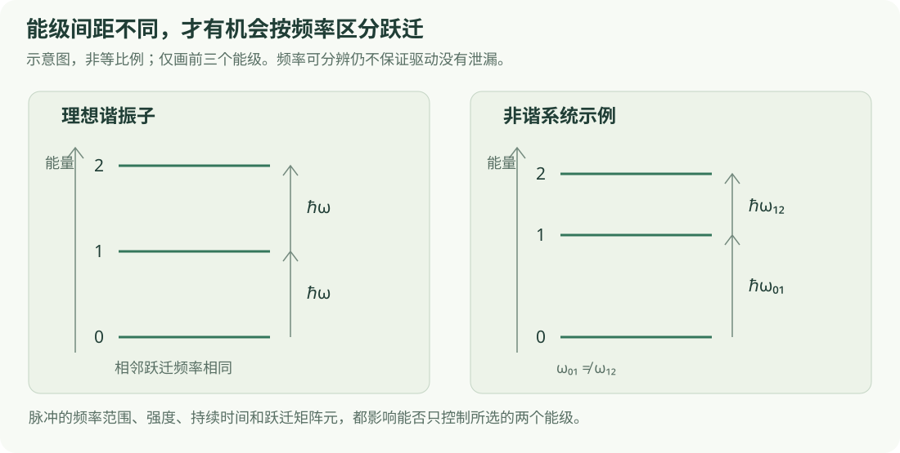

# Q3｜从能级到物理量子比特

[Q2](02-observables-dynamics.md)讨论能量测量和时间演化，[主篇第 02 章](../02-single-qubit.md)则直接从抽象的 $|0\rangle,|1\rangle$ 出发。本章把两边接起来：实验室里怎样从一个有许多自由度、许多能级的器件中选出两个状态，怎样用带频率的场驱动它们，以及这种“两能级语言”在什么条件下会失效。

先记住本章最重要的一句话：**量子比特是选定并受控的二维子空间，不是声称真实器件只有两个能级。**

第一次阅读可先读 §1–4：它们只问能级相隔多远、温度和脉冲会不会把系统带离所选的两级。§5 给另一类自旋实例；§6 的前半推导会用旋转坐标系和微分方程，若只是想知道“共振、失谐、振荡幅度”各是什么意思，可先看 §6 的模型式与“失谐”算例，回头再做完整推导。§7–8 把理想两级接到噪声与不同物理平台。暂时跳过标为进阶的代数，不影响主篇硬件章的第一遍理解。

## 1. 同一个能隙的三种写法

设两个能量本征态为 $|0\rangle,|1\rangle$，且 $E_1>E_0$。能隙

$$
\Delta E=E_1-E_0
$$

可以用普通频率 $f$ 或角频率 $\omega$ 表示：

$$
\Delta E=hf=\hbar\omega,
\qquad \omega=2\pi f,
\qquad h=2\pi\hbar.
$$

$f$ 的单位是 Hz，也就是每秒多少个周期；$\omega$ 的单位是 rad/s。两者都描述同一个能隙，但相差 $2\pi$。若实验写“$5\ \mathrm{GHz}$ 量子比特”，通常是在报 $f_{01}=(E_1-E_0)/h$，不是 $\omega_{01}$。

可以先用一秒钟的钟表来记：一个完整周期转一圈，所以每秒 $f=1$ 个周期就对应每秒 $2\pi$ 弧度，即 $\omega=2\pi\ \mathrm{rad/s}$。每秒 5 个周期则是 $10\pi\ \mathrm{rad/s}$；把“5”换成“50 亿”，关系仍相同。$h$ 与 $\hbar=h/(2\pi)$ 只是分别配合这两种频率写同一个能量，不能把 $5\ \mathrm{GHz}$ 直接代入 $\hbar\omega$ 却忘了先乘 $2\pi$。

### 算例：5 GHz 对应多大能量

用 SI 中的精确值 $h=6.62607015\times10^{-34}\ \mathrm{J\,s}$：

$$
\Delta E
=h(5\times10^9\ \mathrm{s}^{-1})
\approx3.313\times10^{-24}\ \mathrm J.
$$

它约为 $20.7\ \mu\mathrm{eV}$。也可以先算

$$
\frac{\Delta E}{k_{\rm B}}
=\frac{hf}{k_{\rm B}}
\approx0.23996\ \mathrm K,
$$

这个“以 kelvin 表示的能量尺度”方便与温度比较，但不表示量子比特本身就是一支温度计。

频率匹配也不是“只要 $hf=\Delta E$ 就一定发生跃迁”。控制场还要通过某个物理算符与系统耦合，并且相应矩阵元不能为零。例如电偶极驱动的跃迁强弱由偶极算符在两个态之间的矩阵元决定；对称性可能使某些能量匹配的跃迁仍被选择定则压低。真实谱线还有有限宽度，脉冲也不是无限长的单一频率。因此 $\Delta E=hf$ 给出共振中心，耦合矩阵元、线宽和脉冲包络才决定实际跃迁速度与选择性。

## 2. 两能级为什么只是受控近似

真实系统通常有更多状态。把其中两个态选作计算基，需要同时满足：

1. **可制备**：能把大部分概率放入选定子空间；
2. **可选择地控制**：驱动 $|0\rangle\leftrightarrow|1\rangle$ 时，不显著激发别的跃迁；
3. **可读出**：测量记录能可靠地区分两个逻辑态；
4. **可保持**：环境在计算期间不会迅速造成弛豫、退相位、丢失或泄漏；
5. **可组合**：两比特相互作用不会在门结束后留下未消除的辅助自由度纠缠。

这里的**泄漏**是状态离开计算子空间。例如状态从 transmon 的 $|1\rangle$ 跑到 $|2\rangle$，不是普通的 $|0\rangle\leftrightarrow|1\rangle$ 翻转。另一方面，辅助态不一定是坏事：离子门会暂时使用运动模，中性原子门会暂时使用 Rydberg 态，也就是主量子数很高、相互作用很强的原子高激发态。关键是门结束时是否把辅助自由度复位并与逻辑量子比特解除纠缠。

因此“二能级近似有效”不是一个永远成立的标签，而是对制备、脉冲强度和带宽、噪声、读出以及实验时长共同作出的判断。

先用三能级数字看“泄漏”究竟数什么：若一轮门操作后测得 $|0\rangle,|1\rangle,|2\rangle$ 的概率依次为 $0.10,0.85,0.05$，前两项仍在约定的计算空间内，第三项已跑出去，所以泄漏概率为 $0.05=1-(0.10+0.85)$。这与“把 $|0\rangle$ 错翻成 $|1\rangle$”不同；后者仍在前两级之内。

对更多能级及混合态，同一想法可以写成可测量的量。令

$$
P_{\rm comp}=|0\rangle\langle0|+|1\rangle\langle1|
$$

为投影到计算子空间的算符。对完整器件状态 $\rho$，计算空间外的总概率可定义为

$$
L=1-\operatorname{Tr}(P_{\rm comp}\rho).
$$

$L=0$ 只说明此刻没有泄漏，并不证明子空间内的门是正确的；一个错误的 $Z$ 相位门仍可有 $L=0$。上面三能级例子里，$\operatorname{Tr}(P_{\rm comp}\rho)$ 正是 $0.10+0.85=0.95$。反过来，若读出装置只能把 $|2\rangle$ 错归为 0 或 1，仅看二元计数也可能看不见 $L$。实验必须说明泄漏是被直接分辨、通过额外校准估计，还是根本没有进入所报指标。

## 3. 温度怎样影响二能级占据

先考虑一个**与温度为 $T$ 的热库达到平衡、两个能级都非简并**的理想模型。Boltzmann 权重给出

$$
\frac{p_1}{p_0}
=e^{-\Delta E/(k_{\rm B}T)},
$$

而 $p_0+p_1=1$，所以

$$
p_1=\frac{1}{1+e^{\Delta E/(k_{\rm B}T)}}.
$$

### 算例：5 GHz 在 20 mK 与 300 K

上一节已算得 $\Delta E/k_{\rm B}\approx0.23996\ \mathrm K$。

在 $T=20\ \mathrm{mK}=0.020\ \mathrm K$ 时，

$$
\frac{\Delta E}{k_{\rm B}T}\approx11.998,
\qquad
\frac{p_1}{p_0}\approx e^{-11.998}\approx6.16\times10^{-6},
$$

$$
p_1\approx6.16\times10^{-6}.
$$

同一个平衡二能级模型在 $300\ \mathrm K$ 时给出

$$
\frac{\Delta E}{k_{\rm B}T}\approx7.999\times10^{-4},
$$

$$
\frac{p_1}{p_0}\approx0.999200,
\qquad
p_1\approx0.499800.
$$

高温时两个能级几乎各占一半，几乎不能靠被动等待初始化。这个比较解释了为什么微波频段器件需要深低温，却不能被读成某台设备的真实性能：

- 300 K 下，真实弱非谐振荡器的许多更高能级也会被热占据，二能级截断本身已经不可靠；
- 20 mK 是冷台温度，不自动等于量子比特的有效温度；热辐射泄漏、非平衡准粒子、读出回热和不充分热化都可能提高实测激发占据；
- 根据 $p_1$ 反推“有效温度”还假设占据确实服从热平衡分布，不能用它概括所有非平衡误差。

如果在同一平衡二能级假设下测得激发态占据 $0<p_1<1/2$，可反解

$$
T_{\rm eff}
=\frac{\Delta E}{k_{\rm B}\ln[(1-p_1)/p_1]}.
$$

例如 5 GHz 系统若测得 $p_1=1\%$，便得到 $T_{\rm eff}\approx0.23996/\ln99\approx52.2\ \mathrm{mK}$。这个数是把一个占据比压缩成温度参数；若激发来自周期性串扰或非热准粒子，它仍能算出来，却不代表环境真的处于 52.2 mK 的热平衡。

## 4. 等间距振荡器为何难以充当量子比特

理想量子谐振子的能级是

$$
E_n=\hbar\omega_r\left(n+\frac12\right),
\qquad n=0,1,2,\ldots
$$

这个结论的升降阶算符推导见[Q4](04-wavefunctions-models.md)。本章只使用它判断控制选择性：谱图上画出多条水平线并不够，真正重要的是相邻线之间的能量差是否相同，以及控制算符能连接哪些态。

因此相邻跃迁频率完全相同：

$$
\omega_{01}=\omega_{12}=\omega_{23}=\cdots=\omega_r.
$$

若一个驱动能使 $|0\rangle\leftrightarrow|1\rangle$ 共振，它也在同一频率上面对 $|1\rangle\leftrightarrow|2\rangle$。这使“只控制最低两级”缺乏频谱选择性。

若方案要靠频率选择把某个振荡模式的最低两级隔离成量子比特，就需要某种非线性，让相邻间隔不再完全相同。对前三个能级可定义角频率非谐性

$$
\alpha=\omega_{12}-\omega_{01}.
$$

transmon 用约瑟夫森结提供非线性。这里 $E_J$ 是约瑟夫森能，$E_C$ 是充电能；两者的比值 $E_J/E_C$ 决定设计所处的工作区间。在固定 $E_C$、进入 transmon 的大比值近似时，增大 $E_J/E_C$ 会迅速压低电荷色散（能级随偏置电荷变化的幅度），其主导因子含 $\exp[-\sqrt{8E_J/E_C}]$。若设计时 $E_C$ 也改变，绝对频率单位的色散还受前面的系数影响，不能只凭比值推断具体 MHz 数字。代价是相邻跃迁间隔相对于主跃迁频率变得更接近。要把“非谐性变小”说准确，必须分清两个量：本节定义的绝对角频率差 $\alpha=\omega_{12}-\omega_{01}$，以及无量纲的相对非谐性 $|\alpha|/\omega_{01}$。

在 $E_J/E_C\gg1$ 的近似下，低能级满足 $\hbar\omega_{01}\approx\sqrt{8E_JE_C}-E_C$、$\hbar\alpha\approx-E_C$，所以

$$
\frac{|\alpha|}{\omega_{01}}
\approx\frac{E_C}{\sqrt{8E_JE_C}-E_C}
\approx\sqrt{\frac{E_C}{8E_J}}.
$$

最后一个近似还要求 $\sqrt{8E_JE_C}\gg E_C$。例如保持 $E_C$ 不变、只增大 $E_J$ 时，$|\alpha|\approx E_C/\hbar$ 在这一阶近似中**几乎不变**，变小的是它与不断升高的 $\omega_{01}$ 的比值；若设计时维持 $\omega_{01}$ 大致不变而减小 $E_C$，绝对间隔 $|\alpha|$ 才会随之缩小。文献所说“随 $E_J/E_C$ 增大，非谐性只按较慢的幂律下降”，主要指相对非谐性，不能不说明固定了哪些器件参数就直接套到 MHz 差值上。这是抗电荷噪声与可选择控制之间的设计折中；原始推导见 [Koch 等人的 transmon 论文](https://doi.org/10.1103/PhysRevA.76.042319)。transmon 仍有 $|2\rangle,|3\rangle,\ldots$，不是一枚真正的二能级“人工原子”。

这段话不是说等间距谐振模式不能承载量子信息。连续变量计算、GKP 等玻色编码正会利用振荡器的更大 Hilbert 空间，并以非高斯资源、辅助非线性或测量来完成控制。这里讨论的困难只针对“把同一模式的最低两个 Fock 能级当成可按频率单独寻址的裸量子比特”。

图只比较“相邻间隔是否相等”，纵向距离非等比例；不能从线段长度读出真实 GHz 数值。

### 算例：门越快，为什么越容易碰到 $|2\rangle$

假设一个教学模型有

$$
f_{01}=5.0\ \mathrm{GHz},
\qquad
f_{12}=4.8\ \mathrm{GHz},
$$

所以 $\alpha/2\pi=-0.2\ \mathrm{GHz}=-200\ \mathrm{MHz}$。这组数只是算例，不是任何厂商器件指标。

持续时间尺度为 $\tau$ 的脉冲，其频谱宽度量级通常为 $1/\tau$；精确常数取决于矩形、Gaussian、cosine 等包络。若 $\tau=20\ \mathrm{ns}$，量级为 $50\ \mathrm{MHz}$；若压到 $5\ \mathrm{ns}$，量级升到 $200\ \mathrm{MHz}$，已经与本例的 $|\alpha|/2\pi$ 同量级，驱动更容易覆盖 $|1\rangle\leftrightarrow|2\rangle$。

这不是说“脉冲只要长于 $1/|\alpha|$ 就绝不会泄漏”。驱动幅度、跃迁矩阵元、包络旁瓣、失谐、线路响应和多光子过程都会参与。DRAG 一类方法在正交通道加入与主包络导数相关的分量，用相消思路抑制弱非谐系统的泄漏；参数仍需校准。

时间与频谱的制约也不是要求门无限慢。慢脉冲会增加系统暴露在弛豫和低频漂移中的时间，快脉冲则增加宽带激发与波形失真的风险。控制设计是在这两类误差之间寻找可校准的工作点。评价一个“更快的门”时，至少还应同时查看泄漏、相位误差、邻近量子比特串扰和门后残余激发，而不能只比较脉冲长度。

### 4.1 S71-Q3：矩形脉冲的谱零点，为什么不是零泄漏保证

前面的 $1/\tau$ 给出频谱宽度量级，没有给出每个频率的权重。**题目与模型。** 单独研究一个不希望被激发的跃迁 $|a\rangle\leftrightarrow|b\rangle$；初态为 $|a\rangle$，其角频率失谐为 $\delta$。相互作用绘景中的矩形弱驱动写为

$$
H_I(t)=\frac{\hbar\Omega_{ab}}2
\left(e^{i\delta t}|b\rangle\langle a|
+e^{-i\delta t}|a\rangle\langle b|\right),\quad 0\le t\le\tau.
$$

$\Omega_{ab}$ 和 $\delta$ 的单位均为 rad/s；$\Omega_{ab}$ 已包含这一跃迁的矩阵元，不一定等于计算跃迁的 Rabi 频率。取弱脉冲面积 $\Omega_{ab}\tau=0.1$ rad，$\delta/2\pi=200$ MHz，分别算 $\tau=2.5,5,10$ ns 的一阶跃迁概率。

**从振幅积分开始。** 一阶时间依赖微扰只保留一次相互作用：

$$
A_{a\to b}^{(1)}=-\frac{i}{\hbar}\int_0^\tau
\langle b|H_I(t)|a\rangle\,dt
=-\frac{i\Omega_{ab}}2\int_0^\tau e^{i\delta t}\,dt.
$$

对 $\delta\ne0$，积分为 $(e^{i\delta\tau}-1)/(i\delta)$。用 $e^{ix}-1=2ie^{ix/2}\sin(x/2)$，写成保留相位的形式：

$$
A_{a\to b}^{(1)}=-i\frac{\Omega_{ab}\tau}{2}
e^{i\delta\tau/2}\operatorname{sinc}\left(\frac{\delta\tau}{2}\right),
\qquad \operatorname{sinc}(x)=\frac{\sin x}{x},\quad\operatorname{sinc}(0)=1.
$$

先取模平方，得到 $P^{(1)}=(\Omega_{ab}\tau/2)^2\operatorname{sinc}^2(\delta\tau/2)$。指数相位的模为 1，不能把它当成额外衰减。以 Hz 写失谐 $\delta f=\delta/(2\pi)$ 时，sinc 的自变量是 $\pi\delta f\tau$。首个非零频谱零点满足 $|\delta f|\tau=1$，这也给前文的 $1/\tau$ 量级一个精确定义：矩形包络从谱中心到第一零点的频率距离。

| 时长 $\tau$ | sinc 自变量 | 一阶跃迁概率 |
|---:|---:|---:|
| 2.5 ns | $\pi/2$ | $0.0025(2/\pi)^2\approx0.00101321$ |
| 5 ns | $\pi$ | 0 |
| 10 ns | $2\pi$ | 0 |

此表固定的是**面积**，所以缩短时长同时提高了 $\Omega_{ab}$，不是固定驱动幅度比较。更一般地，应把真实包络代入复积分；滤波、时间误差或失谐漂移会移动这些相消位置。

图中纵轴是无量纲概率，横轴为 ns；圆点标出题中三个时长，虚线标出谱零点。[原尺寸 SVG](../assets/round71-systems-spectrum.svg)和[公式生成器](../../codes/systems/plot_round71_spectrum.py)可独立打开。

横轴的 $\tau=0$ 仅表示固定面积公式的数学极限：$\Omega_{ab}=0.1/\tau$ 在此发散。真实控制器幅度有限，且须满足 RWA 等条件，因此不能从曲线原点推断能零时间完成有限旋转；实际时长范围必须依据器件重新限制。

**零点为何仍不是完整答案。** 对同一个孤立的恒驱动两态问题，§6 的精确 Rabi 式给

$$
P_{\rm exact}=\frac{\Omega_{ab}^2}{\Omega_{ab}^2+\delta^2}
\sin^2\left(\frac{\tau\sqrt{\Omega_{ab}^2+\delta^2}}2\right).
$$

在 $\tau=5$ ns、面积 0.1 的点，一阶项是零，精确值却约为 $4.009\times10^{-11}$；高阶项没有被一阶积分保证消失。更不能把本题直接当成完整 transmon 的 $|1\rangle\to|2\rangle$ 泄漏：真正的 $\pi$ 门同时强烈改变 $|0\rangle,|1\rangle$ 振幅，三能级耦合、$\sqrt2$ 量级的矩阵元差异、动态相位与线路响应都参与，须解完整模型并实验校准。

运行 [round71_checks.py](../../codes/systems/round71_checks.py) 的 `--case q3`，以中点复数积分独立核对解析振幅，再对照孤立两态的精确解，检查零失谐极限。计算基础参见 [MIT 原始两能级课程资料](https://ocw.mit.edu/courses/6-728-applied-quantum-and-statistical-physics-fall-2006/resources/twolevel04/)；弱非谐多级控制与 DRAG 的边界参见 [Motzoi 等原论文](https://doi.org/10.1103/PhysRevLett.103.110501)（2009，来源访问 2026-10-13）。图是本文公式生成的教学数据，不是实验频谱。

## 5. 自旋两级：先看磁矩符号，再贴 0 和 1

自旋角动量与磁矩可写成

$$
\boldsymbol\mu=\gamma\mathbf S,
$$

其中旋磁比 $\gamma$ 可以为正，也可以为负。磁场中的能量是

$$
H=-\boldsymbol\mu\cdot\mathbf B.
$$

取 $\mathbf B=B\hat z$ 且 $\mathbf S=\hbar\boldsymbol\sigma/2$：

$$
H=-\frac{\gamma\hbar B}{2}\sigma_z.
$$

能隙大小为

$$
\Delta E=|\gamma|\hbar B,
\qquad \omega_0=|\gamma|B.
$$

哪一个自旋投影能量更低取决于 $\gamma$ 的符号。电子的磁矩与自旋方向相反，某些原子核的符号又不同。因此“沿磁场就是 $|0\rangle$”或“spin up 永远是激发态”都不是通用规则。

一种不易出错的做法是：先由 $H=-\boldsymbol\mu\cdot\mathbf B$ 判定高低能态，再把低能态命名为逻辑 $|0\rangle$、高能态命名为逻辑 $|1\rangle$。若沿用全书的 Pauli 约定 $Z|0\rangle=|0\rangle$、$Z|1\rangle=-|1\rangle$，去掉不影响动力学的共同能量后，自由 Hamiltonian 可写成

$$
H_0=-\frac{\hbar\omega_0}{2}Z.
$$

若另一篇文章写成 $+\hbar\omega_0Z/2$，它可能交换了能量基标签或采用相反的 $Z$ 定义；先查定义，不要只凭正负号判断物理态。

“自旋量子比特”也不一定就是一颗裸电子的两个朝向。单重态—三重态量子比特把两个电子的联合自旋态编码成二维子空间，交换型编码还会使用三个或更多自旋。它们依然可以由有效的 $2\times2$ Hamiltonian 描述，但有效 $X,Y,Z$ 作用在编码子空间上，不能逐字解释为某一颗电子绕三个空间轴旋转。

## 6. 从实验室驱动到 Rabi 振荡

为了把符号问题与驱动推导分开，本节定义能量基算符。Q2 用 $\mathcal H$ 区分 Hamiltonian 与 Hadamard 门；本节为贴近控制文献改用 $H$，这里出现的 $H$ 都指 Hamiltonian。

$$
Z_E=|1\rangle\langle1|-|0\rangle\langle0|,
\qquad
X=|0\rangle\langle1|+|1\rangle\langle0|.
$$

这里 $|0\rangle$ 是低能态、$|1\rangle$ 是高能态，所以 $Z_E=-Z$，其中右边的 $Z$ 是全书常用计算基 Pauli 矩阵。实验室坐标系中的半经典驱动模型写成

$$
H_{\rm lab}(t)
=\frac{\hbar\omega_0}{2}Z_E
+\hbar\Omega\cos(\omega_dt+\phi)X.
$$

这就是常见的 $\hbar\omega_0Z/2+\hbar\Omega\cos(\omega_dt+\phi)X$，但本章保留下标 $E$，提醒读者这里的 $Z$ 定义在能量基上。下面把第二项简称为 $H_d(t)$。$\Omega$ 已经具有角频率单位；它把驱动场幅度、耦合常数和两个态之间的矩阵元合并成一个有效参数，所以改变实验场强通常会改变 $\Omega$。

### 6.1 旋转坐标系与旋波近似

取

$$
R(t)=e^{-i\omega_dtZ_E/2},
\qquad
|\psi_{\rm lab}\rangle=R(t)|\psi_{\rm rot}\rangle.
$$

旋转坐标系 Hamiltonian 是

$$
H_{\rm rot}=R^\dagger H_{\rm lab}R-i\hbar R^\dagger\dot R.
$$

第二项正好把自由演化的一部分减掉，留下失谐

$$
\Delta=\omega_0-\omega_d.
$$

再写

$$
\sigma_+=|1\rangle\langle0|,
\qquad
\sigma_-=|0\rangle\langle1|,
\qquad
X=\sigma_++\sigma_-.
$$

这一步的二倍因子值得直接展开。由

$$
R^\dagger\sigma_+R=e^{i\omega_dt}\sigma_+,
\qquad
R^\dagger\sigma_-R=e^{-i\omega_dt}\sigma_-,
$$

以及余弦的指数形式，旋转后的驱动为

$$
\begin{aligned}
R^\dagger H_dR
=\frac{\hbar\Omega}{2}\bigl(&e^{-i\phi}\sigma_+
+e^{i\phi}\sigma_-\\
&+e^{i(2\omega_dt+\phi)}\sigma_+
+e^{-i(2\omega_dt+\phi)}\sigma_-\bigr).
\end{aligned}
$$

第一行在旋转坐标系中缓慢变化，第二行以约 $2\omega_d$ 快速振荡。旋波近似（RWA）丢掉第二行，得到

$$
H_{\rm RWA}
=\frac\hbar2\left[
\Delta Z_E+
\Omega(\cos\phi\,X+\sin\phi\,Y_E)
\right],
$$

其中 $Y_E=-i|1\rangle\langle0|+i|0\rangle\langle1|$。为得到概率而不跳步，记

$$
K=\Delta Z_E+\Omega(\cos\phi\,X+\sin\phi\,Y_E),
\qquad
\Omega_R=\sqrt{\Omega^2+\Delta^2}.
$$

$X,Y_E,Z_E$ 两两反对易且平方都是 $I$，因此交叉项相消：

$$
K^2=(\Delta^2+\Omega^2)I=\Omega_R^2I.
$$

把 $e^{-iKt/2}$ 的幂级数按偶次与奇次幂分组，和 Pauli 旋转的推导相同，可得

$$
U_{\rm RWA}(t)
=\cos\left(\frac{\Omega_Rt}{2}\right)I
-i\frac{K}{\Omega_R}
\sin\left(\frac{\Omega_Rt}{2}\right).
$$

因为 $\langle1|Z_E|0\rangle=0$，并且

$$
\langle1|(\cos\phi\,X+\sin\phi\,Y_E)|0\rangle
=e^{-i\phi},
$$

初态为 $|0\rangle$ 时的激发振幅是

$$
\langle1|U_{\rm RWA}(t)|0\rangle
=-i\frac{\Omega}{\Omega_R}e^{-i\phi}
\sin\left(\frac{\Omega_Rt}{2}\right).
$$

先取振幅的模平方，才得到下一节的 $P_1(t)$；相位 $\phi$ 会决定旋转轴在赤道面内的方向，但不改变这个特定初态的激发概率。

RWA 需要 $|\Delta|,\Omega\ll\omega_0,\omega_d$，驱动包络相对载频变化缓慢，还要有足够的能级选择性。强驱动时，被 RWA 丢弃的反向旋转快项会使实际共振频率发生小偏移，这称为 Bloch–Siegert 位移；多能级器件还可能在 RWA 对二能级模型尚可时先发生泄漏。

### 6.2 不多也不少的那个二分之一

实验室 Hamiltonian 的驱动系数是 $\hbar\Omega\cos(\omega_dt+\phi)$。因为

$$
\cos\theta=\frac{e^{i\theta}+e^{-i\theta}}2,
$$

RWA 留下的常量驱动系数是 $\hbar\Omega/2$。因此在本章约定下，共振时的 Rabi **角频率就是 $\Omega$**，不是 $\Omega/2$ 或 $2\Omega$。

若初态为 $|0\rangle$，定义

$$
\Omega_R=\sqrt{\Omega^2+\Delta^2},
$$

则激发态概率为

$$
P_1(t)
=\frac{\Omega^2}{\Omega^2+\Delta^2}
\sin^2\left(\frac{\Omega_Rt}{2}\right).
$$

共振时 $\Delta=0$，化为

$$
P_1(t)=\sin^2\left(\frac{\Omega t}{2}\right).
$$

所以 $\pi$ 脉冲满足 $\Omega t_\pi=\pi$，$\pi/2$ 脉冲满足 $\Omega t_{\pi/2}=\pi/2$。不同教材可能把实验室驱动前的系数命名为 $2\Omega$ 或 $\Omega/2$；判断是否差二倍时，必须从完整 Hamiltonian 开始，不能只比较“Rabi frequency”这个名字。

### 算例：失谐会同时改变振荡幅度和速度

设

$$
\frac{\Omega}{2\pi}=10\ \mathrm{MHz},
\qquad
\frac{\Delta}{2\pi}=6\ \mathrm{MHz}.
$$

则

$$
\frac{\Omega_R}{2\pi}=\sqrt{10^2+6^2}\ \mathrm{MHz}
\approx11.66\ \mathrm{MHz}.
$$

第一次达到峰值的时间是

$$
t_{\rm peak}=\frac{\pi}{\Omega_R}
=\frac{1}{2(11.66\ \mathrm{MHz})}
\approx42.9\ \mathrm{ns},
$$

但峰值只有

$$
P_1^{\max}=\frac{10^2}{10^2+6^2}
=\frac{100}{136}
\approx0.735.
$$

失谐并非只是“门慢一点”：广义振荡频率反而变大，但旋转轴倾斜，无法把全部概率送到 $|1\rangle$。

## 7. 退相干可以从系统—环境纠缠看见

设系统初态为 $\alpha|0\rangle+\beta|1\rangle$，环境初态为 $|E\rangle$。联合酉演化可能把它变成

$$
|\Psi(t)\rangle
=\alpha|0\rangle|E_0(t)\rangle
+\beta|1\rangle|E_1(t)\rangle.
$$

整个“系统加环境”仍是纯态。若只看系统，就要对环境做**偏迹**：它忽略环境记录，同时保留所有只作用于系统的测量统计。取环境的一组正交归一基 $\{|e_j\rangle_E\}$，定义

$$
\rho_S
=\operatorname{Tr}_E\!\left(|\Psi\rangle\langle\Psi|\right)
=\sum_j {}_E\!\langle e_j|\Psi\rangle
\langle\Psi|e_j\rangle_E.
$$

这个求和会把环境部分的外积收缩成内积；完整定义和 Bell 态算例见[第 03 章的偏迹小节](../03-multiple-qubits.md#4-局部操作不能单独揭示整个纠缠态)。代入上面的联合态得到

$$
\rho_S(t)=
\begin{bmatrix}
|\alpha|^2 & \alpha\beta^*\langle E_1|E_0\rangle\\
\alpha^*\beta\langle E_0|E_1\rangle & |\beta|^2
\end{bmatrix}.
$$

环境态越能区分两个逻辑分支，重叠 $|\langle E_1|E_0\rangle|$ 越小，系统相干项越弱。若两环境态正交，环境原则上保存了完整“走哪条分支”的信息，系统单独看就完全退相干。

这也解释了为什么“没有人读取环境”并不能阻止退相干。关键不是某位观察者是否查看记录，而是环境的不同物理状态是否已经与两个逻辑分支相关联。若全部环境自由度都能精确反演，联合信息原则上没有丢失；真实装置中环境自由度极多且不可控，系统的相位信息便难以恢复。回波脉冲能抵消一部分缓慢、近似可逆的相位漂移，却不能自动撤销任意系统—环境纠缠。

这个模型主要展示纯退相位。若系统还把能量交给环境，就会出现 $|1\rangle\to|0\rangle$ 的弛豫。密度矩阵、振幅阻尼、退相位以及 $T_1,T_2$ 的完整模型见[第 05 章](../05-noise-channels.md)。

## 8. 同样是量子比特，不同平台选的“两个态”不同

| 平台 | 计算子空间的常见选择 | 子空间以外仍有什么 |
|---|---|---|
| 超导 transmon | 最低两个能量本征态 | $\lvert2\rangle,\lvert3\rangle,\ldots$，读出腔和耦合器模式 |
| 离子阱 | 两个超精细态、Zeeman 态（由磁场分裂并按磁量子数区分的能级）或光学态 | 其他内部能级、多个振动模；运动模可作为门的总线 |
| 中性原子 | 两个基态超精细或钟态 | Rydberg 辅助态、其他内部态和原子运动；丢失也可能离开计算空间 |
| 光子偏振 | 单个光子的 $\lvert H\rangle,\lvert V\rangle$ | 真空、多光子、频率和时间等未编码自由度 |
| 光子双轨 | $\lvert10\rangle_{ab},\lvert01\rangle_{ab}$ | $\lvert00\rangle$ 常表示光子丢失，$\lvert11\rangle$ 等是多光子扇区 |
| 半导体自旋 | 单自旋两投影，或两粒子的单重态—三重态编码 | 轨道、谷态、其他自旋组合和电荷态 |

光子行尤其容易误解。偏振和双轨编码都是“一个光子占据两个正交模式之一”：

$$
|0_L\rangle=|10\rangle_{ab},
\qquad
|1_L\rangle=|01\rangle_{ab}.
$$

这里两个 ket 位分别是模式 $a,b$ 的光子数。它不等于单轨编码 $|0_L\rangle=|0\ \text{photon}\rangle$、$|1_L\rangle=|1\ \text{photon}\rangle$。在双轨方案里，真空 $|00\rangle$ 通常是丢失或擦除事件，不是合法逻辑 0。

离子和中性原子的“两个内部态”也不要与门过程的全部状态混为一谈。离子纠缠门常把内部态振幅暂时映到共享振动模；中性原子常把计算态暂时耦合到短寿命 Rydberg 态以获得强相互作用。理想门要求这些辅助自由度在末态回到预定状态。若没有回来，即使对计算基两态的最终计数看似合理，也可能留下泄漏或与未观测自由度的纠缠。

这张表是通往[第 09 章硬件路线](../09-hardware.md)的桥梁：抽象矩阵相同，不代表制备、门、泄漏、热化、读出和扩展成本相同。

## 9. 常见误区

- “量子比特是二能级系统”不等于真实器件只有两个态。
- $5\ \mathrm{GHz}$ 与 $5\times10^9\ \mathrm{rad/s}$ 不相等；普通频率和角频率相差 $2\pi$。
- 冷台为 20 mK 不保证量子比特服从第 3 节所用的热平衡 Boltzmann（Gibbs）分布。
- 脉冲越短不一定越好；速度、频谱选择性、失谐和泄漏互相制约。
- “spin up”不是跨粒子、跨符号约定都固定为基态或激发态。
- Rabi 频率的二倍因子取决于 Hamiltonian 中怎样定义驱动幅度。
- 光子偏振或双轨量子比特的逻辑 0 通常不是“没有光子”。
- 退相干不要求整个宇宙做非酉演化；系统与环境的联合演化可以仍是酉的。

## 10. 自检

1. $f=6\ \mathrm{GHz}$ 的能隙是多少 joule？对应的 $\Delta E/k_{\rm B}$ 是多少 kelvin？
2. 在平衡非简并二能级模型中，$f=4\ \mathrm{GHz}$、$T=50\ \mathrm{mK}$ 时的 $p_1/p_0$ 和 $p_1$ 各是多少？
3. 为什么“只保留两个能级”必须同时检查制备、控制、读出和环境？各举一个超导与离子例子。
4. 教学模型取 $f_{01}=5.00\ \mathrm{GHz}$、$f_{12}=4.75\ \mathrm{GHz}$。估计 $4\ \mathrm{ns}$ 脉冲的频谱宽度量级，并说明它为什么提示泄漏风险，却不能单独给出泄漏概率。
5. 对 $H=-\gamma\hbar B\sigma_z/2$ 且 $B>0$，分别讨论 $\gamma>0$ 和 $\gamma<0$ 时哪个 $\sigma_z$ 本征态能量更低。为什么不能先把“spin up”固定叫作 $|0\rangle$？
6. 在本章驱动约定下，取 $\Omega/2\pi=4\ \mathrm{MHz}$、$\Delta/2\pi=3\ \mathrm{MHz}$。求广义 Rabi 频率、最大激发概率和第一次达到最大值的时间。
7. 若系统—环境态中的 $\langle E_1|E_0\rangle=0.3e^{i\theta}$，系统密度矩阵的两个占据概率是否改变？相干项的模变成初始值的多少？
8. 写出双轨光子量子比特的两个逻辑基态，并说明 $|00\rangle_{ab}$ 为什么通常不是逻辑 0。

答案见[练习与答案：量子力学 Q3](../appendices/exercises.md#量子力学-q3)。

## 新增诊断练习：只看 Rabi 布居，能否知道失谐的正负

**题目。** 在 §6 的理想恒幅两能级 RWA 模型中，设 $\Omega/2\pi=10\ \mathrm{MHz}$，两个候选失谐为 $\Delta/2\pi=+6\ \mathrm{MHz}$ 与 $-6\ \mathrm{MHz}$。从 $|0\rangle$ 出发，测量 50 ns 后的激发概率，能否区分正负失谐？若把整个时长扫描完，又能否区分？

**第一步：先检查公式怎样依赖未知参数。**

$$
P_1(t;\Delta)=\frac{\Omega^2}{\Omega^2+\Delta^2}
\sin^2\!\left(\frac{\sqrt{\Omega^2+\Delta^2}\,t}{2}\right)
=P_1(t;-\Delta).
$$

两处都只含 $\Delta^2$。代入本题数值，在 $t=50\ \mathrm{ns}$ 时两者都约为 $0.686313$；即使没有噪声、采无限多点，整条布居振荡曲线也相同。这是该实验对参数符号的**不可辨识性**，不是再多采样就一定能解决的精度不足。换驱动频率进行额外扫描会改变实验设计，当然可提供新信息。

**第二步：加一个能区分符号的相位实验。** 为避免与 §6 的 $Z_E=-Z$ 混淆，这里单独声明有效 Ramsey 模型为 $H_{\rm eff}=\hbar\delta Z/2$，$\delta$ 是这个约定中的有符号角频率。先制备 $|+\rangle$，等待 $\tau$ 后

$$
|\psi(\tau)\rangle\sim\frac{|0\rangle+e^{i\delta\tau}|1\rangle}{\sqrt2},\qquad
\langle X\rangle=\cos(\delta\tau),\quad \langle Y\rangle=\sin(\delta\tau).
$$

只测 $X$ 仍分不出正负；测 $Y$ 才读出正弦的符号。若 $\delta/2\pi=\pm6\ \mathrm{MHz}$，选 $\tau=1/(4\times6\ \mathrm{MHz})\approx41.667\ \mathrm{ns}$，理想 $Y$ 期望分别为 $+1,-1$。若沿用 §6 的自由项 $\hbar\Delta Z_E/2$，应代入 $\delta=-\Delta$，不能跨约定直接复制正负号。

运行 `python3 codes/foundations/diagnostic_lab.py --case q3`，从旋转矩阵而非只从正弦公式核对 Ramsey 两个结果。真实实验还要校准 $Y$ 测量的脉冲相位、时间零点与参考振荡器；本题不宣称这些理想概率是设备测量值。控制标定的核心不只是拟合得更精确，还包括判断所选实验能否区分待估参数。

## 配套数值实验与展开答案

用统一 SI 单位计算三个温度的热占据，并从二维 Hamiltonian 核对失谐 Rabi 的峰高和峰值时间。程序采用负指数形式，避免极低温计算的正指数溢出。

题目和逐步解答见[基础实验册](../labs/foundations.md)，本章程序编号为 `q3`。可从[代码说明](../../codes/foundations/README.md)进入独立脚本与保存的运行结果。所有模拟样本均明确标作合成数据，不是硬件实验。

## 参考起点

- NIST, [Meet the Constants](https://www.nist.gov/si-redefinition/meet-constants)：SI 中 $h$ 与 $k_{\rm B}$ 的精确值。
- MIT OpenCourseWare, [Two-Level System with Static and Dynamic Coupling](https://ocw.mit.edu/courses/6-728-applied-quantum-and-statistical-physics-fall-2006/resources/twolevel04/)：旋转坐标系、失谐与 Rabi 振荡。
- MIT OpenCourseWare, [22.51 Course Notes, Chapter 5: Time evolution](https://ocw.mit.edu/courses/22-51-quantum-theory-of-radiation-interactions-fall-2012/resources/mit22_51f12_ch5/)：自旋磁矩、进动与二能级共振。
- J. Koch et al., [Charge-insensitive qubit design derived from the Cooper pair box](https://doi.org/10.1103/PhysRevA.76.042319), *Physical Review A* 76, 042319 (2007)：transmon 的电荷色散与非谐性折中。
- F. Motzoi et al., [Simple Pulses for Elimination of Leakage in Weakly Nonlinear Qubits](https://doi.org/10.1103/PhysRevLett.103.110501), *Physical Review Letters* 103, 110501 (2009)：弱非谐系统中的泄漏与 DRAG 思路。
- H. Jeong et al., [Entanglement and teleportation between polarization and wave-like encodings of an optical qubit](https://doi.org/10.1038/s41467-018-06055-x), *Nature Communications* 9, 4997 (2018)：偏振/双轨与单轨、连续变量编码的区分。
- S. J. Evered et al., [High-fidelity parallel entangling gates on a neutral-atom quantum computer](https://doi.org/10.1038/s41586-023-06481-y), *Nature* 622, 268–272 (2023)：超精细基态量子比特、ground–Rydberg 驱动与并行纠缠门的一手实验。
