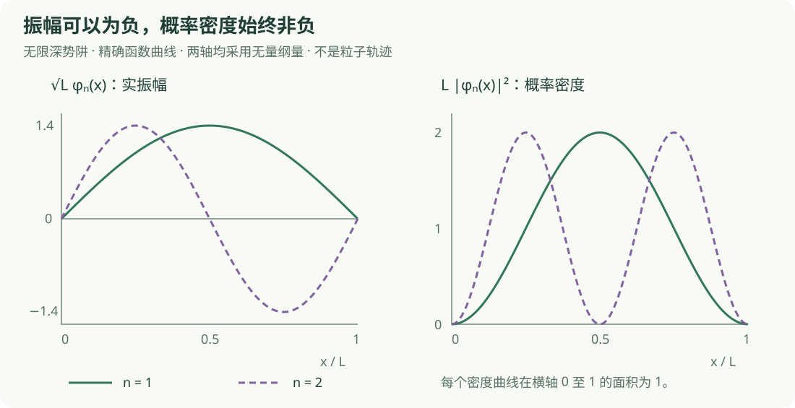
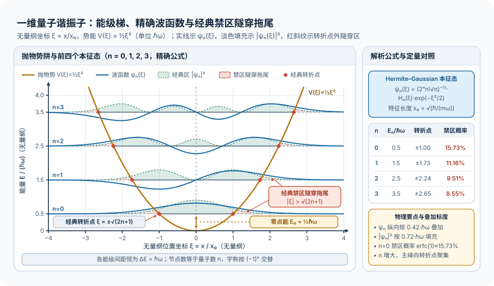
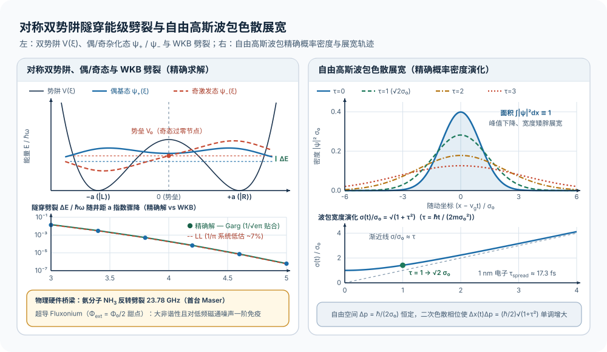
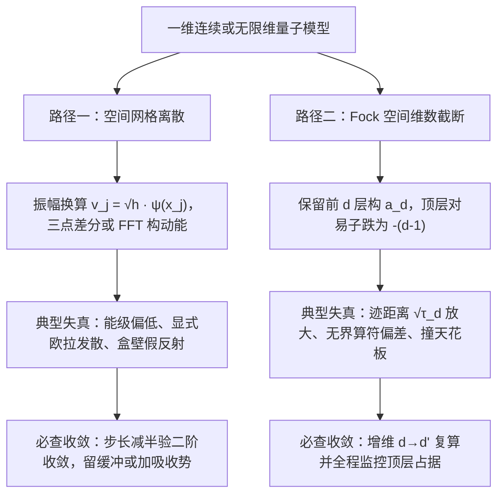

# Q4｜波函数、势阱、谐振子、隧穿与原子能级

前面几章里，我们几乎一直用二维或有限维列向量来描述量子态。但在真实世界里，一个电子的位置可以连续变化，捕获离子在势阱里的振动、微波腔里的电磁场模式，也都拥有无穷多个能级。这一章带你迈出从“离散矩阵”走向“连续波函数”的一步：看清自由高斯波包怎样随时间色散展宽、离散能级怎样从连续空间边界长出来、量子谐振子的等间距能级梯怎样搭建、光滑势垒与对称双势阱如何经由 WKB 隧穿劈裂出硬件二能级，同时快速解码真实离子阱与中性原子实验中的光谱项与超精细“钟态”铭牌，并看清在计算机里把连续空间或无穷能级截成有限矩阵时容易踩到哪些坑。

> **双入口跳读指南（按你的当前阅读目标直达）**：
> - **入口一（硬件与原子钟 / 传感读者，在[第 09 章](../09-hardware.md)或[第 20 章](../20-quantum-sensing-metrology.md)前查阅）**：可直接跳读**第 6.5 节**（对称双势阱劈裂 $\to$ 超导 Fluxonium 甜点）与**第 7 节**（四层角动量耦合与 $^{40}\mathrm{Ca}^+ / ^{171}\mathrm{Yb}^+ / ^{87}\mathrm{Rb} / ^{87}\mathrm{Sr}$ 钟态铭牌），无需先啃完一维波包与方势垒微积分；
> - **入口二（连续变量与玻色纠错读者，在[第 18 章 §9](../18-channels-capacities-complexity.md)或[第 19 章](../19-engineering-architecture.md)前精读）**：按顺序精读**第 1.1–1.3 节、第 4–5 节**（正则对易、升降算符与谐振子能级梯）及**第 8 节**（Fock 空间有限维截断与迹距离误差），与第 18 章无量纲正交分量无缝对接。

**分层阅读建议**：**必读 ★** 涵盖微积分热身、第 1.1–1.3 节、第 2–5 节、第 6.1–6.3 节、第 7 节与第 9–10 节；标有 **进阶选读 ☆** 的第 1.4 节（高斯波包色散）、第 6.4–6.5 节（高能共振与 WKB 双势阱劈裂）与第 8 节（网格离散与 Fock 截断数值失真）可按上述双入口按需研读。动笔推导之前，建议先读过 [Q2](02-observables-dynamics.md)，并准备好三项一元微积分的小工具：会求 $\sin(kx)$、$\cos(kx)$ 和 $e^{kx}$ 的一阶与二阶导数；知道定积分是在求曲线下的总面积；能把一个试探函数代回二阶微分方程，再用边界条件把待定常数定出来。如果暂时对微积分生疏，也完全可以先跟着每节的问题、图像、具体数字例子和结论读下去，文末附有公开课入口。

除非另有说明，本章第 1–6 节与第 8 节的所有波包、势阱、谐振子与势垒算例，都以**一维、非相对论、质量 $m$ 固定**的单粒子模型为舞台；第 7 节则跳过繁复的三维径向微分方程，专讲真实原子与离子硬件中常用的角动量耦合与能级记号。先把最干净的物理模型算透，再看它怎样连接真实的量子比特硬件和连续变量量子信息。

---

## 读公式前，先用三个小算式找回微积分的手感

拿到一整页带 $d/dx$ 和 $\int$ 的公式时，最容易让人紧张的并不是概念本身，而是忘记了每个记号“输入什么、输出什么”。下面用三个很短的算式把直觉找回来。

**第一，一阶导数问的是“在这一点的变化有多快”。** 设函数 $g(x)=2x$。把位置向右挪一小段 $\Delta x$，函数值增加 $2\Delta x$，比值 $\Delta g/\Delta x = 2$。让 $\Delta x$ 趋近于零，局部变化率依然是 $g'(x)=2$。同理，对波形 $\sin(kx)$ 求一次导数得到 $k\cos(kx)$，对 $\cos(kx)$ 求一次导数得到 $-k\sin(kx)$，对指数函数 $e^{\kappa x}$ 求一次导数得到 $\kappa e^{\kappa x}$。

**第二，二阶导数就是“对变化率再求一次变化率”，它刻画曲线的弯曲方向。** 把 $\sin(kx)$ 连续求两次导数：

$$
\frac{d}{dx}\sin(kx) = k\cos(kx), \qquad
\frac{d^2}{dx^2}\sin(kx) = -k^2\sin(kx).
$$

二阶导数和原函数正好成**负比例**，弯曲方向总是指向横轴，波形因此来回振荡；反过来，对 $e^{\kappa x}$ 连续求两次导数得到 $+\kappa^2 e^{\kappa x}$，二阶导数与原函数成**正比例**，曲线于是单调翘起或衰减。后文遇到 $\phi'' = -k^2\phi$ 或 $\phi'' = +\kappa^2\phi$ 时，你不必凭空背诵微分方程解法，直接把正弦余弦或指数函数代进去验算两边是否相等就行。

**第三，定积分问的是“把区间里所有极窄小条的贡献加起来总共有多少”。** 假设粒子在 $0<x<L$ 内的概率密度处处均匀，等于常数 $1/L$。把区间 $[a,b]$ 切成无数宽度为 $dx$ 的小条，每条面积是 $(1/L)\,dx$，全部加起来就是

$$
\Pr(a \le x \le b) = \int_a^b \frac{1}{L}\,dx = \frac{b-a}{L}.
$$

比如在均匀分布里，中间一半区间 $[L/4,\,3L/4]$ 的概率正好是 $1/2$。如果概率密度随位置高低起伏，只是把常数 $1/L$ 换成函数 $|\psi(x)|^2$，求的依然是区间下方那一块面积。后面算三角函数面积时，我们都会在旁边写明用到的三角恒等式，一步不跳。

---

## 1. 波函数与概率流：把量子态写到连续空间上

### 1.1 位置振幅、量纲与归一化

在离散基里，一个量子态可以按一组正交归一基矢展开成 $|\psi\rangle = \sum_j c_j |j\rangle$，其中复数振幅 $c_j = \langle j|\psi\rangle$ 的模平方 $|c_j|^2$ 给出测到结果 $j$ 的概率，并且满足 $\sum_j |c_j|^2 = 1$。

现在把问题搬到一维数轴 $x\in(-\infty,+\infty)$ 上：位置不再是屈指可数的几个编号，而是连续实数。这时，我们把离散的求和换成积分，用位置 $x$ 标记的复值函数

$$
\psi(x,t) = \langle x|\psi(t)\rangle
$$

就称为**位置表象波函数**（wavefunction）。和离散振幅 $c_j$ 一样，$\psi(x,t)$ 本身是一个复数，既不是粒子走过的空间轨迹，也不是一团带电荷的经典流体。它的物理含义由玻恩规则（Born rule）锚定：在时刻 $t$ 测量粒子位置，结果落在区间 $[a,b]$ 内的概率为

$$
\Pr(a \le x \le b;\, t) = \int_a^b |\psi(x,t)|^2\,dx = \int_a^b \psi^*(x,t)\psi(x,t)\,dx.
$$

这里 $\rho(x,t) \equiv |\psi(x,t)|^2 \ge 0$ 称为**概率密度**（probability density）。粒子在整条实线上总得落在某个地方，因此任意物理可制备的束缚态波函数必须满足**归一化条件**：

$$
\int_{-\infty}^{+\infty} |\psi(x,t)|^2\,dx = 1.
$$

先停下来核对一个极容易被忽略的细节——**量纲**。积分结果必须是无量纲的纯概率，而微元 $dx$ 带着长度量纲 $[L]$（在国际单位制中是米，$\mathrm{m}$），所以：

- 概率密度 $|\psi(x,t)|^2$ 的量纲是 $[L]^{-1}$（单位 $\mathrm{m}^{-1}$）；
- 一维波函数 $\psi(x,t)$ 自身的量纲是 $[L]^{-1/2}$（单位 $\mathrm{m}^{-1/2}$）。

因为 $|\psi(x,t)|^2$ 是“密度”而不是“概率”，它在某一点的数值完全可以大于 $1$（比如把粒子压在 $1\ \mathrm{nm}$ 的狭小区域里，密度峰值高达 $10^9\ \mathrm{m}^{-1}$），只要积分面积等于 $1$ 就完全合法。同时，对任意连续概率密度，粒子“恰好落在某一个数学点 $x_0$”的概率 $\int_{x_0}^{x_0}|\psi|^2\,dx = 0$，物理探测器总有一定宽度的窗口 $[a,b]$。另外，写法 $\langle x|\psi\rangle$ 中的 $|x\rangle$ 是连续谱使用的广义基记号，本身不能在普通平方可积空间 $L^2(\mathbb{R})$ 中归一化，不能把它当成一个可以无限精确制备出来的单点物理态。

#### 算例：常数波函数的最小归一化

假设某瞬间，一个一维波函数在 $0<x<L$ 内取复常数 $A$，在区间外恒为零。怎样定出 $A$，使它满足归一化条件？

把波函数代入归一化积分：

$$
1 = \int_{-\infty}^{+\infty} |\psi(x)|^2\,dx
= \int_0^L |A|^2\,dx
= |A|^2 \int_0^L dx
= |A|^2 L.
$$

于是 $|A| = 1/\sqrt{L}$。由于全局相位 $e^{i\theta}$ 不改变任何可观测概率，取实正相位便得到

$$
A = \frac{1}{\sqrt{L}}, \qquad
|\psi(x)|^2 = \frac{1}{L}\quad (0<x<L).
$$

若用米作单位，$L$ 的单位是 $\mathrm{m}$，概率密度 $1/L$ 的单位是 $\mathrm{m}^{-1}$，振幅 $A$ 的单位是 $\mathrm{m}^{-1/2}$。落在任意三分之一区间（例如 $L/3 \le x \le 2L/3$）内的概率是

$$
\Pr\!\left(\frac{L}{3} \le x \le \frac{2L}{3}\right)
= \int_{L/3}^{2L/3} \frac{1}{L}\,dx
= \frac{1}{L}\left(\frac{2L}{3} - \frac{L}{3}\right)
= \frac{1}{3}.
$$

这里要留一个心眼：这个分段常数函数虽然满足 $\int |\psi|^2 dx = 1$，但在 $x=0$ 和 $x=L$ 处发生垂直跳变，导数不存在，对应的动能期望发散。它只适合拿来练手理解归一化与量纲，不能直接充当后面势阱里有限能量的光滑物理态。

---

### 1.2 位置算符、动量算符与正则对易关系

在有限维系统里，可观测量写成厄米矩阵，作用在列向量上；搬到一维位置表象后，可观测量变成作用在波函数 $\psi(x)$ 上的线性算符。在整条实线上，对足够光滑且在无穷远处衰减得足够快的波函数，**位置算符** $\hat x$（单位 $\mathrm{m}$）与**动量算符** $\hat p$（单位 $\mathrm{kg\cdot m/s}$）分别定义为

$$
(\hat x\psi)(x) = x\,\psi(x), \qquad
(\hat p\psi)(x) = -i\hbar\,\frac{d\psi(x)}{dx}.
$$

拿一列单色平面波 $\psi_k(x) = e^{ikx}$ 检验一下动量算符的作用（这里波数 $k$ 的单位是 $\mathrm{m}^{-1}$）：

$$
(\hat p e^{ikx}) = -i\hbar \frac{d}{dx}\!\left(e^{ikx}\right)
= -i\hbar (ik) e^{ikx}
= (-i^2)\hbar k\, e^{ikx}
= \hbar k\, e^{ikx}.
$$

平面波正好是动量算符的本征函数，本征值 $p = \hbar k$ 恰好是德布罗意动量关系！注意单列无限长平面波的模平方恒为 $|e^{ikx}|^2 = 1$，在整条实线上积分发散，所以它只是理想化的动量基底；真实局域粒子总是由许多不同 $k$ 的平面波叠加而成的波包。

现在来回答一个贯穿整本量子力学的关键问题：位置算符 $\hat x$ 和动量算符 $\hat p$ 为什么不对易？把它们先后作用在同一条光滑测试函数 $f(x)$ 上，一步不跳地展开看看。

先算 $\hat x\hat p$（先求导，再乘以 $x$）：

$$
(\hat x\hat p f)(x)
= \hat x\bigl((\hat p f)(x)\bigr)
= x\left(-i\hbar\frac{df(x)}{dx}\right)
= -i\hbar\, x f'(x).
$$

再算 $\hat p\hat x$（先乘以 $x$，再对乘积 $xf(x)$ 用求导的乘积法则）：

$$
(\hat p\hat x f)(x)
= \hat p\bigl(x f(x)\bigr)
= -i\hbar\frac{d}{dx}\bigl[x f(x)\bigr]
= -i\hbar\left[\frac{dx}{dx}f(x) + x\frac{df(x)}{dx}\right]
= -i\hbar\,f(x) - i\hbar\,x f'(x).
$$

把上面两式相减，含有 $x f'(x)$ 的两项完全抵消，只剩下一项：

$$
\bigl([\hat x,\hat p]f\bigr)(x)
= (\hat x\hat p f)(x) - (\hat p\hat x f)(x)
= -i\hbar\,x f'(x) - \bigl(-i\hbar\,f(x) - i\hbar\,x f'(x)\bigr)
= +i\hbar\,f(x).
$$

因为这条等式对定义域内任意光滑测试函数 $f(x)$ 都成立，我们把它写成算符恒等式，即**正则对易关系**（canonical commutation relation）：

$$
[\hat x, \hat p] = i\hbar I.
$$

你看，$i\hbar$ 并不是谁拍脑袋强行塞进去的规则，它直接长在对 $xf(x)$ 求导的乘积法则里。把它放回 [Q2](02-observables-dynamics.md) 推过的 Robertson 不确定关系 $\Delta A\,\Delta B \ge \frac{1}{2}|\langle[A,B]\rangle|$ 中，立刻得到大名鼎鼎的海森堡位置—动量不确定关系：

$$
\Delta x\,\Delta p \ge \frac{1}{2}\left|\langle i\hbar I\rangle\right| = \frac{\hbar}{2}.
$$

同时，把这里带有物理量纲的 $[\hat x,\hat p]=i\hbar I$ 与[第 18 章连续变量部分](../18-channels-capacities-complexity.md)对照一下，能帮你省去日后读论文时一大半的常数换算麻烦：

| 场景与章节 | 位置类与动量类算符 | 对易关系 | 真空 / 基态方差 |
| :--- | :--- | :--- | :--- |
| **本章（Q4）物理坐标与动量** | $\hat x$（单位 $\mathrm{m}$），$\hat p$（单位 $\mathrm{kg\cdot m/s}$） | $[\hat x, \hat p] = i\hbar I$ | $\Delta x^2 = \dfrac{\hbar}{2m\omega}$，$\Delta p^2 = \dfrac{m\hbar\omega}{2}$ |
| **[第 18 章](../18-channels-capacities-complexity.md)无量纲正交分量** | $\hat q = \sqrt{\dfrac{m\omega}{\hbar}}\,\hat x$，$\tilde p = \dfrac{\hat p}{\sqrt{m\hbar\omega}}$（第 18 章直接记作 $\hat p$，物理动量另记 $\hat p_{\mathrm{phys}}$） | $[\hat q, \tilde p] = i I$ | $\operatorname{Var}(\hat q) = \operatorname{Var}(\tilde p) = \dfrac{1}{2}$ |

两套写法之间没有任何物理分歧，只是把长度标度 $x_0 = \sqrt{\hbar/(m\omega)}$ 和动量标度 $\hbar/x_0 = \sqrt{m\hbar\omega}$ 除掉了；本章为与物理动量 $\hat p$ 区分而暂记无量纲动量算符为 $\tilde p$，第 18 章在脱离物理量纲后则直接将此无量纲动量记为 $\hat p$（而把本章物理动量记为 $\hat p_{\mathrm{phys}}$）。第 4 节构造谐振子升降算符时，你会看到两套写法会合在同一个公式里。

> 连续空间上的 $\hat x$ 与 $\hat p$ 都是无界算符，等式 $[\hat x,\hat p]=i\hbar I$ 必须在二者共同的作用域上理解。尤其是当粒子被关在有限区间 $[0,L]$ 上时，不能不检查边界条件就直接把 $-i\hbar\,d/dx$ 当成自伴动量算符。后文的势阱问题会先明确写清边界条件，再求解哈密顿算符。

---

### 1.3 薛定谔方程、概率流与连续性方程

对质量为 $m$、处在实值势能 $V(x)$ 中的一维粒子，哈密顿算符（总能量算符，单位 $\mathrm{J}$）写成动能算符与势能算符之和：

$$
\hat H = \frac{\hat p^2}{2m} + V(\hat x)
= -\frac{\hbar^2}{2m}\frac{\partial^2}{\partial x^2} + V(x).
$$

把它代入 [Q2](02-observables-dynamics.md) 的含时薛定谔方程 $i\hbar\frac{d}{dt}|\psi(t)\rangle = \hat H|\psi(t)\rangle$，在位置表象中就是**一维含时薛定谔方程**：

$$
i\hbar\frac{\partial \psi(x,t)}{\partial t}
= -\frac{\hbar^2}{2m}\frac{\partial^2 \psi(x,t)}{\partial x^2} + V(x)\psi(x,t).
$$

如果初始时刻波函数已经归一化，过了一段时间 $t$ 之后，总概率还会保持等于 $1$ 吗？不仅如此，当某一段区域里的概率减少时，减少的那部分概率是凭空消失了，还是穿过边界“流”进了相邻区域？

让我们直接从含时薛定谔方程出发，一步不跳地算 $\rho(x,t) = \psi^*(x,t)\psi(x,t)$ 对时间的偏导数。先对薛定谔方程两边取复共轭，利用**势能 $V(x)$ 为实函数**（$V^*(x)=V(x)$），得到

$$
-i\hbar\frac{\partial \psi^*}{\partial t}
= -\frac{\hbar^2}{2m}\frac{\partial^2 \psi^*}{\partial x^2} + V(x)\psi^*.
$$

把原方程除以 $i\hbar$，把复共轭方程除以 $-i\hbar$，分别写成

$$
\frac{\partial \psi}{\partial t}
= \frac{i\hbar}{2m}\frac{\partial^2 \psi}{\partial x^2} - \frac{i}{\hbar}V(x)\psi,
\qquad
\frac{\partial \psi^*}{\partial t}
= -\frac{i\hbar}{2m}\frac{\partial^2 \psi^*}{\partial x^2} + \frac{i}{\hbar}V(x)\psi^*.
$$

（核对符号：$-\frac{\hbar^2}{2m}\cdot\frac{1}{i\hbar} = -\frac{\hbar}{2mi} = +\frac{i\hbar}{2m}$，因为 $1/i = -i$。）

现在按乘积法则求 $\partial\rho/\partial t$：

$$
\begin{aligned}
\frac{\partial \rho}{\partial t}
&= \frac{\partial \psi^*}{\partial t}\psi + \psi^*\frac{\partial \psi}{\partial t} \\
&= \left(-\frac{i\hbar}{2m}\frac{\partial^2\psi^*}{\partial x^2} + \frac{i}{\hbar}V\psi^*\right)\psi
 + \psi^*\left(\frac{i\hbar}{2m}\frac{\partial^2\psi}{\partial x^2} - \frac{i}{\hbar}V\psi\right).
\end{aligned}
$$

两项势能项 $+\frac{i}{\hbar}V\psi^*\psi$ 与 $-\frac{i}{\hbar}V\psi^*\psi$ 恰好完全抵消！剩下的二阶导数差可以巧妙地凑成一个全导数，因为按乘积法则展开

$$
\frac{\partial}{\partial x}\left(\psi^*\frac{\partial\psi}{\partial x} - \psi\frac{\partial\psi^*}{\partial x}\right)
= \frac{\partial\psi^*}{\partial x}\frac{\partial\psi}{\partial x} + \psi^*\frac{\partial^2\psi}{\partial x^2}
 - \frac{\partial\psi}{\partial x}\frac{\partial\psi^*}{\partial x} - \psi\frac{\partial^2\psi^*}{\partial x^2}
= \psi^*\frac{\partial^2\psi}{\partial x^2} - \psi\frac{\partial^2\psi^*}{\partial x^2}.
$$

代入刚才的 $\partial\rho/\partial t$，再利用 $i = -1/i$，整理得到

$$
\frac{\partial \rho}{\partial t}
= \frac{i\hbar}{2m}\frac{\partial}{\partial x}\left(\psi^*\frac{\partial\psi}{\partial x} - \psi\frac{\partial\psi^*}{\partial x}\right)
= -\frac{\partial}{\partial x}\left[\frac{\hbar}{2mi}\left(\psi^*\frac{\partial\psi}{\partial x} - \psi\frac{\partial\psi^*}{\partial x}\right)\right].
$$

方括号里是一个纯实数量：因为对任意复数 $z$ 都有 $(z - z^*)/(2i) = \operatorname{Im}(z)$，取 $z = \psi^*\partial_x\psi$ 便定义出**概率流密度**（probability current，一维下量纲为 $\mathrm{s}^{-1}$，表示单位时间自左向右穿过点 $x$ 的净概率通量）：

$$
j(x,t)
= \frac{\hbar}{2mi}\left(\psi^*\frac{\partial\psi}{\partial x} - \psi\frac{\partial\psi^*}{\partial x}\right)
= \frac{\hbar}{m}\operatorname{Im}\!\left(\psi^*\frac{\partial\psi}{\partial x}\right).
$$

于是概率密度与概率流严格服从**连续性方程**：

$$
\frac{\partial \rho(x,t)}{\partial t} + \frac{\partial j(x,t)}{\partial x} = 0.
$$

对任意区间 $[a,b]$ 积分，立即得到直观的守恒律：

$$
\frac{d}{dt}\int_a^b \rho(x,t)\,dx = -\int_a^b \frac{\partial j}{\partial x}\,dx = j(a,t) - j(b,t).
$$

区间内总概率的增加率，严格等于从左端点 $a$ 流入的概率流减去从右端点 $b$ 流出的概率流。如果波函数在 $x\to\pm\infty$ 趋于零，则 $j(\pm\infty,t)=0$，整条实线上的总概率 $\int_{-\infty}^{+\infty}\rho\,dx$ 对时间导数为零——归一化自动永远守恒。

把波函数写成极坐标形式 $\psi(x,t) = \sqrt{\rho(x,t)}\,e^{i\theta(x,t)}$（其中 $\rho\ge 0$、$\theta\in\mathbb{R}$），还能一眼看清概率流的物理脾气：

$$
\psi^*\frac{\partial\psi}{\partial x}
= \sqrt{\rho}\,e^{-i\theta}\left(\frac{\partial\sqrt{\rho}}{\partial x}e^{i\theta} + i\sqrt{\rho}\frac{\partial\theta}{\partial x}e^{i\theta}\right)
= \frac{1}{2}\frac{\partial\rho}{\partial x} + i\rho\frac{\partial\theta}{\partial x},
$$

取虚部乘以 $\hbar/m$，得到

$$
j(x,t) = \rho(x,t)\cdot\frac{\hbar}{m}\frac{\partial\theta(x,t)}{\partial x}.
$$

这个简洁的式子立刻给出三条极有用的推论：

1. **概率流由空间相位梯度驱动**：如果波函数的相位 $\theta$ 不随位置 $x$ 变化（例如一维实值定态波函数乘以纯时间相位 $e^{-iEt/\hbar}$），那么 $\partial\theta/\partial x = 0$，整个空间的概率流处处为零（$j\equiv 0$）。
2. **平面波的概率流等于“速度乘密度”**：对向右传播的平面波 $\psi(x) = A e^{ikx}$，$\rho = |A|^2$、$\theta(x) = kx + \arg A$，故 $j = \frac{\hbar k}{m}|A|^2 = v|A|^2$；对向左传播的 $B e^{-ikx}$，则有 $j = -\frac{\hbar k}{m}|B|^2$。第 6 节算势垒透射率时，正是靠这条公式定义入射、反射和透射通量。
3. **复势能会破坏概率守恒**：前面推导能消去势能项，全靠 $V(x)$ 是实数。如果人为在势能里加入负虚部 $V(x) - iW(x)$（$W(x)>0$），连续性方程右边就会多出汇项 $-\frac{2W(x)}{\hbar}\rho$，概率不断被吸收。这和 [Q2](02-observables-dynamics.md) 开放系统里的非厄米有效哈密顿量相呼应，也在第 8 节数值模拟中用来充当“吸收边界”。

---

### 1.4 进阶选读：自由高斯波包色散展宽——群速度、相速度与不确定度增长

第 1.2 节提到，单列平面波 $e^{ikx}$ 铺满整条实线、无法归一化；要把自由粒子（$V(x)=0$）局域在有限区域内，必须把许多不同波数 $k$ 的平面波叠加成一团**波包**（wavepacket）。于是自然冒出一个困惑：如果 $t=0$ 时我们把一个自由电子捏成宽度仅 $\sigma_0$ 的高斯波包，此后没有任何外力作用在它身上，它会不会像经典子弹一样保持原有形状匀速飞下去？

答案是否定的。直觉上，局域波包必然同时包含跑得快的高动量成分与跑得慢的低动量成分；在自由空间里，粒子的色散关系是二次函数 $\omega(k) = \frac{E(k)}{\hbar} = \frac{\hbar k^2}{2m}$ 而非电磁波在真空中的线性关系 $\omega=ck$，不同 $k$ 成分的传播速度互不相同，就像一群起跑线相同、步速却有快有慢的跑者，跑得越久队伍就拉得越长。这个比方点出了色散展宽的根源，但要留意它在量子层面的失效边界：波包展宽并不是“我们不知道粒子究竟以哪个经典速度运动”所带来的纯统计模糊，而是同一个纯态内部不同动量相位相干干涉的结果，它的空间相位还随位置二次弯曲。

下面逐步把任意时刻的自由高斯波包精确积出来。设 $t=0$ 时刻粒子处于中心位置 $x=0$、中心波数 $k_0\in\mathbb{R}$、初始位置标准差 $\sigma_0 > 0$ 的**最小不确定度高斯波包**：

$$
\psi(x,0) = (2\pi\sigma_0^2)^{-1/4}\exp\!\left(-\frac{x^2}{4\sigma_0^2} + i k_0 x\right).
$$

先做归一化检验：模平方 $|\psi(x,0)|^2 = \frac{1}{\sqrt{2\pi}\,\sigma_0}e^{-x^2/(2\sigma_0^2)}$ 正好是均值为 $0$、标准差为 $\Delta x(0) = \sigma_0$ 的标准高斯概率密度，全实线积分严格等于 $1$。

**第一步：傅里叶变换到波数表象。** 利用复高斯积分公式 $\int_{-\infty}^{+\infty} e^{-\alpha x^2 + \beta x}\,dx = \sqrt{\frac{\pi}{\alpha}}\exp\!\left(\frac{\beta^2}{4\alpha}\right)$（要求 $\operatorname{Re}\alpha > 0$），取 $\alpha = \frac{1}{4\sigma_0^2}$、$\beta = -i(k-k_0)$，求波数振幅 $\tilde\psi(k,0) = \frac{1}{\sqrt{2\pi}}\int_{-\infty}^{+\infty}\psi(x,0)e^{-ikx}\,dx$：

$$
\begin{aligned}
\tilde\psi(k,0)
&= \frac{(2\pi\sigma_0^2)^{-1/4}}{\sqrt{2\pi}}\int_{-\infty}^{+\infty}
\exp\!\left(-\frac{x^2}{4\sigma_0^2} - i(k-k_0)x\right)dx \\
&= \frac{(2\pi\sigma_0^2)^{-1/4}}{\sqrt{2\pi}}\cdot\sqrt{4\pi\sigma_0^2}\,\exp\!\left(-\sigma_0^2(k-k_0)^2\right) \\
&= \left(\frac{2\sigma_0^2}{\pi}\right)^{1/4}\exp\!\left(-\sigma_0^2(k-k_0)^2\right).
\end{aligned}
$$

顺手核对初始动量涨落：波数概率密度 $|\tilde\psi(k,0)|^2 = \sqrt{\frac{2\sigma_0^2}{\pi}}e^{-2\sigma_0^2(k-k_0)^2}$ 的方差为 $(\Delta k)^2 = \frac{1}{4\sigma_0^2}$，故 $\Delta p = \hbar\Delta k = \frac{\hbar}{2\sigma_0}$，初始乘积 $\Delta x(0)\Delta p = \frac{\hbar}{2}$ 恰好饱和海森堡下界。

**第二步：自由演化的时间相位与反变换。** 当 $V(x)=0$ 时，每个平面波分量 $e^{ikx}$ 都是自由哈密顿量 $\hat H = \hat p^2/(2m)$ 的本征态，携带时间相位 $e^{-i\omega(k)t} = e^{-i\hbar k^2 t/(2m)}$，于是

$$
\tilde\psi(k,t) = \tilde\psi(k,0)\exp\!\left(-i\frac{\hbar k^2 t}{2m}\right).
$$

注意模平方 $|\tilde\psi(k,t)|^2 = |\tilde\psi(k,0)|^2$ 与时间完全无关，**自由粒子的动量分布与动量标准差 $\Delta p = \frac{\hbar}{2\sigma_0}$ 永远保持不变**。做逆傅里叶变换回到位置空间，换元 $q = k - k_0$（故 $k^2 = k_0^2 + 2k_0 q + q^2$）：

$$
\begin{aligned}
\psi(x,t)
&= \frac{1}{\sqrt{2\pi}}\int_{-\infty}^{+\infty}\tilde\psi(k,t)e^{ikx}\,dk \\
&= \frac{1}{\sqrt{2\pi}}\left(\frac{2\sigma_0^2}{\pi}\right)^{1/4}
\exp\!\left(ik_0 x - i\frac{\hbar k_0^2 t}{2m}\right)
\int_{-\infty}^{+\infty}\exp\!\left[-\left(\sigma_0^2 + i\frac{\hbar t}{2m}\right)q^2 + i\left(x - \frac{\hbar k_0}{m}t\right)q\right]dq.
\end{aligned}
$$

定义**群速度**（group velocity）$v_g$ 与复展宽系数 $\alpha_t$：

$$
v_g \equiv \left.\frac{d\omega}{dk}\right|_{k=k_0} = \frac{\hbar k_0}{m},
\qquad
\alpha_t \equiv \sigma_0^2 + i\frac{\hbar t}{2m}.
$$

再次套用复高斯积分公式（此时 $\operatorname{Re}\alpha_t = \sigma_0^2 > 0$，积分严格收敛），化简前因子 $\frac{1}{\sqrt{2\pi}}\left(\frac{2\sigma_0^2}{\pi}\right)^{1/4}\sqrt{\frac{\pi}{\alpha_t}} = \left(\frac{\sigma_0^2}{2\pi}\right)^{1/4}\frac{1}{\sqrt{\alpha_t}}$，直接写出任意时刻的精确波函数：

$$
\psi(x,t) = \left(\frac{\sigma_0^2}{2\pi}\right)^{1/4}\frac{1}{\sqrt{\alpha_t}}
\exp\!\left(ik_0 x - i\frac{\hbar k_0^2 t}{2m}\right)
\exp\!\left(-\frac{(x - v_g t)^2}{4\alpha_t}\right).
$$

**第三步：求模平方，读出展宽公式与归一化回验。** 把 $\frac{1}{\alpha_t}$ 分母实数化：

$$
\frac{1}{\alpha_t}
= \frac{\sigma_0^2 - i\dfrac{\hbar t}{2m}}{\sigma_0^4 + \left(\dfrac{\hbar t}{2m}\right)^2}
= \frac{1 - i\dfrac{\hbar t}{2m\sigma_0^2}}{\sigma_0^2\left[1 + \left(\dfrac{\hbar t}{2m\sigma_0^2}\right)^2\right]}.
$$

定义随时间增长的**波包宽度** $\sigma(t)$ 与**特征展宽时间** $\tau_{\mathrm{spread}}$：

$$
\sigma(t) \equiv \sigma_0\sqrt{1 + \left(\frac{\hbar t}{2m\sigma_0^2}\right)^2}
= \sigma_0\sqrt{1 + \left(\frac{t}{\tau_{\mathrm{spread}}}\right)^2},
\qquad
\tau_{\mathrm{spread}} \equiv \frac{2m\sigma_0^2}{\hbar}.
$$

注意到 $|\alpha_t| = \sigma_0\sigma(t)$，且 $\operatorname{Re}\!\left(-\frac{(x-v_g t)^2}{4\alpha_t}\right) = -\frac{(x-v_g t)^2}{4\sigma(t)^2}$，乘以 $2$（因 $|\psi|^2 = \psi^*\psi$）后，任意时刻的概率密度呈现无比简洁的形态：

$$
|\psi(x,t)|^2 = \frac{1}{\sqrt{2\pi}\,\sigma(t)}\exp\!\left(-\frac{(x - v_g t)^2}{2\sigma(t)^2}\right).
$$

独立回验：对任意 $t$，它仍是均值为 $\langle\hat x\rangle_t = v_g t$、标准差为 $\Delta x(t) = \sigma(t)$ 的标准高斯分布，总概率积分恒等于 $1$！从结果中立刻读出三条深刻物理结论：

1. **群速度决定包络前进，相速度只有群速度的一半**：波包峰值以群速度 $v_g = \frac{\hbar k_0}{m} = \frac{p_0}{m}$ 匀速运动，与经典粒子动量速度完全吻合；而单个载波波峰的**相速度**（phase velocity）是 $v_p = \frac{\omega(k_0)}{k_0} = \frac{\hbar k_0}{2m} = \frac{1}{2}v_g$。取一个波数 $k_0 = 10^9\,\mathrm{m}^{-1}$（德布罗意波长 $\lambda = 2\pi/k_0 \approx 6.28\,\mathrm{nm}$）的自由电子代入，得 $v_g \approx 1.158\times 10^5\,\mathrm{m/s}$、$v_p \approx 5.788\times 10^4\,\mathrm{m/s}$——在波包内部，细密相位波纹以包络一半的速度向后滑过。
2. **位置—动量关联使不确定度乘积增长**：虽然 $\Delta p = \frac{\hbar}{2\sigma_0}$ 恒定不变，但乘积 $\Delta x(t)\Delta p = \frac{\hbar}{2}\sqrt{1 + (t/\tau_{\mathrm{spread}})^2}$ 随时间单调增大。这是因为 $\frac{1}{\alpha_t}$ 的虚部在波函数中留下了二次空间相位（啁啾项）$\exp\!\left(+i\frac{t/\tau_{\mathrm{spread}}}{4\sigma(t)^2}(x - v_g t)^2\right)$，使位置与动量之间产生了正协方差（跑得快的高动量成分冲到了波包前缘，恰恰呼应 [Q2](02-observables-dynamics.md) 的薛定谔不确定关系）。
3. **微观飞秒级崩散 vs 宏观宇宙级稳定**：代入特征展宽时间 $\tau_{\mathrm{spread}} = \frac{2m\sigma_0^2}{\hbar}$（此时宽度增至 $\sqrt{2}\sigma_0$）：
   - 初始宽度 $\sigma_0 = 1\,\mathrm{nm}$ 的自由电子（$m_e \approx 9.109\times 10^{-31}\,\mathrm{kg}$）：$\tau_{\mathrm{spread}} = \frac{2\times 9.109\times 10^{-31}\times 10^{-18}}{1.055\times 10^{-34}} \approx \mathbf{17.3\,\mathrm{fs}}$，不到二十飞秒就会显著散开；
   - 质量 $m = 1\,\mathrm{g} = 10^{-3}\,\mathrm{kg}$、初始定位精度 $\sigma_0 = 1\,\mu\mathrm{m}$ 的宏观尘粒：$\tau_{\mathrm{spread}} \approx \mathbf{1.90\times 10^{19}\,\mathrm{s}}$，超过当前宇宙年龄（$\sim 4.35\times 10^{17}\,\mathrm{s}$）的四十倍！这正是日常宏观物体根本看不见波包自发散开的原因。

> **边界提醒**：上述自由展宽仅在势能恒为零、无测量干扰、非相对论（$v_g \ll c$）条件下成立。一旦把粒子放进第 4 节的抛物线谐振子势阱，势能的回复力会恰好抵消色散，高斯形状的**相干态**波包便能永不展宽地来回振荡。

---

## 2. 无限深方势阱：离散能级怎样从边界条件中长出来

很多初学者第一次听说“原子里的能量是量子化的、一份一份的”，容易以为是自然界预先把能量轴切成了离散格子。最能打消这种印象的模型，就是一维**无限深方势阱**（infinite square well，也叫一维盒中粒子）：势阱内部势能为零，哈密顿量光滑连续，离散能级完全是“波函数必须在两堵墙处为零”逼出来的。

### 2.1 硬壁条件与能量必正的证明

设粒子被关在 $0<x<L$ 的区间里：

$$
V(x) =
\begin{cases}
0, & 0 < x < L, \\
+\infty, & x \le 0 \text{ 或 } x \ge L.
\end{cases}
$$

井外势能无限高，粒子完全进不去，因此波函数在井外恒为零，并且在左右两堵硬壁处满足**理想硬壁边界条件**：

$$
\phi(0) = 0, \qquad \phi(L) = 0.
$$

这里要区分两种完全不同的边界条件：对于**无限高**硬壁，我们只要求波函数连续归零，**不要求**一阶导数 $\phi'(x)$ 在 $x=0, L$ 两侧连续（井外导数为零，井内靠墙处的斜率却不为零，导数在无限高墙面发生折角）；而后面第 6 节的**有限高**势垒，才要求 $\phi$ 和 $\phi'$ 同时连续。

我们来找能量本征态（定态），即把波函数写成空间与时间的分离变量形式 $\psi(x,t) = \phi(x)e^{-iEt/\hbar}$，代入含时薛定谔方程，两边消去时间因子 $e^{-iEt/\hbar}$，得到**定态薛定谔方程** $\hat H\phi = E\phi$。在井内 $0<x<L$，$V(x)=0$，方程简化为

$$
-\frac{\hbar^2}{2m}\phi''(x) = E\phi(x).
$$

动手解之前，先一步步证明一个重要事实：**任何非零归一化解的能量 $E$ 都必须严格大于零（$E>0$）。** 用 $\phi^*(x)$ 乘以方程两边并在 $[0,L]$ 上积分：

$$
E = E\int_0^L |\phi(x)|^2\,dx
= -\frac{\hbar^2}{2m}\int_0^L \phi^*(x)\phi''(x)\,dx.
$$

对右端做一次分部积分（$\int u\,dv = uv - \int v\,du$，令 $u=\phi^*$、$dv=\phi''\,dx$）：

$$
-\frac{\hbar^2}{2m}\int_0^L \phi^*\phi''\,dx
= -\frac{\hbar^2}{2m}\Bigl[\phi^*(x)\phi'(x)\Bigr]_0^L
 + \frac{\hbar^2}{2m}\int_0^L |\phi'(x)|^2\,dx.
$$

因为硬壁边界条件给出 $\phi^*(0)=\phi^*(L)=0$，中括号里的边界项严格为零，于是

$$
E = \frac{\hbar^2}{2m}\int_0^L |\phi'(x)|^2\,dx \ge 0.
$$

那 $E$ 能不能等于 $0$ 呢？如果 $E=0$，由于被积函数 $|\phi'(x)|^2 \ge 0$，只能在整个区间内处处有 $\phi'(x)=0$，即 $\phi(x)$ 为常数；再代入边界条件 $\phi(0)=0$，就迫使 $\phi(x)\equiv 0$，零函数没有粒子，无法归一化。所以必有 $E>0$。

---

### 2.2 求解定态波函数与离散能谱

既然 $E>0$，我们可以定义正实波数

$$
k = \frac{\sqrt{2mE}}{\hbar} > 0 \qquad \Longleftrightarrow \qquad E = \frac{\hbar^2 k^2}{2m}.
$$

定态方程变为简洁的二阶常系数微分方程：

$$
\phi''(x) = -k^2\phi(x).
$$

我们在热身算式里验证过，$\sin(kx)$ 和 $\cos(kx)$ 求两次导数都会吐出 $-k^2$ 乘以自身。因为方程是线性的、二阶的，它的全部通解可以写成这两个独立解的线性组合：

$$
\phi(x) = A\sin(kx) + B\cos(kx),
$$

其中 $A, B$ 是待定复常数。接下来用两堵墙把 $A, B$ 和 $k$ 钉死：

1. **代入左边界 $\phi(0)=0$**：由于 $\sin(0)=0$、$\cos(0)=1$，

   $$
   0 = \phi(0) = A\cdot 0 + B\cdot 1 = B \implies B = 0.
   $$

   于是波函数缩减为 $\phi(x) = A\sin(kx)$。
2. **代入右边界 $\phi(L)=0$**：

   $$
   0 = \phi(L) = A\sin(kL).
   $$

   如果取 $A=0$，整个波函数变成零函数，不能归一化。因此必须由正弦函数自己归零，即

   $$
   \sin(kL) = 0 \implies kL = n\pi \implies k_n = \frac{n\pi}{L}, \qquad n \in \mathbb{Z}.
   $$

3. **筛选独立的物理量子数 $n$**：
   - $n = 0$ 时，$k_0 = 0$，导致 $\sin(0)\equiv 0$，是零函数，必须剔除；
   - 负整数 $n = -m$（$m>0$）时，$\sin(-m\pi x/L) = -\sin(m\pi x/L)$，与正整数 $m$ 的解只差一个整体负号（全局相位 $e^{i\pi}$），代表完全相同的物理态。
   - 因此，独立的量子数恰好是全部正整数：$n = 1, 2, 3, \ldots$。

最后一步，把归一化常数 $A$ 一步不跳地算出来。要求 $\int_0^L |A|^2 \sin^2\!\left(\frac{n\pi x}{L}\right)dx = 1$。使用倍角恒等式 $\sin^2\theta = \frac{1-\cos(2\theta)}{2}$：

$$
\begin{aligned}
\int_0^L \sin^2\!\left(\frac{n\pi x}{L}\right)dx
&= \int_0^L \frac{1 - \cos\!\left(\frac{2n\pi x}{L}\right)}{2}\,dx \\
&= \left[\frac{x}{2} - \frac{L}{4n\pi}\sin\!\left(\frac{2n\pi x}{L}\right)\right]_0^L \\
&= \left(\frac{L}{2} - \frac{L}{4n\pi}\sin(2n\pi)\right) - \left(0 - \frac{L}{4n\pi}\sin 0\right)
= \frac{L}{2}.
\end{aligned}
$$

于是 $|A|^2 \cdot \frac{L}{2} = 1 \implies |A| = \sqrt{\frac{2}{L}}$。取实正相位，我们就完整求出了无限深方势阱的全部定态波函数与离散能谱：

$$
\phi_n(x) = \sqrt{\frac{2}{L}}\sin\!\left(\frac{n\pi x}{L}\right), \qquad
E_n = \frac{n^2\pi^2\hbar^2}{2mL^2} = n^2 E_1, \qquad
n = 1, 2, 3, \ldots
$$

花几秒钟回味一下公式里的物理规律：

- **波形就像两端固定的琴弦驻波**：半波长 $\lambda_n/2 = \pi/k_n = L/n$ 恰好把井宽 $L$ 整数等分，井内（不含两端点）有 $n-1$ 个零点，称为**节点**（node）。节点越多，波形弯折得越剧烈，二阶导数幅值越大，动能 $E_n$ 也就越高。
- **尺度标度律**：能级与 $1/(mL^2)$ 成正比。把井宽 $L$ 加倍到 $2L$，基态能量 $E_1$ 会降为原来的 $1/4$；粒子质量 $m$ 加倍，能量降为原来的 $1/2$。并且能级间距随 $n$ 越来越宽：$E_2 - E_1 = 3E_1$，$E_3 - E_2 = 5E_1$，$E_{n+1} - E_n = (2n+1)E_1$。
- **正交性**：任意两个不同能级的定态满足 $\int_0^L \phi_m(x)\phi_n(x)\,dx = \delta_{mn}$（这既可以直接用积化和差算出来，也是厄米算符不同本征值对应本征态正交的直接体现）。

观察上图时，请分清左右两栏：左栏画的是实振幅 $\sqrt{L}\,\phi_n(x)$，对 $n=2$ 的右半井，振幅取负值；右栏画的是概率密度 $L|\phi_n(x)|^2$，它始终非负，且每条曲线在 $0$ 到 $1$ 之间的总面积严格等于 $1$。振幅有正有负，并不意味着概率为负，但正负号在叠加干涉时会起决定作用。

---

### 2.3 算例：基态落在中间一半区域的概率为什么高达 81.83%

取基态 $n=1$，问：对粒子做一次位置测量，结果落在势阱**中间一半区域** $[L/4,\, 3L/4]$ 内的概率是多少？

在经典的均一想象里，区间长度占了一半，人们直觉容易猜 $1/2$。但在量子基态里，概率密度集中在井中央、贴近两壁处被压到零，我们一步步积出来看：

$$
P_{\mathrm{mid}} = \int_{L/4}^{3L/4} |\phi_1(x)|^2\,dx
= \frac{2}{L}\int_{L/4}^{3L/4} \sin^2\!\left(\frac{\pi x}{L}\right)dx.
$$

做无量纲换元 $u = x/L$，则 $dx = L\,du$，积分上下限变为 $u=1/4$ 到 $u=3/4$。再用恒等式 $2\sin^2(\pi u) = 1 - \cos(2\pi u)$：

$$
\begin{aligned}
P_{\mathrm{mid}}
&= \int_{1/4}^{3/4} 2\sin^2(\pi u)\,du
= \int_{1/4}^{3/4} \bigl[1 - \cos(2\pi u)\bigr]\,du \\
&= \left[u - \frac{\sin(2\pi u)}{2\pi}\right]_{1/4}^{3/4} \\
&= \left(\frac{3}{4} - \frac{\sin(3\pi/2)}{2\pi}\right) - \left(\frac{1}{4} - \frac{\sin(\pi/2)}{2\pi}\right).
\end{aligned}
$$

代入 $\sin(3\pi/2) = -1$ 和 $\sin(\pi/2) = +1$：

$$
P_{\mathrm{mid}}
= \left(\frac{3}{4} + \frac{1}{2\pi}\right) - \left(\frac{1}{4} - \frac{1}{2\pi}\right)
= \frac{1}{2} + \frac{1}{\pi}
\approx 0.5 + 0.318310
= 0.8183.
$$

区域长度只占全井的一半，找到粒子的概率却超过 $81.8\%$！剩下的 $18.2\%$ 平均分在靠近左右两壁的 $[0,L/4]$ 与 $[3L/4,L]$ 两段里（各约 $9.08\%$）。随着量子数 $n$ 增大，井内挤满越来越多细密波峰，在一段宏观窗口里求平均时，密度才逐渐趋近经典均匀分布。

---

## 3. 定态与叠加态：为什么两能级叠加会在势阱里左右涌动

### 3.1 定态不是静止的粒子，而是概率密度与概率流都不变

单个能量本征态随时间的完整演化是

$$
\psi_n(x,t) = \phi_n(x)e^{-iE_n t/\hbar}.
$$

算一下它的概率密度与概率流：

$$
\rho_n(x,t) = |\phi_n(x)|^2 \cdot \left|e^{-iE_n t/\hbar}\right|^2 = |\phi_n(x)|^2,
$$

$$
j_n(x,t) = \frac{\hbar}{m}\operatorname{Im}\!\left(\phi_n(x)e^{+iE_n t/\hbar}\cdot \phi_n'(x)e^{-iE_n t/\hbar}\right)
= \frac{\hbar}{m}\operatorname{Im}\bigl(\phi_n(x)\phi_n'(x)\bigr) = 0,
$$

因为 $\phi_n(x)$ 和 $\phi_n'(x)$ 都是实函数，乘积的虚部恒为零。这就是“定态”（stationary state）二字的准确含义：**一切不显含时间的可观测量的概率分布和期望值都恒定不变，空间中也没有净概率流。**

不要把“定态”听成“粒子停在井里不动”。对势阱基态 $\phi_1(x)$，虽然平均动量 $\langle\hat p\rangle = 0$，但动量平方的期望等于 $\langle\hat p^2\rangle = 2mE_1 = \pi^2\hbar^2/L^2 > 0$，动量标准差 $\Delta p = \pi\hbar/L > 0$。你可以把它看成向左和向右波数分别为 $-\pi/L$ 与 $+\pi/L$ 的两列振幅相等的平面波叠加成驻波：两股相反的流恰好抵消，净流为零，动能却实实在在地大于零。

---

### 3.2 两能级叠加的左半井振荡与中点概率流核验

什么时候概率密度会真的动起来？答案是把**至少两个不同能量**的定态叠加在一起，让它们各自携带不同转速的时间相位彼此干涉！

在无限深方势阱里构造基态与第一激发态的等权叠加态：

$$
\psi(x,t) = \frac{1}{\sqrt{2}}\left[\phi_1(x)e^{-iE_1 t/\hbar} + \phi_2(x)e^{-iE_2 t/\hbar}\right].
$$

因为 $\phi_1, \phi_2$ 既归一化又正交，总态的归一化系数 $\frac{1}{2}(1+1)=1$ 在任意时刻都成立。记能级差对应的角频率为

$$
\omega_{21} = \frac{E_2 - E_1}{\hbar} = \frac{4E_1 - E_1}{\hbar} = \frac{3E_1}{\hbar} = \frac{3\pi^2\hbar}{2mL^2}.
$$

因为 $\phi_1(x), \phi_2(x)$ 都是实函数，把概率密度 $|\psi(x,t)|^2 = \psi^*(x,t)\psi(x,t)$ 逐项展开：

$$
\begin{aligned}
|\psi(x,t)|^2
&= \frac{1}{2}\Bigl[\phi_1 e^{+iE_1 t/\hbar} + \phi_2 e^{+iE_2 t/\hbar}\Bigr]
              \Bigl[\phi_1 e^{-iE_1 t/\hbar} + \phi_2 e^{-iE_2 t/\hbar}\Bigr] \\
&= \frac{1}{2}\Bigl[\phi_1^2 + \phi_2^2 + \phi_1\phi_2\bigl(e^{-i(E_2-E_1)t/\hbar} + e^{+i(E_2-E_1)t/\hbar}\bigr)\Bigr] \\
&= \frac{\phi_1(x)^2 + \phi_2(x)^2}{2} + \phi_1(x)\phi_2(x)\cos(\omega_{21}t).
\end{aligned}
$$

最后一项 $\phi_1\phi_2\cos(\omega_{21}t)$ 就是随相对相位起伏的**量子干涉项**！注意看对称性：$\phi_1(x)$ 关于井中点 $x=L/2$ 是偶对称的（始终为正），$\phi_2(x)$ 关于井中点是奇对称的（左半井为正、右半井为负）。因此在 $t=0$（$\cos 0 = +1$）时，干涉项在左半井为**正**、右半井为**负**，把概率密度大举推向左侧；等过了半个周期 $t = \pi/\omega_{21} = \pi\hbar/(3E_1)$（$\cos\pi = -1$）时，正负号翻转，概率密度整个荡到了右侧！

下面把**粒子落在左半井 $[0, L/2]$ 的总概率** $P_{\mathrm{left}}(t)$ 精确积出来。首先，由于 $\phi_1^2$ 与 $\phi_2^2$ 都关于 $x=L/2$ 左右对称，各自在左半井的积分都是 $1/2$：

$$
\int_0^{L/2} \frac{\phi_1(x)^2 + \phi_2(x)^2}{2}\,dx = \frac{1/2 + 1/2}{2} = \frac{1}{2}.
$$

接着算交叉项积分，令 $u = x/L$（$dx = L\,du$），并使用积化和差公式 $2\sin A\sin B = \cos(A-B) - \cos(A+B)$：

$$
\begin{aligned}
I_{\mathrm{left}}
&= \int_0^{L/2} \phi_1(x)\phi_2(x)\,dx
= \frac{2}{L}\int_0^{L/2} \sin\!\left(\frac{\pi x}{L}\right)\sin\!\left(\frac{2\pi x}{L}\right)dx \\
&= \int_0^{1/2} 2\sin(\pi u)\sin(2\pi u)\,du
= \int_0^{1/2} \bigl[\cos(\pi u) - \cos(3\pi u)\bigr]\,du \\
&= \left[\frac{\sin(\pi u)}{\pi} - \frac{\sin(3\pi u)}{3\pi}\right]_0^{1/2} \\
&= \left(\frac{\sin(\pi/2)}{\pi} - \frac{\sin(3\pi/2)}{3\pi}\right) - 0
= \frac{1}{\pi} - \frac{-1}{3\pi}
= \frac{4}{3\pi} \approx 0.424413.
\end{aligned}
$$

合在一起，就得到左半井概率的精确振荡公式：

$$
P_{\mathrm{left}}(t) = \frac{1}{2} + \frac{4}{3\pi}\cos\!\left(\frac{3E_1 t}{\hbar}\right).
$$

代两个关键时刻进去看看变化有多大：

- 在 $t = 0$ 时，$\cos 0 = +1$，$P_{\mathrm{left}}(0) = \frac{1}{2} + \frac{4}{3\pi} \approx 0.9244$（超过 $92\%$ 的概率挤在左半井！）；
- 在 $t = \frac{\pi\hbar}{3E_1}$ 时，$\cos\pi = -1$，$P_{\mathrm{left}}\!\left(\frac{\pi\hbar}{3E_1}\right) = \frac{1}{2} - \frac{4}{3\pi} \approx 0.0756$（超过 $92\%$ 已经荡到了右半井！）。

回过头核对两件很重要的事：

1. **能量分布一点没变**：任何时刻测能量，得到 $E_1$ 和 $E_2$ 的概率始终各是 $1/2$，平均能量恒为 $(E_1+E_2)/2 = 5E_1/2$。位置概率剧烈来回搬家，靠的不是吸收或放出能量，而是两个能级之间的相对相位在匀速旋转。如果把相干叠加换成各 $50\%$ 概率的**经典混合态** $\rho = \frac{1}{2}|\phi_1\rangle\langle\phi_1| + \frac{1}{2}|\phi_2\rangle\langle\phi_2|$，交叉项完全消失，左半井概率就会永远死守在 $1/2$。
2. **用第 1.3 节的概率流独立回验**：左半井的概率从 $0.9244$ 掉到 $0.0756$，必定有一股向右的概率流穿过中点 $x = L/2$！我们在 $x = L/2$ 处直接算概率流 $j(L/2, t)$：
   - $\phi_1(L/2) = \sqrt{2/L}\sin(\pi/2) = \sqrt{2/L}$，$\phi_1'(L/2) = \frac{\pi}{L}\sqrt{2/L}\cos(\pi/2) = 0$；
   - $\phi_2(L/2) = \sqrt{2/L}\sin(\pi) = 0$，$\phi_2'(L/2) = \frac{2\pi}{L}\sqrt{2/L}\cos(\pi) = -\frac{2\pi}{L}\sqrt{2/L}$。

   于是

   $$
   \psi^*(L/2, t) = \frac{1}{\sqrt{L}}e^{+iE_1 t/\hbar}, \qquad
   \frac{\partial\psi}{\partial x}(L/2, t) = -\frac{2\pi}{L\sqrt{L}}e^{-iE_2 t/\hbar},
   $$

   两者相乘得 $-\frac{2\pi}{L^2}e^{-i\omega_{21}t} = -\frac{2\pi}{L^2}\bigl[\cos(\omega_{21}t) - i\sin(\omega_{21}t)\bigr]$，取虚部乘以 $\hbar/m$ 即得

   $$
   j\!\left(\frac{L}{2}, t\right) = \frac{2\pi\hbar}{mL^2}\sin\!\left(\frac{3E_1 t}{\hbar}\right).
   $$

   再把刚才的 $P_{\mathrm{left}}(t)$ 对时间求导：

   $$
   \frac{dP_{\mathrm{left}}}{dt}
   = -\frac{4}{3\pi}\cdot\frac{3E_1}{\hbar}\sin\!\left(\frac{3E_1 t}{\hbar}\right)
   = -\frac{4}{\pi\hbar}\cdot\frac{\pi^2\hbar^2}{2mL^2}\sin\!\left(\frac{3E_1 t}{\hbar}\right)
   = -\frac{2\pi\hbar}{mL^2}\sin\!\left(\frac{3E_1 t}{\hbar}\right)
   = -j\!\left(\frac{L}{2}, t\right).
   $$

   因为左墙 $x=0$ 处 $j(0,t)=0$，连续性方程预测的 $\frac{dP_{\mathrm{left}}}{dt} = j(0,t) - j(L/2,t) = -j(L/2,t)$ 与上面算出的每一个常数因子都丝毫不差！当概率刚挤满左半井（$t=0$）时，中点流恰好为零；当概率正从左往右越过井中央（$\omega_{21}t=\pi/2$）时，中点概率流冲到正向峰值。

---

### 3.3 质心位置振荡与波包的量子复原

我们还可以顺手算出这个叠加态的位置期望值（概率分布的“质心”）$\langle x(t)\rangle$。由对称性，定态自身满足 $\int_0^L x\phi_n(x)^2\,dx = L/2$，因此

$$
\langle x(t)\rangle
= \int_0^L x|\psi(x,t)|^2\,dx
= \frac{L}{2} + \cos(\omega_{21}t)\int_0^L x\,\phi_1(x)\phi_2(x)\,dx.
$$

令 $u = x/L$（$x\,dx = L^2 u\,du$），用积化和差公式并做一次分部积分：

$$
\begin{aligned}
\int_0^L x\,\phi_1(x)\phi_2(x)\,dx
&= L\int_0^1 u\bigl[\cos(\pi u) - \cos(3\pi u)\bigr]\,du \\
&= L\left[u\left(\frac{\sin(\pi u)}{\pi} - \frac{\sin(3\pi u)}{3\pi}\right)\right]_0^1
 - L\int_0^1 \left(\frac{\sin(\pi u)}{\pi} - \frac{\sin(3\pi u)}{3\pi}\right)du.
\end{aligned}
$$

第一项在 $u=0$ 与 $u=1$ 处正弦均为零，整个消失；第二项直接积出：

$$
\begin{aligned}
\int_0^L x\,\phi_1(x)\phi_2(x)\,dx
&= L\left[\frac{\cos(\pi u)}{\pi^2} - \frac{\cos(3\pi u)}{9\pi^2}\right]_0^1 \\
&= L\left[\left(-\frac{1}{\pi^2} + \frac{1}{9\pi^2}\right) - \left(\frac{1}{\pi^2} - \frac{1}{9\pi^2}\right)\right]
= -\frac{16L}{9\pi^2} \approx -0.180127\,L.
\end{aligned}
$$

于是质心以简谐方式在势阱里左右往返：

$$
\langle x(t)\rangle = L\left[\frac{1}{2} - \frac{16}{9\pi^2}\cos\!\left(\frac{3E_1 t}{\hbar}\right)\right]
\approx L\bigl[0.5000 - 0.1801\cos(\omega_{21}t)\bigr],
$$

在 $t=0$ 处偏向左侧 $0.3199\,L$，半周期后荡到右侧 $0.6801\,L$。

如果把更多高能级叠成一个窄波包 $\psi(x,t) = \sum_{n=1}^\infty c_n \phi_n(x)e^{-in^2 E_1 t/\hbar}$（围绕某个较大的中心量子数 $n_0$），还会出现非常奇妙的**双时间尺度现象**（详见 Robinett, 2004）：起初波包像经典小球一样以往返周期 $T_{\mathrm{cl}} = \frac{2mL^2}{\pi\hbar n_0}$ 在两堵墙间弹跳，但因为不同能级的相位按 $n^2$ 非线性散开，弹几次后波包便铺满整个势阱、失去局部形状；然而等到**精确量子复原周期**

$$
T_{\mathrm{rev}} = \frac{2\pi\hbar}{E_1} = \frac{4mL^2}{\pi\hbar} = 2n_0 T_{\mathrm{cl}}
$$

时，所有成分的时间相位 $e^{-in^2 E_1 T_{\mathrm{rev}}/\hbar} = e^{-2\pi i n^2} = 1$ 居然严丝合缝地重新归齐，已经散成一团的波包会像倒放电影一样精确重聚成初始形状；而在半个复原周期 $T_{\mathrm{rev}}/2$ 处，因 $(-1)^{n^2}=(-1)^n$ 且 $\phi_n(L-x)=(-1)^{n-1}\phi_n(x)$，波包会在势阱的左右镜像位置完成一次精确的**镜像复原**。

---

## 4. 量子谐振子：用升降算符一步步搭出等间距能级梯

无限深方势阱的墙壁垂直而锋利，自然界里更常见的束缚势却是平滑的“碗状”谷底——例如分子中原子间的弹性键、离子阱里把离子托在中心的电势、微纳机械振子，乃至微波腔里的电磁振荡模式。只要振幅不大，几乎所有稳定平衡点附近的物理系统，都会变成同一个模型：**一维量子谐振子**（quantum harmonic oscillator）。

### 4.1 为什么谐振子无处不在

设某平滑势能 $V(x)$ 在稳定平衡点 $x_{\mathrm{eq}}$ 处取得极小值。把坐标原点移到 $x_{\mathrm{eq}}=0$，做泰勒展开：

$$
V(x) = V(0) + V'(0)\,x + \frac{1}{2}V''(0)\,x^2 + \frac{1}{6}V'''(0)\,x^3 + \cdots
$$

平衡点的一阶导数为零（$V'(0)=0$），稳定平衡要求二阶导数严格为正（$V''(0) > 0$）。记 $m\omega^2 \equiv V''(0)$，当粒子只在平衡点附近小幅运动、三次及更高次项可以忽略时，势能就简化成抛物线：

$$
V(x) \approx V(0) + \frac{1}{2}m\omega^2 x^2.
$$

常数 $V(0)$ 只整体平移能量零点，不改变任何能级间距，我们把它设为零。由此得到量子谐振子的哈密顿算符：

$$
\hat H = \frac{\hat p^2}{2m} + \frac{1}{2}m\omega^2 \hat x^2.
$$

这里也要留意它的边界：只有在位移远小于势能显著偏离抛物线的尺度、且 $V''(0)>0$ 时，谐振子模型才准确。到了 [Q3](03-levels-control.md) 中，超导 transmon 量子比特正是故意保留约瑟夫森余弦势的四次项 $-\frac{1}{24}E_J\hat\varphi^4$，打破谐振子的等间距特性，才得以单独操控 $|0\rangle$ 与 $|1\rangle$。

---

### 4.2 升降算符代数与正则对易验证

如果直接去解谐振子的定态微分方程 $-\frac{\hbar^2}{2m}\phi'' + \frac{1}{2}m\omega^2 x^2\phi = E\phi$，需要做级数展开和渐近分析，颇费一番功夫。狄拉克发明了一套无比精巧的代数分解法，只用第 1.2 节刚刚证明的 $[\hat x,\hat p]=i\hbar I$，不用解任何二阶微分方程，就能把整个能谱直接“算”出来。

思路很朴素：经典里 $u^2 + v^2 = (u - iv)(u + iv)$，虽然算符 $\hat x$ 和 $\hat p$ 不对易，但试着把 $\hat H$ 拆成一对互为共轭转置的线性组合，差出来的正好是一个常数！

先定义一个自然的长度标度——**谐振子特征长度**（oscillator length）：

$$
x_0 \equiv \sqrt{\frac{\hbar}{m\omega}} \qquad (\text{单位：}\mathrm{m}).
$$

用 $x_0$ 把物理坐标 $\hat x$ 与动量 $\hat p$ 变成无量纲算符 $\hat q \equiv \hat x/x_0$ 与 $\tilde p \equiv x_0\hat p/\hbar$（这正是[第 18 章连续变量部分](../18-channels-capacities-complexity.md)的无量纲正交分量，满足 $[\hat q,\tilde p] = \frac{1}{\hbar}[\hat x,\hat p] = i I$）。现在定义一对无量纲算符——**降阶算符**（也称湮灭算符，annihilation operator）$\hat a$ 与**升阶算符**（也称产生算符，creation operator）$\hat a^\dagger$：

$$
\hat a
= \frac{1}{\sqrt{2}}\left(\frac{\hat x}{x_0} + i\frac{x_0\hat p}{\hbar}\right)
= \sqrt{\frac{m\omega}{2\hbar}}\,\hat x + \frac{i}{\sqrt{2m\hbar\omega}}\,\hat p,
$$

$$
\hat a^\dagger
= \frac{1}{\sqrt{2}}\left(\frac{\hat x}{x_0} - i\frac{x_0\hat p}{\hbar}\right)
= \sqrt{\frac{m\omega}{2\hbar}}\,\hat x - \frac{i}{\sqrt{2m\hbar\omega}}\,\hat p.
$$

用无量纲正交分量写出来就是 $\hat a = (\hat q + i\tilde p)/\sqrt{2}$、$\hat a^\dagger = (\hat q - i\tilde p)/\sqrt{2}$（[第 18 章](../18-channels-capacities-complexity.md)在脱离物理量纲后直接将此无量纲动量 $\tilde p$ 记为 $\hat p$，而把物理动量记为 $\hat p_{\mathrm{phys}}$），两章的升降算符定义分毫不差。

为了写起来清爽，暂记实正系数 $c = \sqrt{\frac{m\omega}{2\hbar}}$、$d = \frac{1}{\sqrt{2m\hbar\omega}}$，它们满足两个一眼可验的乘积关系：

$$
c^2 = \frac{m\omega}{2\hbar}, \qquad
d^2 = \frac{1}{2m\hbar\omega}, \qquad
cd = \frac{1}{2\hbar}.
$$

现在一步不跳地展开 $\hat a^\dagger\hat a$ 和 $\hat a\hat a^\dagger$（注意 $\hat x\hat p$ 与 $\hat p\hat x$ 不可交换顺序！）：

$$
\begin{aligned}
\hat a^\dagger\hat a
&= (c\hat x - id\hat p)(c\hat x + id\hat p) \\
&= c^2\hat x^2 + icd\,\hat x\hat p - icd\,\hat p\hat x - i^2 d^2\hat p^2 \\
&= c^2\hat x^2 + d^2\hat p^2 + icd\,[\hat x, \hat p].
\end{aligned}
$$

把 $c^2, d^2, cd$ 以及 $[\hat x,\hat p] = i\hbar I$ 全部代进去：

$$
\begin{aligned}
\hat a^\dagger\hat a
&= \frac{m\omega}{2\hbar}\hat x^2 + \frac{1}{2m\hbar\omega}\hat p^2 + i\left(\frac{1}{2\hbar}\right)(i\hbar I) \\
&= \frac{1}{\hbar\omega}\left(\frac{\hat p^2}{2m} + \frac{1}{2}m\omega^2\hat x^2\right) - \frac{1}{2}I \\
&= \frac{\hat H}{\hbar\omega} - \frac{1}{2}I.
\end{aligned}
$$

同理，把乘积顺序反过来算 $\hat a\hat a^\dagger$：

$$
\begin{aligned}
\hat a\hat a^\dagger
&= (c\hat x + id\hat p)(c\hat x - id\hat p) \\
&= c^2\hat x^2 + d^2\hat p^2 - icd\,[\hat x, \hat p] \\
&= \frac{\hat H}{\hbar\omega} + \frac{1}{2}I.
\end{aligned}
$$

把这两条展开式相减，立即同时收获谐振子代数的两块基石：

1. **升降算符的对易关系**：

   $$
   [\hat a, \hat a^\dagger] = \hat a\hat a^\dagger - \hat a^\dagger\hat a
   = \left(\frac{\hat H}{\hbar\omega} + \frac{1}{2}I\right) - \left(\frac{\hat H}{\hbar\omega} - \frac{1}{2}I\right) = I.
   $$

2. **用数算符改写哈密顿量**：定义厄米算符 $\hat N \equiv \hat a^\dagger\hat a$（称为**数算符**，number operator），则

   $$
   \hat H = \hbar\omega\left(\hat N + \frac{1}{2}I\right).
   $$

这意味着 $\hat H$ 和 $\hat N$ 拥有完全相同的本征态！只要找出 $\hat N$ 的全部本征值 $\nu$，乘上 $\hbar\omega$ 再加上 $\frac{1}{2}\hbar\omega$，就是谐振子的全部能级。

---

### 4.3 为什么能级梯必须从零开始

先检查数算符 $\hat N = \hat a^\dagger\hat a$ 的本征值能取什么数。设 $|\nu\rangle$ 是 $\hat N$ 的归一化本征态，$\hat N|\nu\rangle = \nu|\nu\rangle$。用左乘 $\langle\nu|$ 计算期望值：

$$
\nu = \langle\nu|\hat N|\nu\rangle
= \langle\nu|\hat a^\dagger\hat a|\nu\rangle
= \bigl(\hat a|\nu\rangle\bigr)^\dagger \bigl(\hat a|\nu\rangle\bigr)
= \bigl\|\hat a|\nu\rangle\bigr\|^2 \ge 0.
$$

任何向量的范数平方都不可能小于零，因此 **$\hat N$ 的所有本征值必满足 $\nu \ge 0$**，而且等号 $\nu = 0$ 成立当且仅当 $\hat a|\nu\rangle = 0$（零向量）。

接下来算 $\hat N$ 分别与 $\hat a$、$\hat a^\dagger$ 的对易子。利用 $[\hat a,\hat a^\dagger] = I \implies \hat a\hat a^\dagger = \hat a^\dagger\hat a + I$：

$$
[\hat N, \hat a]
= \hat a^\dagger\hat a\hat a - \hat a\hat a^\dagger\hat a
= (\hat a^\dagger\hat a - \hat a\hat a^\dagger)\hat a
= -[\hat a, \hat a^\dagger]\hat a
= -\hat a,
$$

$$
[\hat N, \hat a^\dagger]
= \hat a^\dagger\hat a\hat a^\dagger - \hat a^\dagger\hat a^\dagger\hat a
= \hat a^\dagger(\hat a\hat a^\dagger - \hat a^\dagger\hat a)
= \hat a^\dagger[\hat a, \hat a^\dagger]
= +\hat a^\dagger.
$$

把这两条恒等式改写成 $\hat N\hat a = \hat a(\hat N - I)$ 与 $\hat N\hat a^\dagger = \hat a^\dagger(\hat N + I)$，然后作用在本征态 $|\nu\rangle$ 上：

$$
\hat N\bigl(\hat a|\nu\rangle\bigr) = \hat a(\hat N - I)|\nu\rangle = (\nu - 1)\bigl(\hat a|\nu\rangle\bigr),
$$

$$
\hat N\bigl(\hat a^\dagger|\nu\rangle\bigr) = \hat a^\dagger(\hat N + I)|\nu\rangle = (\nu + 1)\bigl(\hat a^\dagger|\nu\rangle\bigr).
$$

看清楚发生了什么！

- 只要 $\hat a|\nu\rangle \ne 0$，它就是 $\hat N$ 的一个新本征态，本征值正好**下降** $1$，能量下降 $\hbar\omega$；
- 同样，$\hat a^\dagger|\nu\rangle$ 的范数平方是

  $$
  \bigl\|\hat a^\dagger|\nu\rangle\bigr\|^2
  = \langle\nu|\hat a\hat a^\dagger|\nu\rangle
  = \langle\nu|(\hat N + I)|\nu\rangle
  = \nu + 1 > 0,
  $$

  它永远不会变成零向量，总能造出一个本征值**上升** $1$、能量上升 $\hbar\omega$ 的新本征态！

现在关键的推论来了：假如某个本征值 $\nu$ 不是非负整数（比如 $\nu = 2.3$），那么每作用一次 $\hat a$，本征值就减 $1$：

$$
2.3 \xrightarrow{\hat a} 1.3 \xrightarrow{\hat a} 0.3 \xrightarrow{\hat a} -0.7.
$$

前面几步因为 $\nu > 0$，范数平方 $\|\hat a|\nu\rangle\|^2 = \nu > 0$，新向量都不是零，于是合法地产生出了本征值为 $-0.7 < 0$ 的本征态——这与刚才证明的“所有本征值 $\nu \ge 0$”直接矛盾！

避免跌入负数的唯一出路，是在向下走有限步之后**恰好踩中 $\nu = 0$**，让 $\hat a|0\rangle = 0$ 把阶梯干净利落地截停。既然从 $\nu$ 每次减 $1$ 必须精准落到 $0$，那么 $\nu$ 只能是非负整数 $n = 0, 1, 2, \ldots$！

再把每一步升降的归一化系数写齐（取正实相位约定）：由于 $\|\hat a|n\rangle\| = \sqrt{n}$、$\|\hat a^\dagger|n\rangle\| = \sqrt{n+1}$，标准化的 **Fock 态**（数态，Fock state）满足

$$
\hat a|0\rangle = 0, \qquad
\hat a|n\rangle = \sqrt{n}\,|n-1\rangle\ \ (n\ge 1), \qquad
\hat a^\dagger|n\rangle = \sqrt{n+1}\,|n+1\rangle,
$$

任意高阶数态都可以从基态 $|0\rangle$ 一步步升上来：$|n\rangle = \frac{(\hat a^\dagger)^n}{\sqrt{n!}}|0\rangle$，全部能级则构成一座无限向上延伸的**等间距能级梯**：

$$
E_n = \left(n + \frac{1}{2}\right)\hbar\omega, \qquad n = 0, 1, 2, \ldots
$$

随手试算一个小例子来熟悉升降算符（注意 $\hat a$ 不是酉算符，它会改变向量长度！）：对 $|3\rangle$ 作用一次 $\hat a$，得到 $\hat a|3\rangle = \sqrt{3}\,|2\rangle$，输出向量的范数是 $\sqrt{3}$（范数平方为 $3$）。原态 $|3\rangle$ 的能量是 $\frac{7}{2}\hbar\omega$，降阶后重新归一化得到的 $|2\rangle$ 能量是 $\frac{5}{2}\hbar\omega$，正好减少了一个能量量子 $\hbar\omega$。

---

## 5. 谐振子的基态、零点能与经典禁区

刚才只用代数就拿到了全部能级 $E_n = (n+\frac{1}{2})\hbar\omega$，并且发现最低能量 $E_0 = \frac{1}{2}\hbar\omega$ 并不等于零！这团被称为**零点能**（zero-point energy）的最低能量，到底对应怎样一个空间波函数？粒子是不是老老实实地呆在抛物线底部？

### 5.1 从 $\hat a|0\rangle=0$ 解出高斯基态与高阶 Hermite 态

基态满足的方程极其简单：$\hat a|0\rangle = 0$。把位置表象中的 $\hat a = \frac{1}{\sqrt{2}}\left(\frac{x}{x_0} + x_0\frac{d}{dx}\right)$ 代入（注意 $i\hat p/\hbar = i(-i\frac{d}{dx}) = +\frac{d}{dx}$），原本的二阶薛定谔方程瞬间降为一阶常微分方程：

$$
\left(\frac{x}{x_0} + x_0\frac{d}{dx}\right)\phi_0(x) = 0
\implies
\frac{d\phi_0}{dx} = -\frac{x}{x_0^2}\phi_0(x).
$$

把变量分开，两边积分：

$$
\int \frac{d\phi_0}{\phi_0} = -\frac{1}{x_0^2}\int x\,dx
\implies
\ln\phi_0(x) = -\frac{x^2}{2x_0^2} + \text{常数}
\implies
\phi_0(x) = C_0\,e^{-x^2/(2x_0^2)}.
$$

这是一个漂亮的钟形高斯函数！用标准高斯积分 $\int_{-\infty}^{+\infty} e^{-\alpha x^2}\,dx = \sqrt{\pi/\alpha}$（这里 $|\phi_0(x)|^2 = |C_0|^2 e^{-x^2/x_0^2}$，故 $\alpha = 1/x_0^2$）做归一化：

$$
1 = |C_0|^2 \int_{-\infty}^{+\infty} e^{-x^2/x_0^2}\,dx
= |C_0|^2 \sqrt{\pi x_0^2}
= |C_0|^2 x_0\sqrt{\pi}.
$$

取正实相位，得 $C_0 = (\pi x_0^2)^{-1/4} = \left(\frac{m\omega}{\pi\hbar}\right)^{1/4}$，从而写出**量子谐振子基态波函数**：

$$
\phi_0(x) = \left(\frac{1}{\pi x_0^2}\right)^{1/4} e^{-x^2/(2x_0^2)}
= \left(\frac{m\omega}{\pi\hbar}\right)^{1/4} e^{-m\omega x^2/(2\hbar)}.
$$

要想得到第一、第二、第三激发态，只需不断往 $\phi_0(x)$ 左边乘升阶算符 $\hat a^\dagger = \frac{1}{\sqrt{2}}\left(\frac{x}{x_0} - x_0\frac{d}{dx}\right)$ 并除以 $\sqrt{n!}$。记无量纲坐标 $\xi \equiv x/x_0$，则 $\hat a^\dagger = \frac{1}{\sqrt{2}}\left(\xi - \frac{d}{d\xi}\right)$。拿 $n=1$ 亲手算一遍：

$$
\phi_1(x) = \hat a^\dagger \phi_0(x)
= \frac{1}{\sqrt{2}}\left(\xi - \frac{d}{d\xi}\right)\left[C_0 e^{-\xi^2/2}\right]
= \frac{C_0}{\sqrt{2}}\bigl(\xi - (-\xi)\bigr)e^{-\xi^2/2}
= \sqrt{2}\,C_0\,\xi\,e^{-\xi^2/2}.
$$

继续升上去，每次求导都会在前头多乘出一个 $n$ 次多项式——物理学中经典的 **Hermite 多项式** $H_n(\xi)$：

- $H_0(\xi) = 1$（0 个节点，偶函数）；
- $H_1(\xi) = 2\xi$（1 个节点，奇函数）；
- $H_2(\xi) = 4\xi^2 - 2$（2 个节点，偶函数）；
- $H_3(\xi) = 8\xi^3 - 12\xi$（3 个节点，奇函数）。

一般第 $n$ 能级的归一化定态波函数为

$$
\phi_n(x) = \frac{1}{\sqrt{2^n n!}}\left(\frac{m\omega}{\pi\hbar}\right)^{1/4} H_n\!\left(\frac{x}{x_0}\right) e^{-x^2/(2x_0^2)}.
$$

观察上图时可以注意两处标度约定：图中展示的是无量纲化本征态 $\psi_n(\xi) \equiv \sqrt{x_0}\,\phi_n(x_0\xi) = (2^n n!\sqrt{\pi})^{-1/2}H_n(\xi)e^{-\xi^2/2}$（满足 $\int_{-\infty}^{+\infty}|\psi_n(\xi)|^2\,d\xi = 1$，特征长度 $x_0 = \sqrt{\hbar/(m\omega)}$）；为方便在同一能量纵轴上并排对比，各能级曲线以 $E_n/(\hbar\omega)$ 为基线按图示比例纵向叠加，转折点 $\xi = \pm\sqrt{2n+1}$ 之外的红斜纹区域标出了前四个本征态各自的经典禁区隧穿拖尾（右栏列出全部四组定量概率）。

---

### 5.2 反解 $\hat x,\hat p$ 验算最小不确定度与零点能

为什么基态能量不能降到零？在经典物理里，小球完全可以既停在 $x=0$ 又保持 $p=0$，总能量为零。但在量子力学里，如果强行把粒子压在 $x=0$ 附近极窄的区间（$\Delta x \to 0$），不确定关系 $\Delta x\,\Delta p \ge \hbar/2$ 会迫使动量涨落急剧增大（$\Delta p \to \infty$），动能随之暴涨；反过来，想把动能压低就必须把波函数铺宽，势能又会上升。零点能正是动能与势能在这场拉锯战中达到的最低妥协点。

用升降算符把位置与动量反解出来，可以**一行积分都不算**，一口气求出任意第 $n$ 个能级的涨落！把 $\hat a$ 与 $\hat a^\dagger$ 相加和相减：

$$
\hat a + \hat a^\dagger = \sqrt{2}\,\frac{\hat x}{x_0}, \qquad
\hat a^\dagger - \hat a = -i\sqrt{2}\,\frac{x_0\hat p}{\hbar},
$$

立刻解得

$$
\hat x = \frac{x_0}{\sqrt{2}}(\hat a + \hat a^\dagger), \qquad
\hat p = \frac{i\hbar}{\sqrt{2}\,x_0}(\hat a^\dagger - \hat a).
$$

因为 $\hat a|n\rangle \propto |n-1\rangle$、$\hat a^\dagger|n\rangle \propto |n+1\rangle$ 都与 $|n\rangle$ 正交，任何定态 $|n\rangle$ 的位置与动量期望值都严格为零：

$$
\langle\hat x\rangle_n = 0, \qquad \langle\hat p\rangle_n = 0.
$$

接着展开 $\hat x^2$ 与 $\hat p^2$：

$$
\hat x^2 = \frac{x_0^2}{2}\bigl(\hat a^2 + (\hat a^\dagger)^2 + \hat a\hat a^\dagger + \hat a^\dagger\hat a\bigr),
$$

$$
\hat p^2 = -\frac{\hbar^2}{2x_0^2}\bigl(\hat a^2 + (\hat a^\dagger)^2 - \hat a\hat a^\dagger - \hat a^\dagger\hat a\bigr).
$$

在定态 $|n\rangle$ 上取期望值时，$\hat a^2|n\rangle \propto |n-2\rangle$ 与 $(\hat a^\dagger)^2|n\rangle \propto |n+2\rangle$ 与 $\langle n|$ 正交，贡献为零；而 $\hat a^\dagger\hat a|n\rangle = n|n\rangle$、$\hat a\hat a^\dagger|n\rangle = (n+1)|n\rangle$，所以 $\langle n|(\hat a\hat a^\dagger + \hat a^\dagger\hat a)|n\rangle = 2n + 1$。代入立即得

$$
(\Delta x)_n^2 = \langle\hat x^2\rangle_n = \left(n + \frac{1}{2}\right)x_0^2 = \left(n + \frac{1}{2}\right)\frac{\hbar}{m\omega},
$$

$$
(\Delta p)_n^2 = \langle\hat p^2\rangle_n = \left(n + \frac{1}{2}\right)\frac{\hbar^2}{x_0^2} = \left(n + \frac{1}{2}\right)m\hbar\omega.
$$

两式相乘再开方，得到整座能级梯上所有定态的不确定度乘积：

$$
(\Delta x)_n\,(\Delta p)_n = \left(n + \frac{1}{2}\right)\hbar.
$$

高斯基态 $n=0$ 的不确定度乘积恰好等于

$$
(\Delta x)_0\,(\Delta p)_0 = \frac{\hbar}{2},
$$

**精准饱和了海森堡不确定关系的下界！**（任何激发态 $n\ge 1$ 都不再饱和，乘积按 $\frac{3}{2}\hbar, \frac{5}{2}\hbar, \ldots$ 增大。）同时，我们可以马上核对动能与势能的分配：对基态 $n=0$，

$$
\langle\hat T\rangle_0 = \frac{\langle\hat p^2\rangle_0}{2m} = \frac{m\hbar\omega/2}{2m} = \frac{1}{4}\hbar\omega,
\qquad
\langle\hat V\rangle_0 = \frac{1}{2}m\omega^2\langle\hat x^2\rangle_0 = \frac{1}{2}m\omega^2\cdot\frac{\hbar}{2m\omega} = \frac{1}{4}\hbar\omega,
$$

动能与势能正好平分零点能，加起来恰是 $E_0 = \frac{1}{2}\hbar\omega$。

**独立高斯积分回验**：把 $\phi_0(x) = (\pi x_0^2)^{-1/4} e^{-x^2/(2x_0^2)}$ 直接放进积分里验算一遍，防止代数搬运出错。利用 $\int_{-\infty}^{+\infty} x^2 e^{-\alpha x^2}\,dx = \frac{\sqrt{\pi}}{2\alpha^{3/2}}$（取 $\alpha = 1/x_0^2$）：

$$
\langle\hat x^2\rangle_0
= \frac{1}{x_0\sqrt{\pi}}\int_{-\infty}^{+\infty} x^2 e^{-x^2/x_0^2}\,dx
= \frac{1}{x_0\sqrt{\pi}}\cdot\frac{\sqrt{\pi}}{2(1/x_0^2)^{3/2}}
= \frac{x_0^2}{2} = \frac{\hbar}{2m\omega}.
$$

再由 $\phi_0'(x) = -(x/x_0^2)\phi_0(x)$，用分部积分将 $\langle\hat p^2\rangle_0 = -\hbar^2\int \phi_0^*\phi_0''\,dx$ 化为 $\hbar^2\int |\phi_0'|^2\,dx$：

$$
\langle\hat p^2\rangle_0
= \hbar^2 \int_{-\infty}^{+\infty} \frac{x^2}{x_0^4}|\phi_0(x)|^2\,dx
= \frac{\hbar^2}{x_0^4}\langle\hat x^2\rangle_0
= \frac{\hbar^2}{2x_0^2}
= \frac{m\hbar\omega}{2}.
$$

两条完全独立的路径——算符代数与直接积分——给出分毫不差的同一结果。此外要记住，零点能是系统所能达到的最低允许能量，不存在更低的能级可供跃迁放能，因此不能把零点能想象成可以源源不断开采的免费能源。

---

### 5.3 经典转折点之外：基态竟有 15.73% 落在经典禁区

在图上再仔细看一眼基态波函数的两边尾巴，你会发现一个出乎经典直觉的现象。

如果一个经典小球拥有与基态相同的总能量 $E_0 = \frac{1}{2}\hbar\omega$，它最远能荡到哪里？动能不能为负，所以最高只能爬到势能等于总能量的**经典转折点**（classical turning point）$x_{\mathrm{tp}}$：

$$
\frac{1}{2}m\omega^2 x_{\mathrm{tp}}^2 = \frac{1}{2}\hbar\omega
\implies
x_{\mathrm{tp}} = \sqrt{\frac{\hbar}{m\omega}} = x_0.
$$

对经典小球而言，$|x| > x_0$ 是绝对去不了的**经典禁区**（classically forbidden region）。可量子基态的高斯尾巴 $e^{-x^2/x_0^2}$ 在 $|x| > x_0$ 处并没有戛然而止！算一下位置测量落在经典禁区 $|x| > x_0$ 的总概率（令 $\xi = x/x_0$）：

$$
P(|x| > x_0)
= 2\int_{x_0}^{+\infty} |\phi_0(x)|^2\,dx
= \frac{2}{\sqrt{\pi}}\int_1^{+\infty} e^{-\xi^2}\,d\xi
= \operatorname{erfc}(1)
\approx 0.1573 = 15.73\%!
$$

这里的 $\operatorname{erfc}(z) = \frac{2}{\sqrt{\pi}}\int_z^\infty e^{-t^2}\,dt$ 是互补误差函数。基态谐振子有将近**六分之一的概率**出现在经典力学认为能量根本够不到的区域！

一般第 $n$ 能级的经典转折点在 $x_{\mathrm{tp},n} = \sqrt{2n+1}\,x_0$。随着 $n$ 增大，进入经典禁区的概率逐步缩小（例如 $n=1$ 时落在 $|x|>\sqrt{3}x_0$ 的概率降为 $11.16\%$），概率密度主峰越来越向两个转折点附近靠拢——正好衔接上经典振子“在两端减速停留最久、在中心跑得最快”的直觉。而基态波函数渗进势能高于总能量区域的这条尾巴，恰恰为我们推开了下一节的大门：如果高势能墙不是无限厚，而是有限宽，渗进去的波函数就能从另一侧穿出来！

---

## 6. 势垒隧穿、WKB 近似与对称双势阱能级劈裂

在经典世界里，如果你把一颗弹珠以能量 $E$ 滚向一座高度为 $V_0$ 的小山坡：只要 $E < V_0$，弹珠必定在半坡停下滚回；只要 $E > V_0$，弹珠必定翻过去，绝不回头。量子力学在这两边同时打破了经典直觉——**低于势垒时仍可能穿过去（隧穿），高于势垒时却依然可能被弹回来（量子反射）**，只在特定的干涉条件才实现 $100\%$ 完全透明。

### 6.1 隧穿不是向自然界“借能量”

考虑最干净的一维**矩形势垒**（rectangular barrier）：在 $0 < x < L$ 区间内势能恒为 $V_0 > 0$，左右两侧（$x < 0$ 与 $x > L$）势能均为零，粒子质量 $m$ 处处相同。

我们先看粒子能量低于势垒高度的情形（$0 < E < V_0$）。在势垒内部 $0 < x < L$，定态薛定谔方程 $-\frac{\hbar^2}{2m}\phi'' + V_0\phi = E\phi$ 整理为

$$
\phi''(x) = \kappa^2\phi(x), \qquad
\kappa \equiv \frac{\sqrt{2m(V_0 - E)}}{\hbar} > 0.
$$

因为二阶导数和原函数成**正比例**，内部通解不再是正弦余弦，而是实指数的线性组合：

$$
\phi_{\mathrm{mid}}(x) = A e^{+\kappa x} + B e^{-\kappa x}.
$$

这里有两条初学者几乎必踩的误区，先一次说透：

1. **为什么有限宽势垒里绝对不能把 $e^{+\kappa x}$ 扔掉？** 只有在势能向右**无限延伸**的半无限高台阶（$x\to+\infty$ 一直保持 $V_0$）里，为了防止波函数在无穷远处指数爆炸，才必须令 $A = 0$。此时仅剩 $B e^{-\kappa x}$，波函数在势阶里虽有非零渗透深度，但它等于一个复常数乘以实函数 $e^{-\kappa x}$，空间相位梯度为零，代入第 1.3 节公式立得概率流 $j = \frac{\hbar}{m}\operatorname{Im}(\phi^*\phi') \equiv 0$——**没有任何概率流向无穷远传播，反射率严格等于 $1$**！而在**有限宽**势垒 $0<x<L$ 中，区间有限，$e^{+\kappa x}$ 完全有界，而且只有把衰减项 $e^{-\kappa x}$ 与增长项 $e^{+\kappa x}$ 同时留下（且两者复系数相位不同），势垒内部才能维持一股非零的向右概率流，把左边的入射波接到右边的透射波上。
2. **静态势垒的隧穿绝不是“借了一点能量翻墙再归还”。** 整个稳态散射解从左到右共用同一个能量本征值 $E$。正如 [Q2](02-observables-dynamics.md) 中 Mandelstam–Tamm 关系所澄清的，能量—时间不确定关系刻画的是态随时间演化的速度与能量展宽的制约，从来不意味着系统可以临时违反能量守恒。

现在写出左右两侧自由区域（$V=0$）的定态散射波。定义外部波数 $k = \frac{\sqrt{2mE}}{\hbar} > 0$，设一束单位振幅的平面波从左侧入射，在势垒处产生反射振幅 $r$，在右侧产生透射振幅 $t$（右侧没有从无穷远向左入射的波）：

$$
\phi_{\mathrm{left}}(x) = e^{ikx} + r e^{-ikx} \quad (x < 0), \qquad
\phi_{\mathrm{right}}(x) = t e^{ikx} \quad (x > L).
$$

单色散射波在整条实线上无法归一化，所以**反射率 $R$ 与透射率 $T$ 必须用概率流之比来定义**。用 $j = \frac{\hbar}{m}\operatorname{Im}(\phi^*\phi')$ 逐项算一下左右两区的概率流：

- **右侧透射流**：$\phi_{\mathrm{right}}^*\phi_{\mathrm{right}}' = (t^* e^{-ikx})(ik\,t e^{ikx}) = ik|t|^2$，故

  $$
  j_{\mathrm{right}} = \frac{\hbar k}{m}|t|^2.
  $$

- **左侧净流**：

  $$
  \begin{aligned}
  \phi_{\mathrm{left}}^*\phi_{\mathrm{left}}'
  &= \bigl(e^{-ikx} + r^* e^{+ikx}\bigr)\bigl(ik e^{ikx} - ik\,r e^{-ikx}\bigr) \\
  &= ik\bigl(1 - |r|^2\bigr) + ik\bigl(r^* e^{2ikx} - r e^{-2ikx}\bigr).
  \end{aligned}
  $$

  注意第二项括号里是 $z^* - z = -2i\operatorname{Im}(z)$（纯虚数），乘以 $ik$ 后变成纯实数 $2k\operatorname{Im}(z)$，取虚部时完全消失！于是左侧净概率流恰好等于入射流减去反射流：

  $$
  j_{\mathrm{left}} = \frac{\hbar k}{m}\bigl(1 - |r|^2\bigr) = j_{\mathrm{inc}} - j_{\mathrm{ref}}.
  $$

对于定态，$\partial\rho/\partial t = 0$，连续性方程 $\partial_t\rho + \partial_x j = 0$ 告诉我们 $\partial_x j = 0$，也就是说**概率流 $j(x)$ 在整条数轴上处处相等**！因此 $j_{\mathrm{left}} = j_{\mathrm{right}}$，两侧消去相同的群速度因子 $\frac{\hbar k}{m}$，立即得到透射率、反射率定义与**概率流守恒律**：

$$
R \equiv \frac{|j_{\mathrm{ref}}|}{j_{\mathrm{inc}}} = |r|^2, \qquad
T \equiv \frac{j_{\mathrm{right}}}{j_{\mathrm{inc}}} = |t|^2, \qquad
R + T = |r|^2 + |t|^2 = 1.
$$

（提醒一句：这里能把速度因子直接约掉，全靠左右两侧势能相同、质量相同从而 $k_{\mathrm{left}} = k_{\mathrm{right}}$。如果遇到左右势能不同的阶梯势或半导体异质结中两侧有效质量不同，透射率必须保留速度比 $T = \frac{k_{\mathrm{right}}/m_{\mathrm{right}}}{k_{\mathrm{left}}/m_{\mathrm{left}}}|t|^2$。）

---

### 6.2 能区 I（$0 < E < V_0$）：隧穿透射率精确推导与厚势垒近似边界

势垒高度 $V_0$ 是有限的，不存在无穷大阶跃，因此在 $x=0$ 与 $x=L$ 两处边界，波函数 $\phi(x)$ 和一阶导数 $\phi'(x)$ 都必须连续。

为了让代数最省力，我们用双曲函数 $\cosh u = (e^u+e^{-u})/2$、$\sinh u = (e^u-e^{-u})/2$（满足 $\cosh' u = \sinh u$、$\sinh' u = \cosh u$、$\cosh^2 u - \sinh^2 u = 1$）从**右边界 $x=L$ 往左推**。记右边界处的波函数值为复常数 $F \equiv t e^{ikL}$，则右边界连续条件为

$$
\phi_{\mathrm{mid}}(L) = F, \qquad \phi_{\mathrm{mid}}'(L) = ikF.
$$

把势垒内部通解改写成以 $L-x$ 为自变量的双曲组合：

$$
\phi_{\mathrm{mid}}(x) = F\left[\cosh\kappa(L-x) - i\frac{k}{\kappa}\sinh\kappa(L-x)\right].
$$

马上逐项检验两件事：

1. 求二阶导数：$\frac{d}{dx}\cosh\kappa(L-x) = -\kappa\sinh\kappa(L-x)$，再求一次导得 $+\kappa^2\cosh\kappa(L-x)$；同理 $\sinh\kappa(L-x)$ 求两次导得 $+\kappa^2\sinh\kappa(L-x)$，所以它精确满足 $\phi'' = \kappa^2\phi$。
2. 代入 $x=L$：$\cosh 0 = 1$、$\sinh 0 = 0$，故 $\phi_{\mathrm{mid}}(L) = F$；一阶导数为

   $$
   \phi_{\mathrm{mid}}'(x) = F\bigl[-\kappa\sinh\kappa(L-x) + ik\cosh\kappa(L-x)\bigr],
   $$

   代入 $x=L$ 恰好得到 $\phi_{\mathrm{mid}}'(L) = ikF$！

现在把 $\phi_{\mathrm{mid}}(x)$ 和 $\phi_{\mathrm{mid}}'(x)$ 代入**左边界 $x=0$**。简记 $C \equiv \cosh(\kappa L)$、$S \equiv \sinh(\kappa L)$，左侧入射加反射给出 $\phi_{\mathrm{left}}(0) = 1+r$、$\phi_{\mathrm{left}}'(0) = ik(1-r)$，于是有两条方程：

$$
1 + r = F\left(C - i\frac{k}{\kappa}S\right),
$$

$$
ik(1 - r) = F\bigl(-\kappa S + ikC\bigr).
$$

把第二条方程两边同时除以 $ik$（注意 $-\frac{\kappa}{ik} = +i\frac{\kappa}{k}$）：

$$
1 - r = F\left(C + i\frac{\kappa}{k}S\right).
$$

把这条式子与第一条方程相加，反射振幅 $r$ 干净利落地消掉了：

$$
2 = F\left[2C + i\left(\frac{\kappa}{k} - \frac{k}{\kappa}\right)S\right].
$$

两边同除以 $2$，再把 $F = t e^{ikL}$ 解回 $t$：

$$
t = \frac{e^{-ikL}}{C + \dfrac{i}{2}\left(\dfrac{\kappa}{k} - \dfrac{k}{\kappa}\right)S}.
$$

取模平方求透射率 $T = |t|^2$。分子 $|e^{-ikL}|^2 = 1$；分母的实部是 $C$、虚部是 $\frac{1}{2}(\frac{\kappa}{k}-\frac{k}{\kappa})S$，实部平方加虚部平方得

$$
\frac{1}{T}
= C^2 + \frac{1}{4}\left(\frac{\kappa}{k} - \frac{k}{\kappa}\right)^2 S^2.
$$

用恒等式 $C^2 = 1 + S^2$ 把 $C^2$ 换掉，合并 $S^2$ 的系数：

$$
\begin{aligned}
\frac{1}{T}
&= 1 + \left[1 + \frac{1}{4}\left(\frac{\kappa^2}{k^2} - 2 + \frac{k^2}{\kappa^2}\right)\right]S^2 \\
&= 1 + \frac{1}{4}\left(\frac{\kappa^2}{k^2} + 2 + \frac{k^2}{\kappa^2}\right)S^2 \\
&= 1 + \frac{(k^2 + \kappa^2)^2}{4k^2\kappa^2}\sinh^2(\kappa L).
\end{aligned}
$$

最后把 $k^2 = \frac{2mE}{\hbar^2}$、$\kappa^2 = \frac{2m(V_0 - E)}{\hbar^2}$ 代进去，分子 $k^2 + \kappa^2 = \frac{2mV_0}{\hbar^2}$，公共因子 $(2m/\hbar^2)^2$ 上下约掉，我们就拿到了能区 I 的**精确隧穿透射率公式**：

$$
T(E) = \left[1 + \frac{V_0^2\sinh^2(\kappa L)}{4E(V_0 - E)}\right]^{-1} \qquad (0 < E < V_0).
$$

#### 算例：$E=V_0/2$、$\kappa L = 1$ 下的精确解与近似边界

把具体数字代进去，看看流传甚广的“隧穿概率约等于 $e^{-2\kappa L}$”错得有多离谱。取粒子能量恰好在势垒一半高度 $E = V_0/2$，此时 $k = \kappa$，系数 $\frac{V_0^2}{4E(V_0-E)} = \frac{V_0^2}{4(V_0/2)(V_0/2)} = 1$，精确公式化简为极其优雅的形式：

$$
T_{\mathrm{exact}} = \frac{1}{1 + \sinh^2(\kappa L)} = \frac{1}{\cosh^2(\kappa L)}.
$$

当 $\kappa L = 1$ 时，$\cosh(1) = \frac{e + e^{-1}}{2} \approx 1.543081$，于是

$$
T_{\mathrm{exact}}(\kappa L = 1) = \frac{1}{\cosh^2(1)} \approx 0.419974 \approx 0.4200.
$$

如果有人直接套用朴素指数 $T_{\mathrm{naive}} = e^{-2\kappa L}$，算出来只有 $e^{-2} \approx 0.135335$，足足少了三倍多！

为什么差这么大？只有在**厚势垒极限** $\kappa L \gg 1$ 时，$\sinh(\kappa L) = \frac{e^{\kappa L}-e^{-\kappa L}}{2} \approx \frac{1}{2}e^{\kappa L}$，且分母中的 $1$ 远小于 $\sinh^2$ 项，精确公式才趋近于带有**边界匹配前因子**的渐近公式：

$$
T_{\mathrm{thick}}(E) = \frac{16E(V_0 - E)}{V_0^2}\,e^{-2\kappa L} \qquad (\kappa L \gg 1).
$$

在 $E = V_0/2$ 时，这个前因子等于 $16 \times \frac{1}{4} = 4$，即 $T_{\mathrm{thick}} = 4e^{-2\kappa L}$！下面把固定 $E=V_0/2$、不同势垒厚度 $\kappa L$ 的三组数值并排放在一起，真相一目了然：

| 厚度参数 $\kappa L$ | 精确透射率 $T_{\mathrm{exact}} = \mathrm{sech}^2(\kappa L)$ | 含前因子渐近 $T_{\mathrm{thick}} = 4e^{-2\kappa L}$ | $T_{\mathrm{thick}}$ 相对误差 | 朴素指数 $T_{\mathrm{naive}} = e^{-2\kappa L}$ | 比值 $T_{\mathrm{naive}}/T_{\mathrm{exact}}$ |
|---:|---:|---:|---:|---:|---:|
| $0.5$ | $0.786448$ | **$1.471518$（$>1$，失效！）** | $+87.11\%$ | $0.367879$ | $0.468$ |
| $1.0$ | $0.419974$ | $0.541341$ | $+28.90\%$ | $0.135335$ | $0.322$ |
| $2.0$ | $0.070651$ | $0.073263$ | $+3.70\%$ | $0.018316$ | $0.259$ |
| $3.0$ | $0.009866$ | $0.009915$ | $+0.50\%$ | $0.002479$ | $0.251$ |
| $5.0$ | $1.8158\times 10^{-4}$ | $1.8160\times 10^{-4}$ | $+0.01\%$ | $4.5400\times 10^{-5}$ | $0.250$ |

这张表一举揭示了两个必须牢记的数值边界：

- **厚势垒渐近式有明确下界**：当 $\kappa L < \ln 2 \approx 0.693$ 时，$4e^{-2\kappa L} > 1$，直接违背概率守恒！只有当 $\kappa L \gtrsim 3$ 时，$T_{\mathrm{thick}}$ 的相对误差才压进 $0.5\%$ 以内。
- **朴素 $e^{-2\kappa L}$ 丢掉了边界匹配前因子**：即使势垒厚到 $\kappa L = 5$ 乃至 $\kappa L \to \infty$，它仍然恒定低估 $4$ 倍；要是能量靠近底部（$E\to 0$）或靠近顶部（$E\to V_0$），前因子趋向零，朴素指数甚至会高估成千上万倍。指数项正确刻画了透射率对势垒宽度的敏感标度，但做定量计算绝不能跳过边界匹配。

---

### 6.3 能区 II（$E = V_0$）：势垒顶不是 $0/0$，量子波仍会反射

如果直接把 $E = V_0$（此时 $\kappa = 0$）硬塞进能区 I 的公式，分母里的 $\frac{\sinh^2(0)}{4V_0\cdot 0}$ 会撞出不定式 $0/0$。不能误以为它跳变到了 $1$！

回到势垒内部的原始定态方程：当 $E = V_0$ 时，势能与总能量抵消，方程变成最简单的

$$
\phi_{\mathrm{mid}}''(x) = 0.
$$

二阶导数为零的函数是一次**线性函数**！仍记 $F = t e^{ikL}$，利用右边界条件 $\phi_{\mathrm{mid}}(L) = F$、$\phi_{\mathrm{mid}}'(L) = ikF$，势垒内部的线性解唯一确定为

$$
\phi_{\mathrm{mid}}(x) = F\bigl[1 + ik(x - L)\bigr].
$$

代入左边界 $x = 0$（注意此时 $\phi_{\mathrm{mid}}'(0) = ikF$）：

$$
1 + r = F(1 - ikL), \qquad
ik(1 - r) = ikF \implies 1 - r = F.
$$

两式相加消去 $r$：

$$
2 = F(2 - ikL) \implies F = \frac{1}{1 - ikL/2} \implies t = \frac{e^{-ikL}}{1 - ikL/2}.
$$

取模平方，再用 $k^2 = 2mV_0/\hbar^2$，立即算出**势垒顶部的精确透射率**：

$$
T(E = V_0) = \frac{1}{1 + \dfrac{k^2 L^2}{4}} = \frac{1}{1 + \dfrac{mV_0 L^2}{2\hbar^2}}.
$$

拿能区 I 的公式在 $E \to V_0^-$ 取极限来独立检验：当 $\kappa L \to 0$ 时，$\sinh(\kappa L) \sim \kappa L$，于是

$$
\frac{V_0^2\sinh^2(\kappa L)}{4E(V_0 - E)}
\sim \frac{V_0^2 \cdot \dfrac{2m(V_0 - E)}{\hbar^2}L^2}{4E(V_0 - E)}
= \frac{mV_0^2 L^2}{2\hbar^2 E}
\xrightarrow{E\to V_0^-} \frac{mV_0 L^2}{2\hbar^2}.
$$

引起 $0/0$ 的因子 $(V_0 - E)$ 上下精确约掉了，左右极限严丝合缝！物理上，粒子能量刚刚摸到势垒顶时，$T(V_0)$ 严格小于 $1$——哪怕动能刚好够翻墙，势垒前后两道边界仍然会把相当一部分量子波反射回去。

---

### 6.4 进阶选读：能区 III（$E > V_0$）——高于势垒仍反射与完全透明共振

当粒子能量超过势垒高度（$E > V_0$）时，势垒内部重新恢复为正动能的振荡波。定义内部实波数

$$
q \equiv \frac{\sqrt{2m(E - V_0)}}{\hbar} > 0,
$$

此时势垒内方程为 $\phi'' = -q^2\phi$。注意到形式上只需把能区 I 推导中的 $\kappa$ 替换成 $-iq$（使 $\cosh(-iqL)=\cos(qL)$、$\sinh(-iqL)=-i\sin(qL)$），或者同样从右边界写出 $\phi_{\mathrm{mid}}(x) = F\bigl[\cos q(L-x) - i\frac{k}{q}\sin q(L-x)\bigr]$ 并在 $x=0$ 消去 $r$，都一步给出透射振幅：

$$
t = \frac{e^{-ikL}}{\cos(qL) - \dfrac{i}{2}\left(\dfrac{k}{q} + \dfrac{q}{k}\right)\sin(qL)}.
$$

取模平方，用 $\cos^2(qL) = 1 - \sin^2(qL)$ 以及恒等式 $\frac{1}{4}\left(\frac{k}{q}+\frac{q}{k}\right)^2 - 1 = \frac{(k^2-q^2)^2}{4k^2 q^2}$：

$$
\frac{1}{T}
= \cos^2(qL) + \frac{1}{4}\left(\frac{k}{q} + \frac{q}{k}\right)^2 \sin^2(qL)
= 1 + \frac{(k^2 - q^2)^2}{4k^2 q^2}\sin^2(qL).
$$

代入 $k^2 - q^2 = \frac{2mV_0}{\hbar^2}$ 与 $k^2 q^2 = \left(\frac{2m}{\hbar^2}\right)^2 E(E-V_0)$，便得能区 III 的**精确透射率公式**：

$$
T(E) = \left[1 + \frac{V_0^2\sin^2(qL)}{4E(E - V_0)}\right]^{-1} \qquad (E > V_0).
$$

因为势垒前后两道边界改变了粒子波数（$k \to q \to k$），就像光线穿过一块玻璃片会在前后两个表面反射一样，一般能量高于势垒时依然有 $T(E) < 1$。什么时候会完全消除反射、达到 $T = 1$ 的**完全透明共振**（transmission resonance，也与光学法布里–珀罗干涉仪和电子 Ramsauer–Townsend 效应同源）？恰是分子里的 $\sin(qL) = 0$ 时：

$$
qL = \ell\pi \quad (\ell = 1, 2, 3, \ldots)
\qquad \Longleftrightarrow \qquad
L = \ell\cdot\frac{\lambda_{\mathrm{in}}}{2},
$$

也就是势垒宽度正好装下内部半波长的整数倍，前后两道边界的反射波恰好相消干涉！（注意 $\ell = 0$ 对应 $q = 0$ 即势垒顶 $E=V_0$，那里分母同步归零，已由能区 II 证明 $T < 1$，不是共振点。）

为了把三个能区画在同一张无量纲图上，引入**无量纲能量** $e \equiv E/V_0 > 0$ 与**无量纲势垒强度/宽度参数**

$$
g \equiv \frac{L\sqrt{2mV_0}}{\hbar} > 0.
$$

三个能区的全部精确公式瞬间统一得清清爽爽：

| 能区 | 无量纲相位 | 精确透射率 $T(e)$ | 关键物理特征 |
| :--- | :--- | :--- | :--- |
| **能区 I：$0<e<1$（隧穿）** | $\kappa L = g\sqrt{1-e}$ | $\left[1 + \dfrac{\sinh^2(g\sqrt{1-e})}{4e(1-e)}\right]^{-1}$ | 双曲指数随 $g$ 急剧衰减；两支指数缺一不可 |
| **能区 II：$e=1$（势垒顶）** | 临界线性解 | $\dfrac{1}{1 + g^2/4}$ | 左右极限严格连续，恒满足 $T(1) < 1$ |
| **能区 III：$e>1$（高能共振）** | $qL = g\sqrt{e-1}$ | $\left[1 + \dfrac{\sin^2(g\sqrt{e-1})}{4e(e-1)}\right]^{-1}$ | 在 $e_\ell = 1 + (\ell\pi/g)^2$（$\ell=1,2,\dots$）处达到完全透明 $T=1$ |

#### 算例与编程细节：固定 $g = 4$ 时的顶点、共振点与防除零技巧

把宽度参数定在 $g = 4$，对照上图手算三个关键特征点（所有结果均可由文末传播矩阵校验脚本独立复算，验证全能区 $R + T = 1$）：

1. **势垒顶部（$e = 1$）**：直接代入能区 II 公式，

   $$
   T(e=1) = \frac{1}{1 + 4^2/4} = \frac{1}{5} = 0.2000.
   $$

   哪怕能量刚好爬到势垒顶，仍有 $80\%$ 被反射回去！
2. **第一、第二完全透明共振点**：代入 $e_\ell = 1 + (\ell\pi/g)^2$，

   $$
   e_1 = 1 + \frac{\pi^2}{16} \approx 1.61685, \qquad
   e_2 = 1 + \frac{4\pi^2}{16} = 1 + \frac{\pi^2}{4} \approx 3.46740.
   $$

   在这两个能量上，$\sin(qL) = 0$，精确得到 $T = 1, R = 0$。
3. **写数值代码时怎样避免 $e = 1$ 报除零？** 不要直接算 $\sinh^2(\kappa L)/(1-e)$。把 $1 - e = (\kappa L)^2/g^2$ 代换进去，改写成

   $$
   \frac{\sinh^2(\kappa L)}{4e(1-e)} = \frac{g^2}{4e}\left(\frac{\sinh(\kappa L)}{\kappa L}\right)^2,
   \qquad
   \frac{\sin^2(qL)}{4e(e-1)} = \frac{g^2}{4e}\left(\frac{\sin(qL)}{qL}\right)^2.
   $$

   利用 $\operatorname{sinhc}(z) \equiv \sinh(z)/z$ 和 $\operatorname{sinc}(z) \equiv \sin(z)/z$ 在 $z\to 0$ 时都有光滑的极限 $1$（或者在 $|e-1|$ 极小时直接调用线性解公式），就能让代码在全能区平稳无跳变。不过也要清醒：哪怕测了 $e = 1 \pm 10^{-8}$ 两点都精准趋向 $0.2$，也只是检验了势垒顶附近的局部连续性，不能替你保证高能区的窄共振峰没有被粗糙的采样网格漏过去。

---

### 6.5 进阶选读：WKB 隧穿近似与对称双势阱能级劈裂——直连 $\mathrm{NH}_3$ 与 Fluxonium

前面的矩形势垒棱角分明，而真实量子器件中的势垒——例如氨分子反转势能、超导约瑟夫森余弦势或半导体双量子点之间的栅极势垒——几乎全是**光滑弯曲**的曲线。更关键的是，当一座光滑势垒把**两个一模一样的势阱**隔在左右两边时，量子隧穿会直接把原本简并的左右基态“劈”成一对间距可控的二能级系统——这正是超导 **Fluxonium 量子比特**与分子微波激射器的物理心脏。

#### 1. WKB 隧穿近似：把光滑势垒切成极薄矩形切片

对任意在经典禁区 $[x_1, x_2]$ 内满足 $V(x) > E$ 的光滑势垒，定义局域衰减波数

$$
\kappa(x) \equiv \frac{\sqrt{2m\bigl(V(x) - E\bigr)}}{\hbar}.
$$

如果势垒变化得足够缓慢，我们可以把 $[x_1, x_2]$ 切成许多宽度为 $\Delta x$ 的极窄竖条，每跨过一片薄矩形势垒，波函数振幅大致按 $e^{-\kappa(x)\Delta x}$ 衰减；把所有薄片的衰减因子连乘起来，指数上的黎曼和自然过渡为定积分，便得到半经典 **WKB（Wentzel–Kramers–Brillouin）隧穿透射率近似**：

$$
T_{\mathrm{WKB}}(E) \approx \exp\!\left(-2\int_{x_1}^{x_2}\kappa(x)\,dx\right)
= \exp\!\left(-\frac{2}{\hbar}\int_{x_1}^{x_2}\sqrt{2m\bigl(V(x) - E\bigr)}\,dx\right).
$$

**适用边界必须牢记**：WKB 近似要求局域德布罗意波长 $\lambda(x) = 2\pi\hbar/\sqrt{2m|E-V(x)|}$ 随位置变化远慢于波长本身，即缓变条件 $\left|\frac{d\lambda}{dx}\right| \ll 2\pi$。在势垒边缘的**经典转折点** $V(x_{1,2})=E$ 处，$\lambda(x)\to\infty$，缓变条件局部失效，必须用艾里（Airy）函数或抛物柱面函数把禁区内外拼接起来——也正因如此，精确隧穿公式里总会带出依赖于转折点匹配方式的前因子。

#### 2. 对称双势阱杂化与有效二能级精确对角化

现在考虑关于 $x=0$ 左右对称的双势阱 $V(-x) = V(x)$（典型代表是四次双势阱 $V(x) = \frac{m\omega^2}{8a^2}(x^2 - a^2)^2$，在 $x = \pm a$ 处有两个曲率均为 $V''(\pm a) = m\omega^2$ 的局部抛物谷底，中间被高度 $V_0 = \frac{1}{8}m\omega^2 a^2$ 的势垒隔开）。

如果中间势垒高到无穷大，左右两个谷底完全隔绝，粒子停在左阱的局域基态 $|L\rangle$ 与停在右阱的局域基态 $|R\rangle$ 拥有完全相同的单阱基态能量 $E_0 \approx \frac{1}{2}\hbar\omega$，彼此简并。当势垒高度有限时，左阱波函数的指数尾巴会渗过势垒与右阱重叠，产生一个实负耦合矩阵元 $-\Delta/2$（$\Delta > 0$）。在 $\{|L\rangle, |R\rangle\}$ 二维低能子空间内，有效哈密顿量写成 $2\times 2$ 实对称矩阵：

$$
H_{\mathrm{eff}} =
\begin{pmatrix}
E_0 & -\Delta/2 \\
-\Delta/2 & E_0
\end{pmatrix}.
$$

一步不跳地求解它的特征方程 $\det(H_{\mathrm{eff}} - \lambda I) = 0$：

$$
(E_0 - \lambda)^2 - \left(\frac{\Delta}{2}\right)^2 = 0
\implies
E_0 - \lambda = \pm\frac{\Delta}{2}
\implies
\lambda_\pm = E_0 \mp \frac{\Delta}{2}.
$$

把两个特征值代回 $(H_{\mathrm{eff}} - \lambda I)\mathbf{v} = 0$ 并归一化：

- **较低能级（基态，偶宇称）**：能量 $E_+ = E_0 - \frac{\Delta}{2}$，方程给出 $\frac{\Delta}{2}v_1 - \frac{\Delta}{2}v_2 = 0 \implies v_1 = v_2$，故

  $$
  |+\rangle = \frac{1}{\sqrt{2}}\bigl(|L\rangle + |R\rangle\bigr).
  $$

  它在势垒中点 $x=0$ 处波形平滑抬起、没有节点，二阶导数幅值更小，动能更低，因此稳居基态。
- **较高能级（第一激发态，奇宇称）**：能量 $E_- = E_0 + \frac{\Delta}{2}$，方程给出 $-\frac{\Delta}{2}v_1 - \frac{\Delta}{2}v_2 = 0 \implies v_1 = -v_2$，故

  $$
  |-\rangle = \frac{1}{\sqrt{2}}\bigl(|L\rangle - |R\rangle\bigr).
  $$

  它在 $x=0$ 处穿过零点（多出 $1$ 个节点），弯折更剧烈，能量被抬高了 $\Delta/2$。

两态的**能级劈裂**（tunnel splitting）严格等于 $\Delta E = E_- - E_+ = \Delta$。反过来，若 $t=0$ 时把粒子局域在左阱 $|L\rangle = \frac{1}{\sqrt{2}}(|+\rangle + |-\rangle)$，按含时演化乘上各自相位并提出全局相位 $e^{-iE_0 t/\hbar}$：

$$
|\psi(t)\rangle
= e^{-iE_0 t/\hbar}\left[\cos\!\left(\frac{\Delta E\,t}{2\hbar}\right)|L\rangle + i\sin\!\left(\frac{\Delta E\,t}{2\hbar}\right)|R\rangle\right].
$$

粒子会在左阱和右阱之间来回相干隧穿，测得它在右阱的概率 $P_R(t) = \sin^2\!\left(\frac{\Delta E\,t}{2\hbar}\right)$ 在 $t = \frac{\pi\hbar}{\Delta E}$ 首次达到 $100\%$！

#### 3. WKB 劈裂前因子的严谨辨析：Landau–Lifshitz vs. Garg (2000)

隧穿劈裂 $\Delta E$ 的大小如何由势垒几何决定？记单阱基态能量为 $E_0$、势垒两侧的经典转折点为 $\pm b$（满足 $V(\pm b) = E_0$），定义穿越势垒的单程无量纲作用量积分

$$
\frac{S_{\mathrm{tp}}}{\hbar} \equiv \frac{1}{\hbar}\int_{-b}^{b}\sqrt{2m\bigl(V(x) - E_0\bigr)}\,dx.
$$

文献中常见两种半经典前因子，这里把它们的由来与精确差异一次讲透：

- **传统 Landau–Lifshitz 线性连接公式**：在转折点 $\pm b$ 处直接套用标准线性 Airy 连接公式（等同于默认势阱内部也处于高量子数半经典区），得到

  $$
  \Delta E_{\mathrm{LL}} = \frac{\hbar\omega}{\pi}\exp\!\left(-\frac{S_{\mathrm{tp}}}{\hbar}\right).
  $$

- **Garg（*Am. J. Phys.* 2000）修正的精确基态前因子**：对真正处于最低层 $n=0$ 的基态，粒子在谷底只有半个量子能级，波函数其实是精确的高斯抛物柱面解而非振荡 WKB 波；用谷底精确二次谐振解与势垒外指数衰减解重新匹配（并与路径积分瞬子法精确一致），得到的渐近精确基态劈裂为

  $$
  \Delta E_{\mathrm{Garg}} = \frac{\hbar\omega}{\sqrt{e\pi}}\exp\!\left(-\frac{S_{\mathrm{tp}}}{\hbar}\right).
  $$

对照两者的前因子：$\frac{1/\sqrt{e\pi}}{1/\pi} = \sqrt{\frac{\pi}{e}} \approx 1.0750$。也就是说，Landau–Lifshitz 教材经典式在深隧穿极限下会系统性地**低估基态劈裂约 $7\%$**（仅相差常数因子 $\sqrt{e/\pi}\approx 0.930$），而 Garg 的二次匹配公式在厚势垒极限（$S_{\mathrm{tp}}/\hbar \gg 1$）下严格收敛至精确数值对角化结果！例如对无量纲四次双势阱 $V(\xi) = \frac{1}{8a^2}(\xi^2 - a^2)^2$（取 $\hbar=m=\omega=1$），当井距参数 $a$ 从 $3.0$ 增至 $5.0$ 时，精确有限差分对角化给出的劈裂 $\Delta E/(\hbar\omega)$ 骤降四个数量级（从 $1.355\times 10^{-2}$ 跌至 $6.118\times 10^{-7}$），代入平均基态能量计算 $S_{\mathrm{tp}}$ 时，$\Delta E_{\mathrm{Garg}}/\Delta E_{\mathrm{exact}}$ 从 $1.100$ 单调收敛到 $1.025 \to 1$。无论采用哪一个前因子，**指数因子 $e^{-S_{\mathrm{tp}}/\hbar}$ 决定了绝对主宰性的物理规律**：只要把势垒略微加高或拉宽，使 $S_{\mathrm{tp}}/\hbar$ 仅增加 $2$，能级劈裂就会立刻缩小 $e^{-2} \approx 0.135$ 倍（骤降七倍多）！

#### 4. 两座直连现实的物理与量子硬件桥梁

- **氨分子 $\mathrm{NH}_3$ 反转跃迁（$23.78\,\mathrm{GHz}$）**：氨分子呈三角锥形，氮原子可以停在三个氢原子平面的上方（$|L\rangle$）或下方（$|R\rangle$），构成天然对称双势阱。氮原子隧穿氢平面产生的偶/奇基态劈裂对应微波频率 $f = \Delta E/h \approx 23.78\,\mathrm{GHz}$——它不仅催生了人类历史上第一台微波激射器（Maser，1954 年），也是费曼物理学讲义展示量子二能级系统的经典起点。
- **超导 Fluxonium 量子比特（$\Phi_{\mathrm{ext}} = \Phi_0/2$ 甜点）**：正如 [Q3](03-levels-control.md) 与[第 09 章](../09-hardware.md)所述，在超导相位坐标 $\varphi$ 下，Fluxonium 并联了大电感（超电感 $E_L$）与约瑟夫森结（$E_J$）。当外加磁通偏置恰好调到半个磁通量子 $\Phi_{\mathrm{ext}} = \Phi_0/2$ 时，约瑟夫森余弦项反号，势能成为完美的对称双势阱：

  $$
  U(\varphi) = \frac{1}{2}E_L\varphi^2 + E_J\cos\varphi.
  $$

  左右两个谷底对应相反方向的超导持续环流态 $|L\rangle$ 与 $|R\rangle$。跨越中心势垒的宏观量子相位滑移（quantum phase slip）隧穿，把 $|L\rangle, |R\rangle$ 杂化劈裂成低频 $|0\rangle = |+\rangle$、$|1\rangle = |-\rangle$（典型跃迁频率仅数百 $\mathrm{MHz}$ 至 $\sim 1\,\mathrm{GHz}$），而更高的势阱内激发态 $|2\rangle$ 远在数 $\mathrm{GHz}$ 之外——相比弱非谐 transmon，Fluxonium 天然获得了**极大非谐性**（强抑制 $|1\rangle\to|2\rangle$ 泄漏），同时因对称双势阱处 $\partial\omega_{01}/\partial\Phi_{\mathrm{ext}} = 0$ 而对低频磁通噪声一阶免疫，把相干时间 $T_1, T_2$ 推向毫秒级！

上图左侧由精确数值求解呈现了对称双势阱中左右局域态杂化为偶基态 $|+\rangle$、奇第一激发态 $|-\rangle$ 的劈裂 $\Delta E$（以及 Garg 与 Landau–Lifshitz 两条 WKB 渐近曲线对精确解的贴合），右侧展示了第 1.4 节自由高斯波包随无量纲时间 $\tau = t/\tau_{\mathrm{spread}}$ 的矮胖展宽轨迹 $\sigma(t)/\sigma_0 = \sqrt{1+\tau^2}$。[查看原尺寸图](../assets/v3-q4-double-well-splitting.svg)。

---

## 7. 原子角动量、自旋-轨道耦合与超精细能级铭牌

读到[第 09 章](../09-hardware.md)的离子阱与中性原子硬件时，你一定会频频撞见一串长得像航空班次表的神秘记号：$4\,^2S_{1/2}$、$3\,^2D_{5/2}$、$|F=0, m_F=0\rangle$、$|F=2, m_F=0\rangle$，以及反复出现的“超精细钟态”。如果把三维氢原子径向微分方程完整推一遍，足足需要额外半本书；但作为量子计算读者，你完全可以先掌握一套**紧凑的量子数“铭牌解码器”**——只需看懂四层角动量怎样逐级相加，就能一眼读懂离子阱 $^{40}\mathrm{Ca}^+$、$^{171}\mathrm{Yb}^+$ 与中性原子 $^{87}\mathrm{Rb}$ 的真实能级图。

### 7.1 四层角动量耦合与光谱项 $n\,^{2S+1}L_J$ 的读法

把一颗带单价电子的碱金属原子（如 $^{87}\mathrm{Rb}$）或类碱金属单价离子（如 $^{40}\mathrm{Ca}^+$、$^{171}\mathrm{Yb}^+$）的能级结构想象成一台从粗到细的四级放大镜，每一级多考虑一种更微弱的磁相互作用，就会把上一级原本简并的能级再劈成几条细线：

1. **主量子数 $n = 1, 2, 3, \ldots$（电子壳层，能量尺度 $\sim\mathrm{eV}$ / 光学）**：决定价电子所处的主壳层，也决定电离能与可见光/紫外主跃迁波长。
2. **轨道角动量 $\mathbf L$ 与电子自旋 $\mathbf S$**：量子数 $L = 0, 1, 2, 3$ 按历史光谱命名依次写成大写字母 **$S, P, D, F$**（轨道角动量平方本征值为 $L(L+1)\hbar^2$）；单价电子的自旋量子数为 $S = 1/2$，其自旋多重度 $2S+1 = 2$（读作“二重态”）。
3. **自旋-轨道耦合 → 精细结构 $\mathbf J = \mathbf L + \mathbf S$（尺度 $\sim\mathrm{THz}$ / 红外至光学）**：电子绕核运动在自身参考系里等效看到核电荷产生的磁场，与电子自旋磁矩耦合（$\propto \mathbf L\cdot\mathbf S$），把总电子角动量量子数限制在 $J \in \{|L-S|, \ldots, L+S\}$。由此拼出标准**光谱项铭牌** $n\,^{2S+1}L_J$：
   - 例如 $L=0$（$S$ 态）配 $S=1/2$，只能合成唯一的 $J = 1/2$，记作 $n\,^2S_{1/2}$；
   - $L=1$（$P$ 态）配 $S=1/2$，裂成 $J = 1/2$ 与 $J = 3/2$ 两条精细结构能级，记作 $n\,^2P_{1/2}$ 与 $n\,^2P_{3/2}$；
   - $L=2$（$D$ 态）配 $S=1/2$，裂成 $n\,^2D_{3/2}$ 与 $n\,^2D_{5/2}$。
4. **核自旋耦合 → 超精细结构 $\mathbf F = \mathbf I + \mathbf J$ 与塞曼子能级 $m_F$（尺度 $\sim\mathrm{GHz}$ 微波与 $\mathrm{MHz}$ 射频）**：如果原子核自身带有非零核自旋量子数 $I > 0$，核磁矩与价电子在核处产生的磁场耦合（$\propto \mathbf I\cdot\mathbf J$），把每个 $J$ 能级再劈成总原子角动量 $F \in \{|I-J|, \ldots, I+J\}$。最后施加微弱静态外磁场 $B$，每个 $F$ 能级沿磁场方向裂为 $2F+1$ 条等距**塞曼（Zeeman）子能级**，由磁量子数 $m_F \in \{-F, -F+1, \ldots, +F\}$ 标记。

**小算例：亲手解码 $3\,^2D_{5/2}$ 与 $^{87}\mathrm{Rb}$ 基态子能级总数。**
- 看到 $^{40}\mathrm{Ca}^+$ 的 $3\,^2D_{5/2}$：从左到右直接读出 $n=3$、$2S+1=2 \Rightarrow S=1/2$、字母 $D \Rightarrow L=2$、下标 $J=5/2$（即 $L$ 与 $S$ 平行相加 $2 + 1/2 = 5/2$）。因为 $^{40}\mathrm{Ca}^+$ 的质子数（20）和中子数（20）均为偶数，核自旋 $I=0$，所以它**没有超精细结构**，$F=J$。
- 看到 $^{87}\mathrm{Rb}$ 基态 $5\,^2S_{1/2}$（已知核自旋 $I = 3/2$）：电子总角动量 $J = 1/2$，与 $I=3/2$ 耦合出两个超精细量子数 $F = |3/2 - 1/2| = 1$ 和 $F = 3/2 + 1/2 = 2$。核对态数守恒：$F=1$ 有 $2(1)+1 = 3$ 个 $m_F$ 子态（$-1,0,+1$），$F=2$ 有 $2(2)+1 = 5$ 个 $m_F$ 子态（$-2,-1,0,+1,+2$），合计 $3 + 5 = 8$ 个态；反过来直接按未耦合维度相乘 $(2I+1)(2J+1) = 4\times 2 = 8$，分毫不差！

### 7.2 为什么 $m_F=0 \leftrightarrow m_F=0$ 叫“钟态”？

在弱外磁场 $B$ 下，子能级 $|F, m_F\rangle$ 的一阶线性塞曼能量移动正比于磁量子数 $m_F$：

$$
\Delta E_Z^{(1)}(F, m_F) = g_F\,\mu_B\,m_F\,B,
$$

其中 $\mu_B = \frac{e\hbar}{2m_e} \approx 1.40\,\mathrm{MHz/G}\cdot h$ 为玻尔磁子，$g_F$ 为无量纲超精细朗德 $g$ 因子。对 $m_F \ne 0$ 的子能级，哪怕实验室屏蔽箱里的杂散磁场漂移 $1\,\mathrm{mG}$（$10^{-7}\,\mathrm{T}$），跃迁频率也会立刻偏移千赫兹量级，退相干时间 $T_2^*$ 被压到亚毫秒。

但如果专门挑选 $|F, m_F=0\rangle$ 与 $|F', m_F=0\rangle$ 这对子能级来编码 $|0\rangle$ 与 $|1\rangle$，两边的一阶线性塞曼移位**严格为零**！此时跃迁频率在零磁场附近对磁场的一阶导数为零：

$$
\left.\frac{\partial \nu_{01}}{\partial B}\right|_{B=0} = 0, \qquad \nu_{01}(B) = \nu_{01}(0) + \alpha_Z B^2 + O(B^4).
$$

只剩下极其微弱的二阶塞曼灵敏度（如 $^{171}\mathrm{Yb}^+$ 仅约 $310\,\mathrm{Hz/G}^2$），频率稳定性堪比微波原子钟，因此被称为**钟态跃迁**（clock transition）——与 Fluxonium 在 $\Phi_{\mathrm{ext}}=\Phi_0/2$ 处消除一阶磁通噪声共享完全相同的“一阶导数为零甜点”设计哲学！

### 7.3 四种主力硬件原子/离子与光学钟能级铭牌速查表

把上面这套记号直接对照到[第 09 章](../09-hardware.md)与[第 20 章 §8.1](../20-quantum-sensing-metrology.md)的四款标志性硬件载体上，实验论文里看似复杂的能级结构立刻清晰起来：

| 物理载体 | 核自旋 $I$ | 量子比特 / 钟跃迁 $\lvert 0\rangle \leftrightarrow \lvert 1\rangle$ 铭牌 | 跃迁频率 / 波长与机制 | 冷却、读出、囚禁或双比特门辅助能级 |
| :--- | :---: | :--- | :--- | :--- |
| **$^{40}\mathrm{Ca}^+$（光学离子比特）** | $0$ | $4\,^2S_{1/2} \leftrightarrow 3\,^2D_{5/2}$ | $729\,\mathrm{nm}$ 电四极窄线宽跃迁；上能级亚稳态寿命 $\sim 1\,\mathrm{s}$ | 借 $4\,^2S_{1/2}\leftrightarrow 4\,^2P_{1/2}$（$397\,\mathrm{nm}$ 强偶极跃迁）做多普勒冷却与亮/暗态荧光读出（另配 $866\,\mathrm{nm}$ 重泵激光） |
| **$^{171}\mathrm{Yb}^+$（超精细离子钟比特）** | $1/2$ | 基态 $6\,^2S_{1/2}$ 中 $\lvert F=0,m_F=0\rangle \leftrightarrow \lvert F=1,m_F=0\rangle$ | $12.64\,\mathrm{GHz}$ 微波/双光子 Raman 钟态跃迁（一阶抗磁） | 借 $6\,^2P_{1/2}$（$369.5\,\mathrm{nm}$）循环跃迁实现高对比度状态依赖荧光读出 |
| **$^{87}\mathrm{Rb}$（中性原子钟比特）** | $3/2$ | 基态 $5\,^2S_{1/2}$ 中 $\lvert F=1,m_F=0\rangle \leftrightarrow \lvert F=2,m_F=0\rangle$ | $6.83\,\mathrm{GHz}$ 微波/Raman 钟态跃迁（一阶抗磁） | 经 $5\,^2P_{1/2}/5\,^2P_{3/2}$ 中间态双光子激发至主量子数 $n\sim 50\text{--}70$ 的高激发 Rydberg 态，利用范德瓦尔斯阻塞执行双比特 `CZ` 门 |
| **$^{87}\mathrm{Sr}$（中性原子光学晶格钟）** | $9/2$ | $5s^2\,^1S_0 \leftrightarrow 5s5p\,^3P_0$ | $698\,\mathrm{nm}$（$\nu_0 \approx 429.2\,\mathrm{THz}$）；由双价电子与 $I=9/2$ 超精细混合弱打开的 $\sim\mathrm{mHz}$ 超窄钟跃迁（支撑[第 20 章 §8.1](../20-quantum-sensing-metrology.md) $10^{-19}$ 级光晶格钟） | $461\,\mathrm{nm}$（$^1S_0\leftrightarrow\,^1P_1$）与 $689\,\mathrm{nm}$（$^1S_0\leftrightarrow\,^3P_1$）两级激光冷却；$813\,\mathrm{nm}$ **魔术波长**光晶格囚禁（上下能级交流斯塔克频移精确抵消） |

> **范围边界**：前三行为单价电子 $LS$ 耦合铭牌（自旋多重度 $2S+1=2$）；第四行 $^{87}\mathrm{Sr}$ 属于**双价电子碱土金属原子**，两颗价电子自旋可合成单重态（$S=0 \Rightarrow 2S+1=1$，如 $^1S_0$）或三重态（$S=1 \Rightarrow 2S+1=3$，如 $^3P_0$），正是 $J=0 \to J'=0$ 禁戒经由 $I=9/2$ 核自旋超精细混合微微破缺，才造就了自然线宽仅毫赫兹级的光学钟态。面对强磁场（帕邢–巴克区，Paschen–Back regime）或重核复杂电子壳层时，耦合顺序会随相互作用强弱重新排列，具体参数须查对应原子光谱表。

---

## 8. 进阶选读：计算机模拟连续量子系统的两类核心数值失真

真实科研与工程中，大多数势能（如非谐超导电路、双势阱或受脉冲驱动的腔模）并没有简洁的解析解，我们必须把问题交给计算机。把无限维连续模型塞进有限内存，主要有两条路线：**把连续空间切成离散网格**，或者**把无穷能级（Fock 空间）截成有限维矩阵**。

这两条路都有一个极具迷惑性的共同特点——**程序不会报错，矩阵特征值能精准解出来，甚至波函数范数能严格保持等于 $1$，结果却可能悄悄偏离了真正的连续物理！** 这一节带你把两类数值失真一次看透。

### 8.1 空间网格离散误差：漏乘 $\sqrt{h}$、色散低估能级与人工盒壁反射

假设我们要在电脑上求解 $0 < x < L$ 的一维无限深方势阱。把区间均匀分成 $N + 1$ 段，步长为

$$
h = \frac{L}{N + 1}, \qquad x_j = jh \quad (j = 1, 2, \ldots, N),
$$

两端点 $x_0 = 0$、$x_{N+1} = L$ 处按硬壁条件固定波函数为零。

#### 失真一：把函数值直接当离散向量，漏掉 $\sqrt{h}$

连续波函数满足积分归一化 $\int_0^L |\psi(x)|^2\,dx = 1$，离散到步长 $h$ 的网格上对应黎曼和 $h\sum_{j=1}^N |\psi(x_j)|^2 \approx 1$。如果要在程序中直接用普通向量内积 $\sum_{j=1}^N |v_j|^2 = 1$，必须定义带权重的离散振幅向量

$$
v_j = \sqrt{h}\,\psi(x_j).
$$

比如基态 $\phi_1(x)=\sqrt{2/L}\sin(\pi x/L)$ 对应的离散向量是 $v_j = \sqrt{2h/L}\sin(\pi jh/L)$，恰好满足 $\sum_{j=1}^N |v_j|^2 = 1$。忘了乘 $\sqrt{h}$，波函数的量纲和概率求和全都会跟着步长 $h$ 漂移。

#### 失真二：二阶中心差分总是系统性低估能级，且高能态误差暴涨

在网格上，最常用的二阶导数近似是三点中心差分：

$$
\phi''(x_j) \approx \frac{\phi(x_{j+1}) - 2\phi(x_j) + \phi(x_{j-1})}{h^2}.
$$

动能算符 $-\frac{\hbar^2}{2m}\frac{d^2}{dx^2}$ 于是变成一个 $N\times N$ 对称三对角矩阵：

$$
(H_h v)_j = \frac{\hbar^2}{2m}\cdot\frac{2v_j - v_{j-1} - v_{j+1}}{h^2} \qquad (v_0 = v_{N+1} = 0).
$$

把第 $n$ 个精确正弦本征态采样到网格上 $v_j^{(n)} = \sqrt{2h/L}\sin(k_n x_j)$（其中 $k_n = n\pi/L$），利用和差化积公式 $\sin(\theta + \eta) + \sin(\theta - \eta) = 2\sin\theta\cos\eta$（令 $\theta = k_n x_j$、$\eta = k_n h$），一步不跳地算它作用在 $H_h$ 下的结果：

$$
\begin{aligned}
(H_h v^{(n)})_j
&= \frac{\hbar^2}{2m h^2}\bigl[2\sin(k_n x_j) - \sin(k_n x_j - k_n h) - \sin(k_n x_j + k_n h)\bigr]\sqrt{\frac{2h}{L}} \\
&= \frac{\hbar^2}{2m h^2}\bigl[2 - 2\cos(k_n h)\bigr] v_j^{(n)}
= \frac{2\hbar^2}{m h^2}\sin^2\!\left(\frac{k_n h}{2}\right) v_j^{(n)}.
\end{aligned}
$$

网格采样点竟然还是精确的离散本征向量，但它的离散能量本征值——即**网格色散关系**——变成了

$$
E_{\mathrm{FD}}(k) = \frac{2\hbar^2}{m h^2}\sin^2\!\left(\frac{kh}{2}\right).
$$

把 $\sin z = z - z^3/6 + O(z^5)$ 代进去展开（令 $z = kh/2$）：

$$
E_{\mathrm{FD}}(k)
= \frac{2\hbar^2}{m h^2}\left(\frac{kh}{2} - \frac{(kh)^3}{48} + \cdots\right)^2
= \frac{\hbar^2 k^2}{2m}\left[1 - \frac{(kh)^2}{12} + O\bigl((kh)^4\bigr)\right].
$$

因为对所有非零实数恒有 $\sin^2 z < z^2$，**二阶中心差分算出的每一个能级都严格低于连续精确值！**（这与量子力学里的瑞利–里兹变分法总是给出能量上界截然相反。）

我们先看基态随网格加密的收敛表现。取无量纲单位 $L = 1$、$\hbar^2/(2m) = 1$，精确基态能量为 $E_1 = \pi^2 \approx 9.86960440$，离散能量为 $E_h = \frac{4}{h^2}\sin^2(\frac{\pi h}{2})$：

| 内点数 $N$ | 步长 $h = 1/(N+1)$ | 数值基态能量 $E_h$ | 绝对误差 $E_1 - E_h$ | 相邻误差比 |
|---:|---:|---:|---:|---:|
| $15$ | $1/16$ | $9.83793643$ | $0.03166797$ | — |
| $31$ | $1/32$ | $9.86167978$ | $0.00792463$ | $3.996$ |
| $63$ | $1/64$ | $9.86762277$ | $0.00198163$ | $3.999$ |
| $127$ | $1/128$ | $9.86910896$ | $0.00049544$ | $4.000$ |

每当把步长 $h$ 严格减半（注意要让 $N+1$ 翻倍，即 $N$ 从 $15\to 31\to 63\to 127$），主导误差 $\pi^4 h^2/12$ 就缩小为原来的 $1/4$，这就是典型的**二阶收敛** $O(h^2)$。

但不要只看基态收敛良好就高枕无忧！因为误差的主导项正比于 $(k_n h)^2 = (n\pi h)^2$，**随着量子数 $n$ 升高，相对误差按 $n^2$ 急剧恶化**：

| 内点数 $N$ | 基态 $n=1$ 相对误差 | 第 $5$ 能级 $n=5$ 相对误差 |
|---:|---:|---:|
| $10$ | $-0.678\%$ | **$-15.879\%$** |
| $50$ | $-0.032\%$ | $-0.788\%$ |
| $100$ | $-0.008\%$ | $-0.201\%$ |

更糟糕的是，当高动量波包的波数接近网格的奈奎斯特极限 $kh \to \pi$ 时，离散群速度 $v_g = \frac{1}{\hbar}\frac{dE_{\mathrm{FD}}}{dk} = \frac{\hbar}{mh}\sin(kh)$ 竟趋向于零！网格上的高频波包不但能量算低了，还会像陷进泥潭一样速度骤降、剧烈色散畸变。

#### 失真三：时间步进破坏幺正性与人工盒壁反射

在空间离散之后，如果要模拟波包随时间撞击势垒（如 Goldberg–Schey–Schwartz, 1967 的经典动画），还有两个经典暗礁：

- **显式前向欧拉法无条件不稳定**：如果把含时薛定谔方程粗暴写成 $|\psi(t+\Delta t)\rangle = \left(I - \frac{i\Delta t}{\hbar}H_h\right)|\psi(t)\rangle$，对应本征值 $E_n$ 的放大因子模长是 $\sqrt{1 + (E_n\Delta t/\hbar)^2} > 1$。无论步长 $\Delta t$ 调得多小，只要多走几步，总概率就会指数爆炸！数值传播必须采用严格保幺正的格式，例如 **Crank–Nicolson 凯莱格式** $U_{\mathrm{CN}} = \left(I + \frac{i\Delta t}{2\hbar}H_h\right)^{-1}\left(I - \frac{i\Delta t}{2\hbar}H_h\right)$，或者交替在位置空间乘势能相位、用快速傅里叶变换（FFT）切到动量空间乘动能相位的**分步傅里叶法（Split-Operator FFT）**。
- **人工边界假反射与周期卷绕**：把无限实线截成有限盒子后，如果盒子两端是硬壁，透射出去的波包撞到人工盒壁会原路反弹回来，与势垒附近的波形叠加出完全虚假的干涉条纹；如果用的是基于 FFT 的周期边界，波包从右边界飞出去后会立刻从左边界“穿越回来”撞上自己！解决办法是把计算区域留足缓冲空间，或在盒壁边缘平滑加上第 1.3 节提到的负虚部**复吸收势**（complex absorbing potential）$-iW(x)$ 把出射波吃掉。

---

### 8.2 Fock 空间截断失真一：有限矩阵永远装不下 $[\hat a,\hat a^\dagger]=I$

研究谐振子、微波腔或弱非谐超导比特时，更常用的数值手段不是画空间网格，而是直接取前 $d$ 个 Fock 态 $\{|0\rangle, |1\rangle, \ldots, |d-1\rangle\}$ 构成 $d$ 维子空间，把升降算符写成 $d\times d$ 矩阵。

先看一个无法绕过的线性代数铁律：**对任意两个有限维 $d\times d$ 方阵 $A, B$，由于迹满足循环性 $\operatorname{Tr}(AB) = \operatorname{Tr}(BA)$，对易子的迹永远为零**：

$$
\operatorname{Tr}[A, B] = \operatorname{Tr}(AB) - \operatorname{Tr}(BA) = 0.
$$

然而 $d\times d$ 单位矩阵的迹是 $\operatorname{Tr}(I_d) = d \ne 0$！这意味着**任何有限维矩阵，从数学上就绝无可能在整个空间里满足 $[\hat a, \hat a^\dagger] = I_d$**——这绝不是电脑的浮点舍入误差，而是有限维空间的固有障碍。

把截断到 $d=4$ 维（保留 $|0\rangle, |1\rangle, |2\rangle, |3\rangle$）的矩阵明明白白写出来，看看破缺到底发生在哪一行。按 $\hat a|n\rangle = \sqrt{n}|n-1\rangle$ 排成矩阵及其共轭转置：

$$
a_4 = \begin{bmatrix}
0 & 1 & 0 & 0 \\
0 & 0 & \sqrt{2} & 0 \\
0 & 0 & 0 & \sqrt{3} \\
0 & 0 & 0 & 0
\end{bmatrix},
\qquad
a_4^\dagger = \begin{bmatrix}
0 & 0 & 0 & 0 \\
1 & 0 & 0 & 0 \\
0 & \sqrt{2} & 0 & 0 \\
0 & 0 & \sqrt{3} & 0
\end{bmatrix}.
$$

在真实无限维中，$\hat a^\dagger|3\rangle = 2|4\rangle$；可是在四维矩阵里根本没有 $|4\rangle$ 这一层，所以截断矩阵强行给出 $a_4^\dagger|3\rangle = 0$！逐行相乘计算 $a_4 a_4^\dagger$ 与 $a_4^\dagger a_4$：

$$
a_4 a_4^\dagger = \operatorname{diag}(1, 2, 3, 0), \qquad
a_4^\dagger a_4 = \operatorname{diag}(0, 1, 2, 3).
$$

两式相减，真相赤裸裸地露了出来：

$$
[a_4, a_4^\dagger] = \operatorname{diag}(1, 1, 1, -3) = I_4 - 4|3\rangle\langle 3|.
$$

推广到任意截断维数 $d$，对易子总在前 $d-1$ 个对角元上等于 $+1$，而在最顶层 $|d-1\rangle$ 上猛地跌成 $-(d-1)$（让整条对角线的和 $(d-1) - (d-1) = 0$ 刚好归零）：

$$
[a_d, a_d^\dagger] = \operatorname{diag}\bigl(1, 1, \ldots, 1, -(d-1)\bigr) = I_d - d\,|d-1\rangle\langle d-1|.
$$

对任意归一化密度矩阵 $\rho$，令最高截断层的占据概率为 $p_{d-1} = \langle d-1|\rho|d-1\rangle$，算一下这个对易子的期望值：

$$
\operatorname{Tr}\!\left(\rho [a_d, a_d^\dagger]\right) = 1 - d\,p_{d-1}.
$$

注意那个放大系数 $d$！拿 $d = 4$ 试一个具体数字：假如某态四个能级的占据概率为 $(0.97,\, 0,\, 0,\, 0.03)$，顶层看似只有区区 $3\%$ 的占据，对易子期望值却直接跌成了

$$
1 - 4\times 0.03 = 0.88,
$$

偏离理论值 $1$ 高达 $0.12$！主流开源量子模拟库（例如 QuTiP 的 `destroy(d)`）正是采用这种有限维降阶矩阵。就算初始时刻顶层占据为零，只要后续微波驱动或非线性耦合把布居推到顶层附近，这个 $-(d-1)$ 的悬崖就会立刻污染整个动力学。

---

### 8.3 Fock 空间截断失真二：相干态尾概率的平方根放大与无界算符敏感性

刚才看到顶层占据不能太大。现在更进一步问一个定量问题：如果真实的物理态本身就在无限维 Fock 空间里拖着一条尾巴，我们把它截断到前 $d$ 层并重新归一化，**新态与真实态之间的距离到底有多大？**

这里用量子光学和微波腔里最核心的状态——**相干态**（coherent state）$|\alpha\rangle$——作标杆。相干态定义为降阶算符的右本征态（$\alpha\in\mathbb{C}$）：

$$
\hat a|\alpha\rangle = \alpha|\alpha\rangle.
$$

把它按 Fock 基展开成 $|\alpha\rangle = \sum_{n=0}^\infty c_n|n\rangle$，一步步解出系数 $c_n$。左边作用 $\hat a$ 得 $\sum_{n=1}^\infty c_n\sqrt{n}\,|n-1\rangle = \sum_{m=0}^\infty c_{m+1}\sqrt{m+1}\,|m\rangle$，与右边 $\sum_{m=0}^\infty \alpha c_m |m\rangle$ 逐项比较，得递推关系

$$
c_{n+1} = \frac{\alpha}{\sqrt{n+1}}\,c_n
\implies
c_n = c_0\frac{\alpha^n}{\sqrt{n!}}.
$$

再由归一化条件

$$
1 = \sum_{n=0}^\infty |c_n|^2 = |c_0|^2 \sum_{n=0}^\infty \frac{|\alpha|^{2n}}{n!} = |c_0|^2 e^{|\alpha|^2},
$$

取正实相位 $c_0 = e^{-|\alpha|^2/2}$，便完整写出相干态：

$$
|\alpha\rangle = e^{-|\alpha|^2/2}\sum_{n=0}^\infty \frac{\alpha^n}{\sqrt{n!}}|n\rangle.
$$

记平均光子数 $\mu \equiv |\alpha|^2$，测到 $n$ 个光子的概率恰好服从**泊松分布**：$p_n = |c_n|^2 = e^{-\mu}\frac{\mu^n}{n!}$。

现在用截断投影算符 $\Pi_d = \sum_{n=0}^{d-1}|n\rangle\langle n|$（与[第 18 章](../18-channels-capacities-complexity.md)的 Fock 截断投影记号统一，以区别于前文的概率 $P$）把第 $d$ 层及以上全部切掉。记漏掉的**总尾概率**为

$$
\tau_d \equiv \sum_{n=d}^\infty p_n = 1 - \sum_{n=0}^{d-1} p_n \in [0, 1).
$$

把留下的部分重新归一化，得到截断投影态

$$
|\alpha_d\rangle = \frac{\Pi_d|\alpha\rangle}{\sqrt{1 - \tau_d}}.
$$

算一下真实无限维态 $|\alpha\rangle$ 与截断态 $|\alpha_d\rangle$ 之间的内积重叠：因为 $\Pi_d^2 = \Pi_d$ 且 $\langle\alpha|\Pi_d|\alpha\rangle = 1 - \tau_d$，

$$
\langle\alpha|\alpha_d\rangle = \frac{\langle\alpha|\Pi_d|\alpha\rangle}{\sqrt{1-\tau_d}} = \sqrt{1 - \tau_d}.
$$

套用全书统一口径（[第 13 章](../13-quantum-information.md)），两纯态之间的**根保真度** $F$ 和**纯态迹距离** $T_{\mathrm{tr}}$（为避免与前文势垒透射率 $T$ 撞号，这里加下标 $\mathrm{tr}$）分别是

$$
F(|\alpha\rangle, |\alpha_d\rangle) = |\langle\alpha|\alpha_d\rangle| = \sqrt{1 - \tau_d},
\qquad
T_{\mathrm{tr}}(|\alpha\rangle, |\alpha_d\rangle) = \sqrt{1 - F^2} = \sqrt{\tau_d}.
$$

盯紧第二个式子里的**平方根**！因为当小数 $\tau_d \ll 1$ 时 $\sqrt{\tau_d} \gg \tau_d$，哪怕漏掉的尾概率看上去已经很小，态的迹距离也会被平方根狠狠放大。固定 $\mu = |\alpha|^2 = 1$，把 $d = 4, 8, 12$ 的精确数字算出来放在同一张表里：

| 截止维数 $d$（保留 $0$ 至 $d-1$） | 漏掉的总尾概率 $\tau_d$ | 迹距离 $T_{\mathrm{tr}} = \sqrt{\tau_d}$ | 根保真度 $F = \sqrt{1-\tau_d}$ | 截断后平均光子数 $\langle\hat N\rangle_d$ |
|---:|---:|---:|---:|---:|
| $4$ | $0.0189882$ | **$0.137798$** | $0.990460$ | $0.937500$（真实值 $1$） |
| $8$ | $1.02492\times 10^{-5}$ | $0.00320144$ | $0.999994875$ | $0.999927$ |
| $12$ | $8.31611\times 10^{-10}$ | $2.88377\times 10^{-5}$ | $0.999999999584$ | $1.000000$ |

表里藏着两条非常实用的工程经验：

1. **想把迹距离压到 $0.01$ 以内，尾概率必须压到 $10^{-4}$ 以内**：$d = 4$ 看似只丢了 $1.9\%$ 的概率、保真度也高达 $0.9905$，迹距离却高达 $0.138$，远远不够；升到 $d = 8$ 后，尾概率掉到 $10^{-5}$ 量级，迹距离才降到 $0.0032 < 0.01$。
2. **无界算符对尾巴格外敏感**：对任意算符范数不超过 $1$ 的**有界**可观测量（例如任意投影测量概率），两态期望值之差不超过 $2T_{\mathrm{tr}}$；但光子数 $\hat N$、能量 $\hat H$ 或四次非谐项 $\hat x^4$ 都是**无界算符**，高能级上的极小漏算概率乘上巨大的 $n$ 或 $n^2$ 仍可能造成可观偏差——例如 $d=4$ 时仅漏了 $1.9\%$ 概率，归一化后的平均光子数就从 $1$ 跌成了 $0.9375$（偏差高达 $6.25\%$）。

> **与第 18 章第 9.6 节的分工边界**：本节（8.3–8.4 节）专注于**物理建模与数值仿真层面的截断机理**——即如何从纯态尾概率算出 $T_{\mathrm{tr}}=\sqrt{\tau_d}$、有限矩阵 $a_d$ 顶层对易子破缺，以及先截断再驱动的“天花板反射”畸变；而一般混态在能量约束下的三层解析尾界（相干态/热态/压缩态对比、Markov 普适界、Uhlmann 温和测量引理）以及无限维信道的**能量受限钻石范数**，则在承接本章的[第 18 章第 9.6 节](../18-channels-capacities-complexity.md#96-fock-空间截断的三层误差界与能量受限钻石范数)系统展开。

---

### 8.4 Fock 空间截断失真三：先截断再驱动，不等于先驱动再投影

刚才算的 $|\alpha_d\rangle$ 是“先在无限维里得到精确相干态，再投影到前 $d$ 层”。可现实中跑数值仿真时，我们并不知道精确解——软件是**先把 $\hat a$ 截成有限矩阵 $a_d$，再用截断后的哈密顿量去演化**！

以最经典的相干位移驱动为例：在无限维中，从真空态 $|0\rangle$ 施加位移算符 $D(\alpha) = \exp(\alpha\hat a^\dagger - \alpha^*\hat a)$ 精确生成相干态 $|\alpha\rangle = D(\alpha)|0\rangle$。在 $d$ 维截断空间里，程序构造有限维矩阵指数

$$
D_d(\alpha) = \exp\!\left(\alpha a_d^\dagger - \alpha^* a_d\right).
$$

因为 $\alpha a_d^\dagger - \alpha^* a_d$ 是严格的 $d\times d$ 反厄米矩阵，它的矩阵指数 $D_d(\alpha)$ 是一个**严格保范数的有限维酉矩阵**，输出态 $|\psi_d\rangle = D_d(\alpha)|0\rangle$ 的模长分毫不差地等于 $1$！

但这里藏着最隐蔽的截断误差：真实无限维演化中，概率振幅可以在中途穿过第 $d-1$ 层访问更高能级，再借由 $\hat a$ 返回低层；截断成 $a_d$ 后，第 $d$ 层被一堵看不见的“天花板”封死了，撞上去的振幅被迫折返，造成额外的相位和振幅畸变。因此**先截断再驱动**的 $|\psi_d\rangle = D_d(\alpha)|0\rangle$，与**先驱动再投影**的 $|\alpha_d\rangle$ 即使落在同一个 $d$ 维子空间里也并不相等！

取实位移 $\alpha = 1$（对应平均光子数 $\mu = 1$），用高精度矩阵指数把 $D_d(1)|0\rangle$ 算出来，与同一子空间内的归一化投影态 $|\alpha_d\rangle$ 逐层比对（注：在 $d=12$ 极小误差区，直接对双精度浮点计算 $\sqrt{1 - |\langle\alpha_d|\psi_d\rangle|^2}$ 会因 $1 - (1 - 6\times 10^{-11})$ 有效数字相消导致第 6 位微差，工程上宜改用同向实向量差范数 $\theta = 2\arcsin(\|\psi_d - \alpha_d\|_2/2)$ 求 $\sin\theta$ 或启用更高精度）：

| 截止维数 $d$ | 保留子空间内迹距离 $T_{\mathrm{tr}}\bigl(\lvert\alpha_d\rangle,\, D_d(1)\lvert 0\rangle\bigr)$ | 未归一化低层振幅差长度 $\lVert D_d(1)\lvert 0\rangle - \Pi_d\lvert\alpha\rangle\rVert_2$ | 与真实无限态 $\lvert\alpha\rangle$ 的精确总迹距离 |
|---:|---:|---:|---:|
| $4$ | $0.055069$ | $0.055650$ | $0.14820$ |
| $8$ | $0.0010117$ | $0.0010117$ | $0.003357$ |
| $12$ | $7.7101\times 10^{-6}$ | $7.7101\times 10^{-6}$ | $2.985\times 10^{-5}$ |

请看 $d = 4$ 那一行：虽然输出态范数严格等于 $1.000000000000$，但光是在保留的四维子空间内部，有限驱动与投影态的迹距离就已经达到 $0.0551$；再算上截掉的无限维尾巴（$0.1378$），把 $|\psi_4\rangle$ 嵌回无限维空间与真实相干态 $|\alpha\rangle$ 比较，总迹距离高达 $0.1482$！当未知真实无限态时，我们可以用迹距离的**三角不等式**把两部分误差加起来作为保守总误差上界（注意是直接相加而非平方和开方）：

$$
T_{\mathrm{tr}}\!\left(D_d(\alpha)|0\rangle,\,|\alpha\rangle\right)
\le T_{\mathrm{tr}}\!\left(D_d(\alpha)|0\rangle,\,|\alpha_d\rangle\right) + \sqrt{\tau_d}.
$$

把这一节的两条路线与收敛检验放进一张图里，今后无论是自己写 Python 仿真，还是读论文审视别人的数值曲线，照着这张图核查一遍，就能躲开九成以上的连续模型数值坑：

---

## 9. 真实物理尺度与回到量子计算的桥梁

前面我们大多用符号 $m, L, \omega, V_0$ 推公式。代入真实世界里的电子、离子和微波电路参数算一算数量级，能让你马上对这些模型有多“真实”建立手感：

| 真实物理系统 | 典型参数 | 用本章公式估算的关键量级 | 物理意义 |
| :--- | :--- | :--- | :--- |
| **纳米尺度电子势阱** | 自由电子 $m_e$，$L = 1\ \mathrm{nm}$ | $E_1 = \dfrac{\pi^2\hbar^2}{2m_e L^2} \approx 0.376\ \mathrm{eV}$ | 远超室温热能 $k_{\mathrm{B}}T \approx 0.026\ \mathrm{eV}$，量子化效应极其显著 |
| **GaAs 半导体量子阱** | 有效质量 $m^* = 0.067\,m_e$，$L = 10\ \mathrm{nm}$ | $E_1 \approx 56.1\ \mathrm{meV}$ | 解释纳米量子点与激光器中由几何尺寸调控发光波长的原理 |
| **捕获离子轴向振动模** | $^{40}\mathrm{Ca}^+$ 离子（$m = 39.9626\,\mathrm{u}$），$\omega_z/(2\pi) = 2\ \mathrm{MHz}$ | 特征长度 $x_0 \approx 11.25\ \mathrm{nm}$，基态零点涨落 $\Delta x_0 = x_0/\sqrt{2} \approx 7.95\ \mathrm{nm}$ | 离子阱量子计算中，集体谐振运动模正是传递多比特纠缠门的“总线” |
| **扫描隧道显微镜（STM）** | 电子，势垒高度 $V_0 - E \approx 4\ \mathrm{eV}$ | $\kappa \approx 1.025\ \text{\AA}^{-1}$；针尖拉远 $1\ \text{\AA}$，$e^{-2\kappa\Delta L} \approx 0.129$ | 间距变动单个原子直径，隧道电流骤降近一个数量级，由此实现原子级成像 |
| **对称双势阱（$\mathrm{NH}_3$ / Fluxonium）** | $\mathrm{NH}_3$ 反转；Fluxonium $\Phi_{\mathrm{ext}}=\Phi_0/2$ | $\mathrm{NH}_3$ 劈裂 $23.78\ \mathrm{GHz}$；Fluxonium $\omega_{01}/(2\pi)\sim 0.1\text{–}1\ \mathrm{GHz}$ | 宏观或分子双势阱隧穿直接劈出大非谐性、一阶抗磁通漂移的天然二能级 |
| **超导约瑟夫森结氧化层** | $\mathrm{Al}/\mathrm{AlO}_x/\mathrm{Al}$，势垒厚 $1\text{--}2\ \mathrm{nm}$ | 临界电流 $I_c \sim 20\text{--}50\ \mathrm{nA}$ | 库珀对隧穿构成约瑟夫森非线性电感；实际电路需用 [Q3](03-levels-control.md) 的超导相位变量描述 |

再回看整本书的起点：我们从第 02 章起就把量子比特写成二维列向量 $\alpha|0\rangle + \beta|1\rangle$，学完本章后你就能看清——**二能级量子比特并不是自然界天生只有两个态的孤岛，而是工程师在庞大乃至无限维希尔伯特空间中，精心隔离出来的一小块“受控二维子空间”**：

| 本章连续模型对象 | 在量子计算中的角色 | 绝不能省略的工程前提 |
| :--- | :--- | :--- |
| **无限深势阱或非线性势阱的最低两级** | 编码逻辑态 $\lvert 0\rangle$ 与 $\lvert 1\rangle$ | 其余高能级始终存在，驱动脉宽与频谱必须避免激发泄漏 |
| **能级差带来的相对相位 $e^{-i\Delta E t/\hbar}$** | 自由演化与 $Z$ 轴相位旋转 | 必须声明参考坐标系（实验室框还是旋转框）与失谐约定 |
| **量子谐振子运动模 / 电磁腔模** | 离子阱纠缠总线、超导读出腔、玻色纠错编码载体 | 等间距楼梯不能靠单频微波直接当二能级比特用，须借助非谐器件或耦合原子 |
| **光滑势垒 WKB 隧穿与双势阱劈裂** | Fluxonium 持续电流比特、半导体双量子点隧穿耦合 | 势垒参数的微小制造离散会导致劈裂指数漂移，且需结合真实多体/电路哈密顿量标定 |
| **原子超精细与光学亚稳能级** | $^{40}\mathrm{Ca}^+$、$^{171}\mathrm{Yb}^+$、$^{87}\mathrm{Rb}$ 钟态与光学比特 | 需配合激光稳频、重泵回流、磁屏蔽及 Rydberg 激发相位控制 |

也就是说，仅仅在一座无穷多能级的楼梯上挑两级起名叫 $|0\rangle$ 和 $|1\rangle$，远不足以证明二能级近似成立；还必须把**态制备、脉冲频谱与驱动强度、非谐能级间距、跃迁矩阵元、读出机制以及环境耗散**全部核查一遍，确认在目标保真度内系统不会逃出这个二维子空间。在当前阅读顺序中，本篇直接通向下一站[第 18 章](../18-channels-capacities-complexity.md)的连续变量相空间与能量受限截断理论，同时也与以下两章紧密呼应：

- [Q3｜从能级到物理量子比特](03-levels-control.md)（看超导 transmon 与 Fluxonium 如何打破谐振子等间距，并控制三能级泄漏）；
- [第 09 章｜主流硬件平台与物理噪声特性](../09-hardware.md)（看六大硬件路线如何利用本章的谐振子、双势阱与原子超精细能级隔离计算子空间）；
- [第 18 章｜量子信道、通信容量与连续变量相空间](../18-channels-capacities-complexity.md)（直通无量纲正交分量、Wigner 负性、GKP 网格态与能量受限钻石范数）。

---

## 10. 常见误区速查

- **把波函数曲线当成粒子在空间里的运动轨迹，或把负振幅当成负概率。** 波函数是复振幅，正负号和相位决定干涉；概率密度 $|\psi|^2$ 永远非负，且量纲是长度的倒数而非无量纲概率。
- **以为自由高斯波包展宽是因为粒子动量也在变大，或以为波包按相速度前进。** 自由演化中动量分布与 $\Delta p$ 恒定不变，展宽源于不同波数分量按 $\omega(k)=\hbar k^2/(2m)$ 非线性色散并建立位置—动量关联；波包中心以群速度 $v_g=\hbar k_0/m$ 前进，是相速度 $v_p=v_g/2$ 的两倍。
- **以为“定态”意味着粒子在势阱里静止不动。** 定态只是概率密度与概率流不随时间变化（$j_n \equiv 0$），势阱与谐振子基态的动量方差 $\langle\hat p^2\rangle$ 依然严格大于零；只要叠加两个不同能量的定态，概率密度和概率流就会来回振荡。
- **把有限势垒的导数连续条件硬套到无限深硬壁上。** 有限无奇异势阶跃要求 $\phi$ 和 $\phi'$ 同时连续；理想无限高硬壁只要求 $\phi=0$，斜率在墙面处存在跳变。
- **把谐振子零点能当成可提取的“免费能源”。** $E_0 = \frac{1}{2}\hbar\omega$ 是该哈密顿量所能允许的最低能量，没有更低能级可供跃迁放能。
- **以为隧穿是粒子靠不确定关系“借能量翻墙”，或在有限宽势垒里直接扔掉 $e^{+\kappa x}$。** 静态势垒散射全程共用同一个能量 $E$；半无限势阶才必须令 $e^{+\kappa x}$ 系数为零（且此时无透射流），有限宽势垒必须同时保留 $e^{-\kappa x}$ 与 $e^{+\kappa x}$ 才能维持非零透射概率流。
- **以为 $E = V_0$ 时透射率出现 $0/0$ 会跳到 $1$，或以为 $E > V_0$ 就一定 $100\%$ 穿过。** 势垒顶的内部解是线性函数，精确给 $T(V_0) = (1 + g^2/4)^{-1} < 1$；即使 $E > V_0$，两道边界的波数突变仍引起反射，仅在 $qL = \ell\pi$ 处发生干涉透明共振 $T = 1$。
- **把厚势垒隧穿一律粗略写成 $T \approx e^{-2\kappa L}$，或忽视双势阱基态 WKB 前因子差异。** 丢掉边界匹配前因子 $\frac{16E(V_0-E)}{V_0^2}$ 后，即便在 $E=V_0/2$ 且 $\kappa L \to \infty$ 时仍恒差 $4$ 倍；双势阱基态劈裂中，Landau–Lifshitz 线性连接前因子 $\frac{\hbar\omega}{\pi}$ 与 Garg 修正的二次匹配前因子 $\frac{\hbar\omega}{\sqrt{e\pi}}$ 相差 $\sqrt{\pi/e}\approx 1.075$，定量检验须分清两者与转折点积分定义。
- **以为“钟态”完全不受任何磁场影响。** $m_F=0\leftrightarrow m_F=0$ 跃迁消除了弱磁场下的**一阶**线性塞曼频移（$\partial\nu/\partial B|_{B=0}=0$），但仍存在微小的二阶塞曼项 $\propto B^2$，高精实验依然需要稳恒偏置磁场与磁屏蔽。
- **在计算机模拟中看到“波函数范数等于 $1$”，就误以为空间离散或 Fock 截断已经收敛。** 二阶空间差分会系统性低估能级且高能态误差急剧放大；截断 Fock 矩阵指数 $D_d(\alpha)$ 虽严格保范数，却会因顶层 $[a_d,a_d^\dagger]$ 破缺与天花板反射悄悄失真，必须做加密网格 / 增维收敛校验并监控顶层占据。

---

## 本章一页速记卡

- **主线压缩**：连续波函数归一化与概率流 $\to$ 自由高斯波包色散 $\to$ 无限深方势阱边界量化与两态干涉振荡 $\to$ 谐振子升降算符、零点能与经典禁区 $\to$ 矩形势垒三能区、WKB 对称双势阱劈裂 $\to$ 原子光谱铭牌（含 $^{87}\mathrm{Sr}$）与离散/Fock 数值截断界。

| 核心模型 / 对象 | 关键公式 | 适用条件与量纲 | 典型数值 / 工程对照 |
| :--- | :--- | :--- | :--- |
| **正则对易与连续性** | $[\hat x,\hat p]=i\hbar I$；$\partial_t\rho+\partial_x j=0$，$j=\frac{\hbar}{m}\operatorname{Im}(\psi^*\partial_x\psi)$ | 实势能 $V(x)$；$\psi$ 量纲 $[L]^{-1/2}$ | 无量纲化 $\hat q=\hat x/x_0$ 直通第 18 章 $[\hat q,\hat p]=i$ |
| **方势阱与谐振子** | 方阱 $E_n=\frac{n^2\pi^2\hbar^2}{2mL^2}$；谐振子 $E_n=(n+\frac{1}{2})\hbar\omega$，$[\hat a,\hat a^\dagger]=I$ | 无限硬壁 $\phi=0$；谐振子小幅抛物势 | 方阱基态中间半井概率 $81.83\%$；谐振子基态经典禁区 $15.73\%$ |
| **势垒与双势阱劈裂** | $T(E)=\bigl[1+\frac{V_0^2\sinh^2(\kappa L)}{4E(V_0-E)}\bigr]^{-1}$；$\Delta E_{\mathrm{Garg}}=\frac{\hbar\omega}{\sqrt{e\pi}}e^{-S_{\mathrm{tp}}/\hbar}$ | $0<E<V_0$；厚势垒须保留边界匹配前因子 | $E=V_0/2,\kappa L=1$：$T=0.420$（$e^{-2}=0.135$）；Fluxonium 甜点双势阱 |
| **原子铭牌与数值截断** | $n\,^{2S+1}L_J$、$\mathbf F=\mathbf I+\mathbf J$；$[a_d,a_d^\dagger]=I_d-d|d-1\rangle\langle d-1|$；$T_{\mathrm{tr}}=\sqrt{\tau_d}$ | 弱场钟态 $m_F=0\leftrightarrow 0$ 一阶抗磁；数值截断须做增维检验 | $^{87}\mathrm{Sr}$ $^1S_0\leftrightarrow\,^3P_0$（$698\,\mathrm{nm}$）；$\tau_d=10^{-4}\Rightarrow T_{\mathrm{tr}}=10^{-2}$ |

- **三句自检**：① 写连续变量与波函数公式时，是否对齐了有量纲 $[\hat x,\hat p]=i\hbar$ 与第 18 章无量纲 $[\hat q,\hat p]=i$？② 做势垒或双势阱估算时，是否保留了边界匹配前因子与 Garg/LL 区别？③ 做有限维 Fock 仿真时，是否检查了顶层占据 $d\,p_{d-1}$ 与增维收敛，而非只看态范数等于 $1$？

---

## 自检题

1. 在长度 $L$ 的区间内，常数波函数如何归一化？落在其中三分之一长度内的概率是多少？说明概率密度的单位。
2. 无限深势阱中为什么不能取 $n=0$？井宽从 $L$ 加倍到 $2L$ 后，基态能量如何变化？
3. 重算基态落在中间一半井宽内的概率，解释它为什么不是 $1/2$。
4. 第 3 节的等权叠加态 $\psi(x,t)=\frac{1}{\sqrt{2}}\bigl[\phi_1(x)e^{-iE_1 t/\hbar}+\phi_2(x)e^{-iE_2 t/\hbar}\bigr]$ 在 $t=0$ 与 $t=\pi\hbar/(3E_1)$ 时，左半井概率各是多少？这是否说明能量分布改变？
5. 对谐振子 $|3\rangle$ 作用一次 $\hat a$，结果及其范数是什么？该态原能量与降阶后归一化态的能量分别是多少？
6. 谐振子基态的平均位置和平均动量均为零，为何动能与势能平均值仍非零？求其不确定度乘积。
7. 在 $E=V_0/2$、$\kappa L=1$ 的方势垒例子中计算透射率，并解释为何不能直接用 $e^{-2\kappa L}$。
8. 为什么“选两个能级作为 0 和 1”还不是二能级近似有效的充分论证？

完整解答与核对步骤见[练习与答案：量子力学 Q4](../appendices/exercises.md#量子力学-q4)。

---

## 就地进阶练习

下面两道独立标签练习对应本章新增的自由波包色散、WKB 对称双势阱与原子超精细能级内容，附完整分步解答，供读完后立刻练手（不改变上方 1–8 题原有编号）。

### 练 Q4-A：自由高斯波包展宽时间与群/相速度辨析

**题目**：一个自由电子在 $t=0$ 时处于初始宽度 $\sigma_0 = 1.0\,\mathrm{nm}$、中心波数 $k_0 = 1.0\times 10^9\,\mathrm{m}^{-1}$ 的最小不确定度高斯波包。求：（a）初始动量标准差 $\Delta p$；（b）波包中心前进的群速度 $v_g$ 与内部载波相速度 $v_p$；（c）波包宽度展宽到初始值 $\sqrt{5}$ 倍所需的时刻 $t$，并验证该时刻的 $\Delta x(t)\Delta p$ 是否超过 $\hbar/2$。

**解答**：

- **求初始动量标准差**：最小不确定度高斯波包在 $t=0$ 饱和海森堡下界 $\Delta x(0)\Delta p = \hbar/2$，代入 $\sigma_0 = 1.0\times 10^{-9}\,\mathrm{m}$ 与 $\hbar \approx 1.0546\times 10^{-34}\,\mathrm{J\cdot s}$：

  $$
  \Delta p = \frac{\hbar}{2\sigma_0}
  = \frac{1.0546\times 10^{-34}}{2\times 1.0\times 10^{-9}}
  \approx 5.273\times 10^{-26}\,\mathrm{kg\cdot m/s}.
  $$

- **求群速度与相速度**：自由电子色散关系为 $\omega(k) = \frac{\hbar k^2}{2m_e}$（$m_e \approx 9.1094\times 10^{-31}\,\mathrm{kg}$），逐项代入 $k_0 = 1.0\times 10^9\,\mathrm{m}^{-1}$：

  $$
  v_g = \left.\frac{d\omega}{dk}\right|_{k_0} = \frac{\hbar k_0}{m_e}
  \approx \frac{1.0546\times 10^{-34}\times 10^9}{9.1094\times 10^{-31}}
  \approx 1.158\times 10^5\,\mathrm{m/s},
  $$

  $$
  v_p = \frac{\omega(k_0)}{k_0} = \frac{\hbar k_0}{2m_e} = \frac{1}{2}v_g \approx 5.788\times 10^4\,\mathrm{m/s}.
  $$

- **求宽度达到 $\sqrt{5}\sigma_0$ 的时刻与不确定度乘积**：由 $\sigma(t) = \sigma_0\sqrt{1 + (t/\tau_{\mathrm{spread}})^2} = \sqrt{5}\,\sigma_0$，两边平方得 $1 + (t/\tau_{\mathrm{spread}})^2 = 5 \implies t = 2\tau_{\mathrm{spread}}$。先算特征展宽时间：

  $$
  \tau_{\mathrm{spread}} = \frac{2m_e\sigma_0^2}{\hbar}
  \approx \frac{2\times 9.1094\times 10^{-31}\times 10^{-18}}{1.0546\times 10^{-34}}
  \approx 1.728\times 10^{-14}\,\mathrm{s} = 17.28\,\mathrm{fs}.
  $$

  于是 $t = 2\tau_{\mathrm{spread}} \approx \mathbf{34.55\,\mathrm{fs}}$。因为自由演化保持 $\Delta p$ 不变，此时不确定度乘积为 $\Delta x(t)\Delta p = (\sqrt{5}\,\sigma_0)\cdot\frac{\hbar}{2\sigma_0} = \frac{\sqrt{5}}{2}\hbar \approx 1.118\,\hbar > \frac{\hbar}{2}$，增加部分来自波包内部建立起的位置—动量二次相位关联。

### 练 Q4-B：对称双势阱 WKB 指数灵敏度与 $^{171}\mathrm{Yb}^+$ 钟态解码

**题目**：（a）某对称双势阱的两个局域谷底具有相同的简谐角频率 $\omega$。若微调势垒参数使单程转折点作用量 $S_{\mathrm{tp}}/\hbar$ 从 $4$ 增至 $6$，分别按 Landau–Lifshitz 公式与 Garg (2000) 公式计算能级劈裂 $\Delta E$ 的缩小倍数，并计算两种公式在同一 $S_{\mathrm{tp}}/\hbar$ 下的比值 $\Delta E_{\mathrm{Garg}}/\Delta E_{\mathrm{LL}}$；（b）已知 $^{171}\mathrm{Yb}^+$ 核自旋 $I=1/2$、基态电子光谱项为 $6\,^2S_{1/2}$，写出所有 $(F, m_F)$ 子能级并核对总态数，指出其中哪一对构成抗一阶磁场漂移的钟态比特。

**解答**：

- **双势阱劈裂缩放与前因子比**：因 $\omega$ 不变，两种公式的前因子 $\frac{\hbar\omega}{\pi}$ 与 $\frac{\hbar\omega}{\sqrt{e\pi}}$ 在求比值时均完整消去，劈裂缩小倍数完全由指数项决定：

  $$
  \frac{\Delta E(S_{\mathrm{tp}}/\hbar = 6)}{\Delta E(S_{\mathrm{tp}}/\hbar = 4)}
  = \frac{e^{-6}}{e^{-4}} = e^{-2} \approx 0.1353 \quad (\text{缩小为约 }1/7.39).
  $$

  在同一 $S_{\mathrm{tp}}/\hbar$ 下，两个前因子的精确比值为

  $$
  \frac{\Delta E_{\mathrm{Garg}}}{\Delta E_{\mathrm{LL}}}
  = \frac{\hbar\omega/\sqrt{e\pi}}{\hbar\omega/\pi}
  = \sqrt{\frac{\pi}{e}} \approx 1.0750.
  $$

  这说明改变势垒厚度的指数效应远大于前因子的 $7.5\%$ 修正，但做定量理论对标时必须区分两者。

- **$^{171}\mathrm{Yb}^+$ 基态超精细解码与态数回验**：从 $6\,^2S_{1/2}$ 读出 $n=6$、$S=1/2$、$L=0$、$J=1/2$。与核自旋 $I=1/2$ 耦合，得 $F \in \{|1/2 - 1/2|,\, 1/2 + 1/2\} = \{0, 1\}$：
  - $F=0$：唯一子态 $|F=0, m_F=0\rangle$（共 $1$ 个态）；
  - $F=1$：三条子态 $|F=1, m_F=-1\rangle$、$|F=1, m_F=0\rangle$、$|F=1, m_F=+1\rangle$（共 $3$ 个态）。

  态数独立回验：$1 + 3 = 4$，等于未耦合维数 $(2I+1)(2J+1) = 2\times 2 = 4$。因为一阶线性塞曼移位 $\Delta E_Z^{(1)} \propto m_F B$ 在 $m_F=0$ 处严格为零，所以 **$|F=0, m_F=0\rangle \leftrightarrow |F=1, m_F=0\rangle$**（$12.64\,\mathrm{GHz}$）构成一阶抗磁场漂移的钟态量子比特。

---

## 动手实验与延伸阅读

### 配套代码与交互实验

- **网格归一化与二阶收敛验证**：打开[基础实验册](../labs/foundations.md)（编号 `q4`）与[代码目录说明](../../codes/foundations/README.md)，运行 `python3 codes/foundations/foundations_lab.py --case q4`（见[基础物理实验脚本](../../codes/foundations/foundations_lab.py)），在 $N = 15, 31, 63, 127$ 四级网格上核对三对角差分哈密顿量的基态二阶收敛与中间半井积分 $0.818310$。
- **Fock 截断对易子破缺复算**：运行 `python3 codes/foundations/diagnostic_lab.py --case q4`（见[基础诊断核验脚本](../../codes/foundations/diagnostic_lab.py)），复算四维截断矩阵 $[a_4,a_4^\dagger] = \operatorname{diag}(1,1,1,-3)$ 与合成态期望值 $0.88$。
- **矩形势垒三能区传播矩阵与相干态 Fock 截断核对**：可通过统一回归脚本 `python3 codes/run_all.py` 或单独运行仓库附带的[方势垒三能区传播矩阵核验脚本](../../codes/algorithms/round71_checks.py)（核对三个能区闭式、全能区通量守恒 $R + T = 1$、$g=4$ 顶点 $0.2$ 与两处共振峰，势垒曲线见[方势垒透射率原尺寸图](../assets/round71-barrier-transmission.svg)）、[相干态 Fock 尾概率核验脚本](../../codes/algorithms/round72_checks.py)（双路径核对 $\mu=1$ 在 $d=4,8,12$ 下的尾概率与迹距离 $\sqrt{\tau_d}$）以及[有限维位移指数对照脚本](../../codes/algorithms/round73_checks.py)（独立计算 $D_d(1)|0\rangle$ 并与归一化投影态 $|\alpha_d\rangle$ 逐项比对）。

### 权威教材与一手文献

- **一元微积分与微分方程先修**：MIT OpenCourseWare，[18.01SC Single Variable Calculus](https://ocw.mit.edu/courses/18-01sc-single-variable-calculus-fall-2010/pages/syllabus/) 与 [18.03 Differential Equations](https://ocw.mit.edu/courses/18-03-differential-equations-spring-2010/pages/syllabus/)。
- **经典量子力学与原子物理教材**：
  - D. J. Griffiths & D. F. Schroeter, *Introduction to Quantum Mechanics*, 3rd ed. (Cambridge Univ. Press, 2018)，第 1.4 节（概率流）、第 2.2–2.6 节（势阱、谐振子、自由高斯波包与势垒散射）及第 9 章（WKB 近似）；
  - J. J. Sakurai & J. Napolitano, *Modern Quantum Mechanics*, 3rd ed. (Cambridge Univ. Press, 2020)，第 2.3–2.4 节（谐振子代数、相干态与连续性方程）与第 3 章（角动量耦合）；
  - L. D. Landau & E. M. Lifshitz, *Quantum Mechanics: Non-Relativistic Theory*, 3rd ed. (Pergamon, 1977)，§50（半经典双势阱劈裂经典习题）；
  - A. Garg, *Tunnel splittings for one-dimensional potential wells revisited*, *Am. J. Phys.* **68**(5), 430–437 (2000), DOI: [10.1119/1.19458](https://doi.org/10.1119/1.19458)（精确修正基态 WKB 双势阱前因子 $\frac{\hbar\omega}{\sqrt{e\pi}}$）；
  - C. J. Foot, *Atomic Physics* (Oxford Univ. Press, 2005)，第 5–6 章（精细结构、超精细结构与塞曼钟态跃迁）；
  - V. E. Manucharyan et al., *Fluxonium: Single Cooper-Pair Circuit Free of Charge Offsets*, *Science* **326**, 113–116 (2009)（超导双势阱磁通量子比特原型）。
- **MIT 8.04 / 8.05 / 6.772 公开讲义**：
  - B. Zwiebach, MIT 8.04 (2016)，[第 5 讲（位置表象与薛定谔方程）](https://ocw.mit.edu/courses/8-04-quantum-physics-i-spring-2016/resources/mit8_04s16_lecnotes5/)、[第 6 讲（归一化与概率流）](https://ocw.mit.edu/courses/8-04-quantum-physics-i-spring-2016/resources/mit8_04s16_lecnotes6/)、[第 11 讲（无限深与有限深势阱）](https://ocw.mit.edu/courses/8-04-quantum-physics-i-spring-2016/resources/mit8_04s16_lecnotes11/)、[第 14–15 讲（谐振子代数解）](https://ocw.mit.edu/courses/8-04-quantum-physics-i-spring-2016/resources/mit8_04s16_lecnotes14_15/)、[第 16 讲（势阶跃与散射态）](https://ocw.mit.edu/courses/8-04-quantum-physics-i-spring-2016/resources/mit8_04s16_lecnotes16/)；
  - MIT 8.05 (2013)，[Lecture 14（谐振子与相干态）](https://ocw.mit.edu/courses/8-05-quantum-physics-ii-fall-2013/resources/lecture-14-quantum-dynamics-cont/)；
  - C. G. Fonstad, MIT 6.772 (2003)，[Lecture 6: Quantum Effects in Heterostructures, II](https://ocw.mit.edu/courses/6-772-compound-semiconductor-devices-spring-2003/cf610e766603218f5e15fe998daf18d4_Lecture6v2.pdf)（单方势垒透射系数）。
- **波包复原与一维散射数值经典文献**：
  - R. W. Robinett, *Quantum wave packet revivals*, *Phys. Rep.* **392**(1–2), 1–119 (2004), DOI: [10.1016/j.physrep.2003.11.002](https://doi.org/10.1016/j.physrep.2003.11.002)；
  - A. Goldberg, H. M. Schey & J. L. Schwartz, *Computer-Generated Motion Pictures of One-Dimensional Quantum-Mechanical Transmission and Reflection Phenomena*, *Am. J. Phys.* **35**(3), 177–186 (1967), DOI: [10.1119/1.1973991](https://doi.org/10.1119/1.1973991)；
  - QuTiP 官方文档，[States and Operators（有限维 `destroy(N)` 算符示例）](https://qutip.readthedocs.io/en/stable/guide/guide-states.html)。
