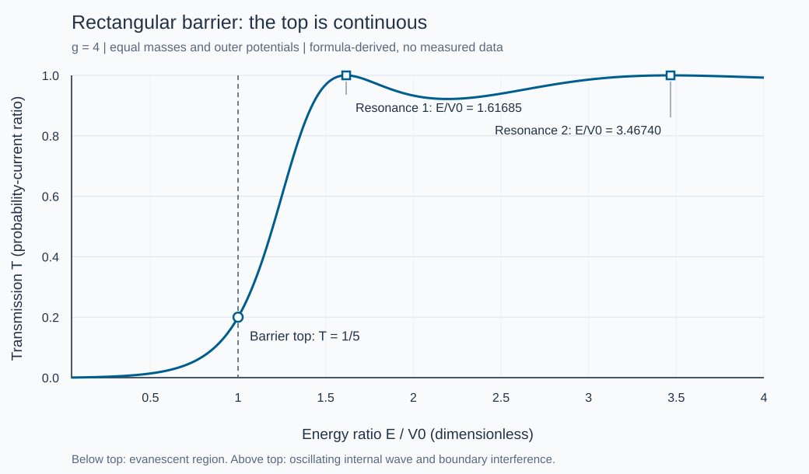

# Q4｜波函数、势阱、谐振子与隧穿

本章是进阶选读。先读 [Q2](02-observables-dynamics.md)，并准备好三项计算技能：求 $\sin(kx)$、$\cos(kx)$ 和 $e^{kx}$ 的导数；用定积分计算区间内的总概率；把试探函数代入二阶微分方程，再用边界条件确定常数。导数描述局部变化，定积分把连续小段的贡献相加，二阶导数是对导数再求一次导数。不熟悉这些技能的读者，可以先看每节的问题、图和结论，暂不做微分方程推导。学习量子算法不要求先完整解完本章。需要从头补一元微积分和二阶线性方程时，可用 [MIT 18.01SC](https://ocw.mit.edu/courses/18-01sc-single-variable-calculus-fall-2010/pages/syllabus/) 和 [18.03](https://ocw.mit.edu/courses/18-03-differential-equations-spring-2010/pages/syllabus/) 的公开课程。

前面主要使用二维列向量。真实粒子的位置却可能连续取值，谐振子也有无穷多个能级。本章说明二能级模型从更大的状态空间中怎样出现，也说明它忽略了什么。所有势阱与势垒例子都指一维、非相对论、质量固定的单粒子模型，不直接代表完整的超导电路或原子。

### 读公式前，用三个算式找回微积分的手感

**导数问“在这一点附近变得多快”。** 若函数 $g(x)=2x$，把位置从 $x$ 增加一小段 $\Delta x$，数值增加 $2\Delta x$，所以变化率 $\Delta g/\Delta x=2$；当小段趋近于零，导数仍是 $g'(x)=2$。波形 $\sin(kx)$ 的导数是 $k\cos(kx)$，再求一次是 $-k^2\sin(kx)$。后文看见 $\phi''=-k^2\phi$，便可试 $\phi=\sin(kx)$ 并把它代回去检查；此处并不要求先会独立解所有微分方程。

**积分问“把整个区间的小贡献加起来有多少”。** 若 $0<x<L$ 上的概率密度恒为 $1/L$，长度为 $b-a$ 的区间概率是

$$
\Pr(a<x<b)=\int_a^b\frac1L\,dx=\frac{b-a}{L}.
$$

例如从 $L/4$ 到 $3L/4$ 占井宽一半，**在这个恒定密度示例中**概率就是 $1/2$；下文势阱基态的密度并不恒定，同一区间会算出不同的数。波函数若有起伏，便把常数 $1/L$ 换成随位置变化的 $|\psi(x)|^2$；积分仍做同一件事。以上两种语言都先说明了**输入和输出是什么**：导数输出局部变化率，积分输出一段区间的总量。后面的势阱计算会多用一次三角函数积分，旁边也写出所用恒等式。

## 1. 波函数是另一种写量子态的方法

在离散基中，$|\psi\rangle=\sum_j c_j|j\rangle$，系数为 $c_j=\langle j|\psi\rangle$。用位置来标记状态时，对应的振幅写作

$$
\psi(x,t)=\langle x|\psi(t)\rangle.
$$

它不是粒子的轨迹，也不是通常意义上的物质密度。位置测量的概率由

$$
\Pr(a\le x\le b)=\int_a^b|\psi(x,t)|^2\,dx
$$

给出，因此归一化条件是 $\int_{-\infty}^{\infty}|\psi|^2dx=1$。这里 $|x\rangle$ 是连续谱使用的广义基记号，不是一个可归一化、能被无限精确制备的位置态。

若 $x$ 用米计，$|\psi|^2$ 的量纲为每米，$\psi$ 为米的负二分之一次方。概率密度不是概率：密度的数值可以大于 1，只有乘上区间长度并积分后才得到无量纲概率。对连续概率密度，恰落在一个数学点的概率为零，但落在有限探测区间的概率可以非零。波函数与概率解释的基础可对照 [MIT 第 5、6 讲](https://ocw.mit.edu/courses/8-04-quantum-physics-i-spring-2016/pages/lecture-notes/)。

### 一个最小归一化计算

若某时刻在 $0<x<L$ 内振幅为常数 $A$，外面为零，则

$$
1=\int_0^L|A|^2dx=|A|^2L.
$$

取实正的全局相位约定，$A=1/\sqrt L$。于是落在中间三分之一长度内的概率为 $(1/L)(L/3)=1/3$。这个分段常数只是演示归一化的平方可积函数；边缘跳变使它不属于下文有限动能、硬壁 Hamiltonian 所需的光滑定义域，不能直接当作硬壁基态。

## 2. 从矩阵方程到微分方程

在整条实线上，对足够光滑且具有适当边界行为的波函数，位置与动量的作用为

$$
(\hat x\psi)(x)=x\psi(x),\qquad
(\hat p\psi)(x)=-i\hbar\frac{d\psi}{dx}.
$$

例如 $d(e^{ikx})/dx=ik e^{ikx}$，所以 $\hat p e^{ikx}=\hbar k e^{ikx}$。$k$ 的单位是每米；整条实线上的单个平面波不能归一化，实际局域粒子要用许多动量成分组成的波包描述。

位置和动量为什么不对易，可以用一条足够光滑、两种复合操作都能作用的试探函数 $f(x)$ 直接检查。先算

$$
(\hat x\hat p f)(x)=-i\hbar x f'(x),
\qquad
(\hat p\hat x f)(x)=-i\hbar\frac d{dx}[xf(x)]
=-i\hbar[f(x)+xf'(x)].
$$

两式相减，$xf'$ 项抵消，留下

$$
([\hat x,\hat p]f)(x)
=[\hat x\hat p-\hat p\hat x]f(x)
=i\hbar f(x).
$$

因此在这些算符共同适用的函数上，简写为 $[\hat x,\hat p]=i\hbar I$。这里的 $i\hbar$ 来自对 $xf$ 求导时的乘积法则；它不是另加的一条任意数值约定。位置和动量是无界算符，等式需带着共同作用域理解，不能不检查边界条件就套到任意函数上。第 5 节会用这一关系计算谐振子的能级。

对实势能 $V(x)$，Hamiltonian 为

$$
\hat H=\frac{\hat p^2}{2m}+V(\hat x),
$$

因此薛定谔方程写成

$$
i\hbar\frac{\partial\psi}{\partial t}
=-\frac{\hbar^2}{2m}\frac{\partial^2\psi}{\partial x^2}+V(x)\psi.
$$

这是同一条状态演化定律在位置表示中的形式，不是另一套量子力学。它也不是由经典能量公式严格证明出来的；从经典表达式寻找算符形式，是建立模型的一步，仍要检查适用条件和实验依据。

连续系统里的算符往往无界，必须连同作用域和边界条件一起定义。尤其不能把有限区间上形式相同的 $-i\hbar d/dx$，在任意边界条件下都直接称为自伴动量算符。本章的势阱能量问题明确使用下一节的硬壁条件。

## 3. 无限深势阱：能级离散怎样出现

把粒子限制在 $0<x<L$，内部势能为零，边界采用理想硬壁条件

$$
\phi(0)=\phi(L)=0.
$$

这对应无限高势垒的理想极限。我们只要求此处的波函数边界值为零，不另外要求其导数在硬壁两侧连续；有限势能阶跃的边界条件不能不加区分地套用到无限壁。

若 $\hat H\phi=E\phi$，时间因子为 $e^{-iEt/\hbar}$。内部的定态方程为

$$
-\frac{\hbar^2}{2m}\phi''=E\phi.
$$

非零归一化解的能量必须为正。可由分部积分看到

$$
E=\int_0^L\phi^*\hat H\phi\,dx
=\frac{\hbar^2}{2m}\int_0^L|\phi'|^2dx\ge0,
$$

边界项因 $\phi(0)=\phi(L)=0$ 消失；若等于零，则 $\phi$ 为常数，而边界又强迫该常数为零，不能归一化。

令 $k=\sqrt{2mE}/\hbar$，方程变为 $\phi''=-k^2\phi$，通解是

$$
\phi(x)=A\sin kx+B\cos kx.
$$

可以先检查这一步：$d^2\sin(kx)/dx^2=-k^2\sin(kx)$，$d^2\cos(kx)/dx^2=-k^2\cos(kx)$；由于方程是线性的，两者的任意线性组合也满足它。它是二阶常系数方程，需要两个独立解来容纳左右两个边界条件。这里 $A,B$ 是待定复常数，后面的归一化可把整体相位选为实数。

左边界给 $B=0$；右边界给 $\sin(kL)=0$，所以 $kL=n\pi$。$n=0$ 对应零函数，负整数只重复同一物理态，于是取 $n=1,2,\ldots$。

归一化还需计算

$$
1=|A|^2\int_0^L\sin^2\frac{n\pi x}{L}\,dx
=|A|^2\frac L2.
$$

最后得到

$$
\phi_n(x)=\sqrt{\frac2L}\sin\frac{n\pi x}{L},\qquad
E_n=\frac{n^2\pi^2\hbar^2}{2mL^2}.
$$

离散能量在这里来自微分方程与边界条件共同限制，不是预先把能量切成格子。井宽加倍会让所有能级降为原来的四分之一；质量加倍则降为一半。这个理想模型及其边界处理可对照 [MIT 第 11 讲](https://ocw.mit.edu/courses/8-04-quantum-physics-i-spring-2016/resources/mit8_04s16_lecnotes11/)。

图中的振幅有正有负；概率密度始终非负。第二个态中间的零点称为节点。曲线不是粒子在井内来回走的路径。

### 算例：粒子位于中间一半区域的概率

取基态 $n=1$，计算 $L/4<x<3L/4$ 的概率。令 $u=x/L$，使用 $2\sin^2\theta=1-\cos2\theta$：

$$
P=2\int_{1/4}^{3/4}\sin^2(\pi u)\,du
=\left[u-\frac{\sin(2\pi u)}{2\pi}\right]_{1/4}^{3/4}
=\frac12+\frac1\pi\approx0.8183.
$$

区域长度只占一半，概率却超过一半，因为此态的位置密度不是均匀分布。

## 4. 定态密度不变，叠加态密度可以改变

单个能量本征态满足

$$
\psi_n(x,t)=\phi_n(x)e^{-iE_nt/\hbar},\qquad
|\psi_n(x,t)|^2=|\phi_n(x)|^2.
$$

这就是“定态”的含义之一，不是说波函数的复相位不变，也不是说粒子具有一条静止的经典轨迹。

考虑一个自选的两能级叠加：

$$
\psi(x,t)=\frac1{\sqrt2}
\left[\phi_1(x)e^{-iE_1t/\hbar}+\phi_2(x)e^{-iE_2t/\hbar}\right].
$$

两个函数正交，因此总态归一化。把模平方逐项展开，因 $\phi_1,\phi_2$ 均取实值，得到

$$
|\psi|^2=\frac{\phi_1^2+\phi_2^2}{2}
+\phi_1\phi_2\cos\frac{(E_2-E_1)t}{\hbar}.
$$

最后一项是干涉项，随相对相位变化。能量测量始终以各 $1/2$ 概率得到 $E_1,E_2$，平均能量恒为 $5E_1/2$，但位置密度并不固定。

还可以算出落在左半井的概率。两个定态分别在左半井有 $1/2$ 概率，而

$$
\int_0^{L/2}\phi_1\phi_2dx
=\int_0^{1/2}[\cos(\pi u)-\cos(3\pi u)]\,du
=\frac4{3\pi}.
$$

于是

$$
P_{\rm left}(t)=\frac12+\frac4{3\pi}\cos\frac{3E_1t}{\hbar}.
$$

从 $t=0$ 的约 $0.9244$，到 $t=\pi\hbar/(3E_1)$ 的约 $0.0756$，概率发生明显变化，却没有改变能量分布。若一开始制备的是各半概率的两个能量态的经典混合，就没有交叉项，左半井概率始终为 $1/2$。

## 5. 谐振子：为什么经常遇到等间隔能级

若一个平滑势能在稳定平衡点附近有严格正的曲率，把坐标原点移到该点，保留到二阶可写成

$$
V(x)\approx V(0)+\frac12m\omega^2x^2.
$$

线性项因平衡条件为零。只有在振幅足够小、较高阶项可忽略时，这个近似才好；曲率为零的特殊平衡点不适用。能量常数 $V(0)$ 不改变能级间距，下面将其设为零。

谐振子 Hamiltonian 是

$$
\hat H=\frac{\hat p^2}{2m}+\frac12m\omega^2\hat x^2.
$$

定义无量纲的降阶与升阶算符

$$
\hat a=\sqrt{\frac{m\omega}{2\hbar}}\hat x
+\frac{i\hat p}{\sqrt{2m\hbar\omega}},\qquad
\hat a^\dagger=\sqrt{\frac{m\omega}{2\hbar}}\hat x
-\frac{i\hat p}{\sqrt{2m\hbar\omega}}.
$$

“降阶”指降低一个能量阶梯，不是降低空间位置。利用第 2 节从位置表示推得的 $[\hat x,\hat p]=i\hbar I$，有

$$
[\hat a,\hat a^\dagger]=I.
$$

令 $c=\sqrt{m\omega/(2\hbar)}$、$d=1/\sqrt{2m\hbar\omega}$，直接展开可核对关键的常数项：

$$
\hat a^\dagger\hat a
=c^2\hat x^2+d^2\hat p^2+icd[\hat x,\hat p]
=\frac{\hat H}{\hbar\omega}-\frac12I.
$$

所以定义 $\hat N=\hat a^\dagger\hat a$ 后，

$$
\hat H=\hbar\omega\left(\hat N+\frac12I\right).
$$

### 为什么阶梯从非负整数开始

首先 $\langle\chi|\hat N|\chi\rangle=\|\hat a|\chi\rangle\|^2\ge0$，所以 $\hat N$ 的本征值不能为负。由对易关系得 $[\hat N,\hat a]=-\hat a$，因此对本征态 $\hat N|\nu\rangle=\nu|\nu\rangle$，

$$
\hat N\hat a|\nu\rangle=(\nu-1)\hat a|\nu\rangle.
$$

先把 $|\nu\rangle$ 归一化。只要降阶后的向量不为零，它的本征值就少 1，而该向量的范数平方是 $\|\hat a|\nu\rangle\|^2=\langle\nu|\hat a^\dagger\hat a|\nu\rangle=\nu$。若没有归一化，右边应是 $\nu\langle\nu|\nu\rangle$。不断下降不能进入负本征值，因此必须在本征值为零的态终止。这使原本征值只能为非负整数。相应的归一化作用与能量为

$$
\hat a|0\rangle=0,\qquad \hat a|n\rangle=\sqrt n\,|n-1\rangle\ (n\ge1),\qquad
\hat a^\dagger|n\rangle=\sqrt{n+1}\,|n+1\rangle,
$$

$$
E_n=\hbar\omega(n+1/2),\qquad n=0,1,2,\ldots.
$$

这里给出了正规化本征态能谱的代数推导；不把它推广为任意 Hamiltonian 都有这样的阶梯。更完整的谱构造见 [MIT 第 14–15 讲](https://ocw.mit.edu/courses/8-04-quantum-physics-i-spring-2016/resources/mit8_04s16_lecnotes14_15/)。

## 6. 基态并不是“位置、动量都等于零”

基态条件 $\hat a|0\rangle=0$ 在位置表示中为

$$
\left(x+\frac{\hbar}{m\omega}\frac d{dx}\right)\phi_0(x)=0.
$$

整理为 $\phi_0'/\phi_0=-m\omega x/\hbar$，积分得到高斯形状；再用高斯积分归一化：

$$
\phi_0(x)=\left(\frac{m\omega}{\pi\hbar}\right)^{1/4}
e^{-m\omega x^2/(2\hbar)}.
$$

偶对称性给 $\langle x\rangle=\langle p\rangle=0$，但二阶矩不为零。由

$$
\int_{-\infty}^{\infty}e^{-\alpha x^2}dx=\sqrt{\pi/\alpha},\qquad
\int_{-\infty}^{\infty}x^2e^{-\alpha x^2}dx=\frac{\sqrt\pi}{2\alpha^{3/2}}
$$

可得 $\Delta x^2=\hbar/(2m\omega)$。又因 $\phi_0'=-(m\omega/\hbar)x\phi_0$，用 $\langle p^2\rangle=\hbar^2\int|\phi_0'|^2dx$ 得

$$
\Delta p^2=\frac{m\hbar\omega}{2},\qquad
\Delta x\Delta p=\frac\hbar2.
$$

动能、势能平均值各为 $\hbar\omega/4$，总能为 $\hbar\omega/2$。这称为零点能；不能由此画出粒子具有确定位置和动量的隐藏振动轨迹，也不能把基态能量当成可无限提取的能源。

在离子阱中，近似谐振的是集体运动模；在电磁模式中，$n$ 可以表示该模式的光子数；在 LC 电路中，对应的广义变量是电荷与磁通。它们共享数学形式，但物理变量不同。理想谐振子的相邻能级等间隔，如何选出可控制的二能级空间，见 [Q3](03-levels-control.md)。

## 7. 隧穿不是暂时违反能量守恒

在势能常数为 $V_0$、粒子能量 $0<E<V_0$ 的区域，定态方程变为

$$
\phi''=\kappa^2\phi,\qquad
\kappa=\frac{\sqrt{2m(V_0-E)}}{\hbar}.
$$

其通解是 $A e^{\kappa x}+B e^{-\kappa x}$，不再是振荡正弦波。对于向右无限延伸的高势能区域，为避免指数发散，只保留衰减解。这说明波函数可进入经典禁止区；但半无限高台阶与有限宽势垒不是同一件事。前者在此能量下没有传到无穷远的概率流，后者可以在另一侧接上传播解。参见 [MIT 第 16 讲](https://ocw.mit.edu/courses/8-04-quantum-physics-i-spring-2016/resources/mit8_04s16_lecnotes16/)。

静态势垒的透射仍使用同一个能量 $E$。不能说粒子“借来一点能量，翻墙后归还”；能量—时间关系也不允许这种解释。

## 8. 有限势垒：从边界匹配算出透射率

取 $0<x<L$ 内 $V=V_0$，两侧 $V=0$，各处质量相同。令 $k=\sqrt{2mE}/\hbar$。左边入射振幅定为 1，反射与透射振幅分别为 $r,t$：

$$
\phi_{\rm left}=e^{ikx}+r e^{-ikx},\qquad
\phi_{\rm right}=t e^{ikx}.
$$

这些定态散射波不按整条实线的范数归一化；透射率用概率流之比定义。对于 $A e^{ikx}$，概率流为

$$
j=\frac\hbar m\operatorname{Im}(\phi^*\phi')
=\frac{\hbar k}{m}|A|^2.
$$

本例两侧的 $k,m$ 相同，故 $T=|t|^2$；若两侧不同，不能省略速度比。概率流定义见 [MIT 第 6 讲](https://ocw.mit.edu/courses/8-04-quantum-physics-i-spring-2016/resources/mit8_04s16_lecnotes6/)。

有限、无奇异项的势阶跃要求 $\phi$ 与 $\phi'$ 连续。用右边界先消去势垒内部的两个系数。记 $F=t e^{ikL}$，由 $\phi(L)=F$、$\phi'(L)=ikF$，势垒内可写成

$$
\phi(x)=F\left[\cosh\kappa(L-x)-i\frac k\kappa\sinh\kappa(L-x)\right].
$$

其中 $\cosh u=(e^u+e^{-u})/2$，$\sinh u=(e^u-e^{-u})/2$。令 $C=\cosh(\kappa L)$、$S=\sinh(\kappa L)$，在左边界得到

$$
1+r=F(C-ikS/\kappa),\qquad
ik(1-r)=F(-\kappa S+ikC).
$$

将第二式除以 $ik$ 后与第一式相加，消去 $r$：

$$
2=F[2C+i(\kappa/k-k/\kappa)S].
$$

因此

$$
t=\frac{e^{-ikL}}{C+\tfrac i2(\kappa/k-k/\kappa)S},
$$

$$
T=\frac1{C^2+\tfrac14(\kappa/k-k/\kappa)^2S^2}
=\left[1+\frac{V_0^2\sinh^2(\kappa L)}{4E(V_0-E)}\right]^{-1}.
$$

最后一步使用 $C^2-S^2=1$ 以及 $k^2+\kappa^2=2mV_0/\hbar^2$。可与 [MIT 6.772 第 6 讲第 6 页的单势垒公式](https://ocw.mit.edu/courses/6-772-compound-semiconductor-devices-spring-2003/cf610e766603218f5e15fe998daf18d4_Lecture6v2.pdf)交叉核对；该讲义采用半导体记号，使用时须先统一能量零点和固定质量模型。

### 算例与厚势垒近似

若 $E=V_0/2$，则 $k=\kappa$，所以 $T=1/\cosh^2(\kappa L)$。取 $\kappa L=1$，得到 $T\approx0.4200$，而不是仅把衰减指数平方所得的 $e^{-2}\approx0.1353$。边界匹配的系数不能随意丢弃。

只有厚势垒 $\kappa L\gg1$ 时，$\sinh(\kappa L)\approx e^{\kappa L}/2$，才有

$$
T\approx\frac{16E(V_0-E)}{V_0^2}e^{-2\kappa L}.
$$

仍取 $E=V_0/2$，在 $\kappa L=3$ 时，精确值约 $0.009866$，此近似约 $0.009915$。式中的指数解释了透射对势垒宽度的敏感性，前因子和近似条件则决定定量计算是否可靠。

### 势垒顶部 $E=V_0$：不能把 $0/0$ 当成透射率

前面的双曲函数式只直接适用于 $0<E<V_0$。当 $E=V_0$ 时，势垒内的方程变为 $\phi''=0$，所以内部解是**线性函数**，不是零波函数，也不是尚有非零 $\kappa$ 的衰减波。仍记 $F=t e^{ikL}$，由右边界 $\phi(L)=F,\phi'(L)=ikF$ 得

$$
\phi(x)=F[1+ik(x-L)].
$$

左边界给 $1+r=F(1-ikL)$、$ik(1-r)=ikF$。后式除以 $ik$ 后与前式相加，得到 $2=F(2-ikL)$。因此

$$
t=\frac{e^{-ikL}}{1-ikL/2},\qquad
T(E=V_0)=\frac1{1+k^2L^2/4}
=\frac1{1+mV_0L^2/(2\hbar^2)}.
$$

从低能一侧取极限也必须回到同一结果：$\sinh(\kappa L)\sim\kappa L$，$\kappa^2=2m(V_0-E)/\hbar^2$，故原式分母里的附加项趋向

$$
\frac{V_0^2\kappa^2L^2}{4E(V_0-E)}
\longrightarrow\frac{mV_0L^2}{2\hbar^2}.
$$

出现的 $V_0-E$ 在极限中抵消，不能直接在原公式里分别代零。达到势垒顶并不使有限宽量子势垒必然透明；两处边界匹配仍会产生反射。

### 高于势垒仍可反射：共振来自边界干涉

当 $E>V_0$，令 $q=\sqrt{2m(E-V_0)}/\hbar$，内部解恢复为振荡波。沿用相同质量、相同外侧势能、仅从左入射的模型，由边界匹配得到

$$
t=\frac{e^{-ikL}}{\cos(qL)-\frac{i}{2}(k/q+q/k)\sin(qL)},
$$

$$
T=\left[1+\frac{V_0^2\sin^2(qL)}{4E(E-V_0)}\right]^{-1}.
$$

模平方的一步用到了 $(k/q+q/k)^2/4-1=(k^2-q^2)^2/(4k^2q^2)$。边界改变了波数，所以通常 $T<1$；只有 $qL=\ell\pi$、$\ell=1,2,\ldots$ 等共振点才恰有 $T=1$。$qL=0$ 的势垒顶须用上一段的连续极限，不能也列为透明共振。共振并不消耗或借出能量，透射波、反射波和入射波使用同一个 $E$。

为方便画图，定义无量纲能量 $e=E/V_0>0$ 与宽度参数 $g=L\sqrt{2mV_0}/\hbar>0$。低于势垒时 $\kappa L=g\sqrt{1-e}$，高于势垒时 $qL=g\sqrt{e-1}$；顶部为 $T=1/(1+g^2/4)$。于是第一、第二个透明共振分别在 $e=1+(\pi/g)^2$ 与 $e=1+(2\pi/g)^2$。

横轴为 $E/V_0$，纵轴为概率流比 $T$，均无量纲。虚线标出势垒顶；圆点为精确顶部值，方形为两个解析共振点。连线来自固定质量的散射公式，不是实测能谱。[原尺寸图](../assets/round71-barrier-transmission.svg)由 [生成器](../../codes/algorithms/round71_figures.py)重建。两侧极限和共振可对照 [MIT 8.04 2013 第 7 份习题答案的式 32–34](https://ocw.mit.edu/courses/8-04-quantum-physics-i-spring-2013/40efdf7cc15a643eeade11c4178e5cf7_MIT8_04S13_ps7_sol.pdf)（PDF 页 6–7；访问于 2026-10-13）。

**练习 A71-Q4（含详解）。** 固定 $g=4$，求势垒顶透射率和第一透明共振能量。若求解程序在 $e=1$ 报除零，应如何修复？用 $e=1\pm10^{-8}$ 检验，是否足以证明整个能区的误差都小？

**解答。** 顶部为 $1/(1+16/4)=1/5=0.2$；第一共振为 $e=1+\pi^2/16\approx1.61685$，因为这时 $qL=\pi$、正弦为零。应在顶部用线性解的公式；附近也可把 $\sinh z/z$ 或 $\sin z/z$ 写成有连续极限 1 的函数，避免单独计算一大一小两个因子。两侧指定输入应趋向 0.2；这只是局部核查，不证明所有能量的数值误差，尤其不检验窄共振是否被网格跳过。运行 `python3 codes/algorithms/round71_checks.py q4`，用内部波的传播矩阵重新解四个边界方程，独立核对三个能区的闭式、概率流守恒 $R+T=1$、顶点和两侧极限。它不模拟波包的有限带宽、有效质量变化或实际器件。

## 9. 这些模型怎样回到量子计算

| 本章对象 | 与量子计算的联系 | 不能省略的限制 |
|---|---|---|
| 两个选定能量态 | 可编码 $\alpha|0\rangle+\beta|1\rangle$ | 其余能级仍存在，驱动可能造成泄漏 |
| 能量差带来的相对相位 | 自由演化或受控旋转 | 必须声明参考系与相位约定 |
| 谐振子运动模或电磁模式 | 相互作用的媒介，也可编码连续变量信息 | 不天然等于一个只含两态的 qubit |
| 势垒耦合 | 帮助理解空间局域态之间的耦合 | 单粒子方势垒不直接等于完整约瑟夫森结模型 |

只选择两个基矢，不足以证明二能级近似有效；还要验证制备、驱动、读出及环境耦合在所需精度下没有把状态带出子空间。接下来可读 [Q3](03-levels-control.md)、[第 09 章硬件](../09-hardware.md)和[第 18 章连续变量部分](../18-channels-capacities-complexity.md)。

## 10. 常见误区

- 波函数不是粒子的运动轨迹，负振幅也不是负概率。
- 能量本征态的密度不随时间变，不等于所有叠加态都如此。
- 硬壁边界和有限势垒边界不能用完全相同的导数条件。
- 零点能与能量守恒并不冲突，也不意味着基态提供无限能源。
- 隧穿不是临时借用能量，半无限禁止区的衰减也不等于存在透射到无穷远的流。
- 量子比特的二维模型是一个有条件的选择，不是说器件的 Hilbert 空间只有两维。

## 11. 自检

1. 在长度 $L$ 的区间内，常数波函数如何归一化？落在其中三分之一长度内的概率是多少？说明概率密度的单位。
2. 无限深势阱中为什么不能取 $n=0$？井宽从 $L$ 加倍到 $2L$ 后，基态能量如何变化？
3. 重算基态落在中间一半井宽内的概率，解释它为什么不是 $1/2$。
4. 第 4 节的等权叠加态在 $t=0$ 与 $t=\pi\hbar/(3E_1)$ 时，左半井概率各是多少？这是否说明能量分布改变？
5. 对谐振子 $|3\rangle$ 作用一次 $\hat a$，结果及其范数是什么？该态原能量与降阶后归一化态的能量分别是多少？
6. 谐振子基态的平均位置和平均动量均为零，为何动能与势能平均值仍非零？求其不确定度乘积。
7. 在 $E=V_0/2$、$\kappa L=1$ 的方势垒例子中计算透射率，并解释为何不能直接用 $e^{-2\kappa L}$。
8. 为什么“选两个能级作为 0 和 1”还不是二能级近似有效的充分论证？

答案见[练习与答案：量子力学 Q4](../appendices/exercises.md#量子力学-q4)。

## 新增诊断练习：计算机里的升降算符为什么不严格满足原对易关系

**题目。** 将谐振子截断成 $d=4$ 维，只保留 $|0\rangle,|1\rangle,|2\rangle,|3\rangle$。按 $a|n\rangle=\sqrt n|n-1\rangle$ 写出矩阵及其共轭转置，求 $[a,a^\dagger]$。它应当等于第 5 节的 $I$ 吗？

**第一步：写出截断实际做了什么。**

$$
a=\begin{bmatrix}0&1&0&0\\0&0&\sqrt2&0\\0&0&0&\sqrt3\\0&0&0&0\end{bmatrix}.
$$

在无限维中，$a^\dagger|3\rangle=2|4\rangle$；在这个四维矩阵中没有 $|4\rangle$，所以截断后的 $a^\dagger|3\rangle=0$。于是

$$
aa^\dagger=\operatorname{diag}(1,2,3,0),\qquad
a^\dagger a=\operatorname{diag}(0,1,2,3),
$$

$$
[a,a^\dagger]=\operatorname{diag}(1,1,1,-3)
=I_4-4|3\rangle\langle3|.
$$

一般 $d$ 维 Fock 截断给 $I_d-d|d-1\rangle\langle d-1|$。这不是浮点误差：任何有限方阵都满足 $\operatorname{Tr}[A,B]=0$，但 $\operatorname{Tr}I_d=d$，所以有限维矩阵根本不可能在整个空间严格满足 $[a,a^\dagger]=I_d$。

**第二步：把误差放回所用状态。** 对归一化 $\rho$，令最高层占据为 $p_{d-1}$，有

$$
\operatorname{Tr}(\rho[a,a^\dagger])=1-dp_{d-1}.
$$

四维时若固定合成占据为 $(0.97,0,0,0.03)$，期望值是 $1-4(0.03)=0.88$，与 1 相差 0.12。若当前最高层为空，这一个期望值可恰好正确，但不能据此保证后续动力学正确：驱动仍可能把概率推到截断边缘。

**工程含义。** 应扩大截止维数并检查关心的占据、能量和演化曲线是否稳定，同时检查最高若干层的占据；只看矩阵指数保持归一化不足以证明无限维模型已收敛。[QuTiP 官方文档的 `destroy(5)` 示例](https://qutip.readthedocs.io/en/stable/guide/guide-states.html)正采用这种有限维降阶矩阵（核查 2026-09-26）；软件没有宣称整个有限矩阵可保持无限维正则对易关系。运行 `python3 codes/foundations/diagnostic_lab.py --case q4`，重算本题所有矩阵对角项与 0.88 的期望。该诊断补充前面的空间网格误差：**网格间距**和**Fock 维数截止**是两种不同的离散近似。

## 配套数值实验与展开答案

把波函数变成数值向量时需要带上根号网格步长；再用四级网格检验无限势阱基态能量的二阶收敛。精确求解离散矩阵，仍不意味着连续问题已没有离散化误差。

题目和逐步解答见[基础实验册](../labs/foundations.md)，本章程序编号为 `q4`。可从[代码说明](../../codes/foundations/README.md)进入独立脚本与保存的运行结果。所有模拟样本均明确标作合成数据，不是硬件实验。

## 参考起点

- Barton Zwiebach，MIT 8.04，[第 5 讲：位置表示与薛定谔方程](https://ocw.mit.edu/courses/8-04-quantum-physics-i-spring-2016/resources/mit8_04s16_lecnotes5/)。
- 同课程，[第 6 讲：归一化与概率流](https://ocw.mit.edu/courses/8-04-quantum-physics-i-spring-2016/resources/mit8_04s16_lecnotes6/)。
- 同课程，[第 11 讲：无限深与有限深势阱](https://ocw.mit.edu/courses/8-04-quantum-physics-i-spring-2016/resources/mit8_04s16_lecnotes11/)。
- 同课程，[第 14–15 讲：谐振子的代数解](https://ocw.mit.edu/courses/8-04-quantum-physics-i-spring-2016/resources/mit8_04s16_lecnotes14_15/)。
- 同课程，[第 16 讲：势阶跃与散射态](https://ocw.mit.edu/courses/8-04-quantum-physics-i-spring-2016/resources/mit8_04s16_lecnotes16/)。
- Clifton G. Fonstad，MIT 6.772，[Lecture 6: Quantum Effects in Heterostructures, II](https://ocw.mit.edu/courses/6-772-compound-semiconductor-devices-spring-2003/cf610e766603218f5e15fe998daf18d4_Lecture6v2.pdf)，第 6 页：单方势垒透射系数。
