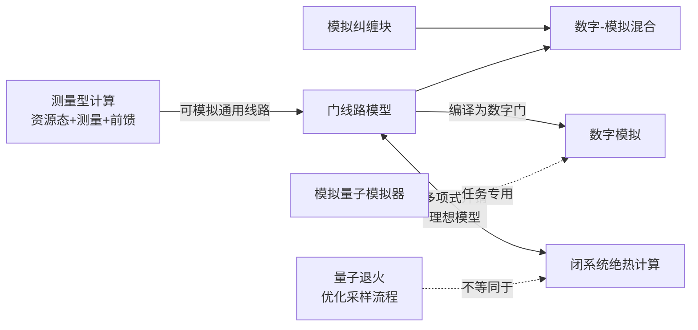

# 第 15 轮：算法与计算模型深度缺口审计

> 日期：2026-09-22  
> 范围：`handbook/00-overview.md` 至 `16-advanced-algorithms-verification.md` 现行文本。  
> 方法：只读审查正文；对时效事实或疑难理论只核对原始论文与官方资料；未修改任何 `handbook` 文件。  
> 分级：**P1** 表示会造成知识主线断裂或明显错误外推，建议下一轮必须补；**P2** 表示现有文字大体正确，但例题、证据或边界不足；**扩展** 表示适合研究生衔接，不宜挤占零基础主线。

## 一、结论摘要

本轮没有发现现行公式的 P0 级硬错误。既有教材在门模型、查询模型、Simon/Grover/Shor、乘积公式、VQE/QAOA 基本边界、数据访问、LCU/block encoding 与验证工具上已相当扎实。新增问题不是第 6 轮所列“完全缺少 LCU/QSVT/量子行走”等旧问题；这些内容已经在第 7 轮后得到落实。

当前真正尚未闭合的主线有四条：

1. **计算模型地图不完整。** 全书几乎默认“量子计算 = 门线路”，只用两句话提到模拟器和退火；测量型量子计算、闭系统绝热计算、实际量子退火、数字—模拟混合模型之间的可编程性、复杂度保证和验证方式尚未建立对应关系。
2. **Hamiltonian 的两种角色没有拆开。** 第 7、16 章主要把 Hamiltonian 当作要模拟的动力学输入；“局域 Hamiltonian 作为判定问题/复杂度完全问题”只出现一句 QMA-complete 结论。承诺间隙、物理谱隙、找基态和验证低能见证因而容易混淆。
3. **现代算法栈仍缺“真正运行一小步”的算例。** 第 16 章的 $P(A)=2A^2-I$ 很适合纠正“逐元素代函数”，却没有展示信号酉如何产生 Chebyshev 多项式；第 7 章只展示 Trotter，没有让读者比较 qDRIFT、Taylor/LCU、qubitization/QSP 与时变 Dyson 方法各自吃什么 oracle。
4. **输出与证据边界虽已写对，却少了第二个可计算实例。** HHL、QAOA、QML、密码分析和委托验证目前主要依靠原则性提醒。初学者需要至少各算一次“为什么解态不是解向量”“为什么单边 QAOA 不代表一般图”“为什么预处理要摊销”“为什么一次 Grover 查询不是一次 AES 调用”“经典验证者究竟依赖什么假设”。

建议工作量汇总：

| 等级 | 数量 | 建议处理 |
|---|---:|---|
| P0 | 0 | 无 |
| P1 | 4 | 下一轮必须补；其中 P1-1、P1-2 可共享一张模型地图 |
| P2 | 8 | 以短小算例、表格和边界句补齐 |
| 扩展 | 6 | 放入第 16 章末或研究项目，不进入零基础必读主线 |

---

## 二、逐章教学与算例审查

| 章 | 当前算例与推导是否足够 | 本轮新发现 | 处理等级 |
|---|---|---|---|
| 00 全景 | 概念边界、加速口径和最小随机数线路足够 | “计算模型”仍等同门模型；应先给模型地图，避免读到第 12 章才第一次见退火/模拟 | P1-1 |
| 01 数学 | 复数、谱分解、张量积、期望和渐近记号足够 | 可在局域 Hamiltonian 补写时回链谱分解；不需改本章 | 0 |
| 02 单比特 | 测量基与测量后态算例足够 | 尚未把“换测量基”连接到“测量本身执行计算” | P1-1 的前置回链 |
| 03 多比特 | Bell、Schmidt、CHSH 与局部不可区分足够 | 簇态不是普通 Bell 对堆叠，可在模型地图中简述，不必扩写本章 | 扩展 E1 |
| 04 电路与协议 | 传态、超密编码、相位回踢推导完整 | 传态已经给 MBQC 最佳前置，但缺“一比特簇态传送”算例 | P1-1 |
| 05 噪声 | 信道、$T_1/T_2$、过程指标足够 | 绝热/退火的开放系统效应应在第 12 章讲，不应塞入噪声章 | 0 |
| 06 算法骨架 | oracle、QFT/QPE、振幅放大和查询下界例题足够 | 无新的 P1/P2；不要再次扩写已有查询下界 | 0 |
| 07 代表算法 | Simon、Grover、Shor、Trotter、AE 已可复算 | 局域 Hamiltonian 判定问题仅有结论；HHL 无二维输出实例；现代模拟只列名 | P1-3、P2-2、P2-3 |
| 08 应用 | 一比特 VQE、单边 QAOA、核集中算例扎实 | QAOA 仍只覆盖一条边；QML 没有摊销阈值算例 | P2-4、P2-5 |
| 09 硬件 | 六条硬件路线和条件指标足够 | 光子章节已提簇态，但未说明它是计算模型；用交叉链接解决即可 | P1-1 的交叉链接 |
| 10 纠错 | 三比特码、Steane、阈值、魔法态和资源边界足够 | 不新增；模型差异下的容错是高级扩展，不应打断本章 | 0 |
| 11 资源与基准 | 条件成功率、吞吐、逻辑基准和端到端账本足够 | 应在模型比较表中复用其资源口径，不需改本章 | 0 |
| 12 安全/前沿 | PQC/QKD/网络例题较完整 | 退火、模拟、门模型只有两段；密码影响缺任务分表和小资源例 | P1-2、P2-6、P2-7、P2-8 |
| 13 信息量度 | 熵、距离、保真度、Holevo 和数据处理算例足够 | 与本轮主题无新缺口 | 0 |
| 14 编译控制 | 门分解、Hamiltonian 控制、动态线路和反馈例题足够 | 数字—模拟混合正好可复用漂移/控制 Hamiltonian，但尚无 echo 算例 | P2-7 |
| 15 实践研究 | 统计、真机复核、经典基线和图表审查足够 | 可增加“模拟器跨尺度验证”和“验证协议假设表”研究项目 | P2-8、扩展 E5 |
| 16 高级算法与验证 | 查询下界、HSP、行走、LCU、精度预算、层析/阴影都已成体系 | QSP 例仍停在矩阵函数；委托验证把不同信任模型压成一行 | P2-1、P1-4 |

这张表中标为 0 的章节不是“没有价值”，而是本轮没有发现不重复旧审计的新缺口。

---

## 三、P1：必须补齐的四项

### P1-1｜建立“计算模型地图”，补测量型量子计算的最小可复算例

**现状。** 第 00 章的全景和第 04 章的协议都以门线路为默认语言；第 09 章光子路线提到簇态和前馈，第 12 章才用两段区分门模型、模拟器和退火。读者会知道这些名词不同，却不知道它们各自把什么当作“程序”，哪些模型在理想条件下可模拟通用门线路。

**为什么是 P1。** 这是“量子计算机是什么”的模型级缺口。测量型量子计算并不是某种测量技巧，而是一种通用计算模型；Raussendorf、Browne 与 Briegel 的原始工作明确以簇态上的单比特测量实现通用量子计算。若全书不展示一次测量如何产生逻辑门，读者会误以为测量只负责最后读出。

**建议落点。**

- 第 00 章在“四个发展阶段”之前加一张模型地图；
- 第 04 章传态之后加半页“一比特簇态传送”；
- 第 09 章光子簇态句回链第 04 章；
- 第 12 章只保留工程边界，不重复数学推导。

**建议模型表。**

| 模型 | 程序由什么指定 | 核心资源 | 理想通用性/能力 | 主要成本不能漏掉 |
|---|---|---|---|---|
| 门线路 | 门序列、连接与测量 | 可控单/双比特门 | 标准 BQP 模型 | 编译、路由、纠错、读出 |
| 测量型计算 | 资源态、测量基、前馈规则 | 簇态/图态、单比特测量 | 合适资源态上可模拟通用线路 | 资源态制备、适应性、丢失、前馈时延 |
| 闭系统绝热计算 | $H(s)$ 路径和总时间 | 可制备初始基态、受控慢变 Hamiltonian | 在标准条件下与线路模型多项式等价 | 最小谱隙、路径导数、温度与控制误差 |
| 量子退火 | 驱动项、问题 Hamiltonian、schedule | 隧穿/量子涨落、采样 | 通常作为优化启发式；不能由设备名称自动推出通用性 | 嵌入、温度、重复、调参、经典基线 |
| 模拟量子模拟 | 目标或同构多体 Hamiltonian | 原生相互作用 | 专用动力学/物性研究 | 模型偏差、可观测量、跨尺度验证 |
| 数字—模拟混合 | 数字脉冲与模拟纠缠块 | 固定多体相互作用加局部控制 | 取决于可控块；某些构造可通用 | 校准、脉冲误差、不可任意开关的耦合 |

**必须加入的手算：测量本身实现 $H$ 门。**

令输入在第一个量子比特上：

$$
|\psi\rangle=a|0\rangle+b|1\rangle,
$$

第二个量子比特制备为 $|+\rangle$，做 $CZ$ 后得到

$$
CZ(|\psi\rangle|+\rangle)
=a|0\rangle|+\rangle+b|1\rangle|-\rangle.
$$

在第一个量子比特上测量 $X$ 基，令结果 $m=0$ 对应 $|+\rangle$，$m=1$ 对应 $|-\rangle$。投影并归一化后，第二个量子比特分别为

$$
H|\psi\rangle,
\qquad
XH|\psi\rangle.
$$

统一写成

$$
X^mH|\psi\rangle.
$$

两个结果各以 $1/2$ 出现。测量结果不是“错误”；它给出一个已知的 Pauli byproduct（伴随算符），后续测量基或最终经典解释必须依据 $m$ 调整。这一例同时解释：资源态为何需要纠缠、测量为何能推进计算、为什么适应性前馈属于计算本身。

**必须写出的边界句。**

> 单次 $X$ 基测量只演示了一个逻辑步；通用 MBQC 还需要足够大的合适图态、非 Clifford 测量角和依赖先前结果的测量基。不能把“能制备一个簇态”直接改写成“已经运行通用容错计算”。

**来源。** Raussendorf–Browne–Briegel，[The one-way quantum computer](https://arxiv.org/abs/quant-ph/0108118)；Broadbent–Fitzsimons–Kashefi 的原始盲计算协议还展示了 MBQC 与委托计算的直接关系，[Universal blind quantum computation](https://arxiv.org/abs/0807.4154)。

### P1-2｜把“绝热计算”和“量子退火”从一句并列改成可计算的边界

**现状。** 第 12 章准确提醒退火、模拟和门模型不同，但“通过改变 Hamiltonian 寻找低能态”太粗。它没有区分：

- 闭系统绝热计算的计算模型与多项式等价定理；
- 理想基态跟随所需的谱隙/路径条件；
- 实际退火器的有限温度、开放系统、冻结、重复采样和嵌入；
- “优化启发式有效”与“证明通用量子加速”是两件事。

**建议落点。** 第 12 章第 11 节扩为三小节：“闭系统绝热模型”“量子退火作为优化流程”“与门模型/模拟器的关系”。

**必须加入的二阶矩阵手算。** 取

$$
H(s)=-(1-s)X-sZ,
\qquad 0\le s\le1.
$$

矩阵为

$$
H(s)=
\begin{pmatrix}
-s&-(1-s)\\
-(1-s)&s
\end{pmatrix}.
$$

因为迹为 0、行列式为 $-[s^2+(1-s)^2]$，本征值是

$$
E_\pm(s)=\pm\sqrt{s^2+(1-s)^2}.
$$

瞬时谱隙为

$$
\Delta(s)=E_+(s)-E_-(s)
=2\sqrt{s^2+(1-s)^2}.
$$

在 $s=1/2$ 取得最小值

$$
\Delta_{\min}=\sqrt2.
$$

$s=0$ 时基态是 $|+\rangle$，$s=1$ 时基态是 $|0\rangle$。这让学生能亲手看见“初始易制备基态—路径—最终问题基态—最小谱隙”的完整链条。

**必须写出的边界句。**

> “变化得足够慢”不是只看总时间。严谨绝热误差界还依赖路径光滑性、$\partial_sH$ 及更高导数、最小谱隙和所用定理；实际退火还会受温度、环境耦合与控制误差影响。上面的常数谱隙二能级例不能外推为一般组合优化实例的高效保证。

**证据。** Aharonov 等证明标准条件下绝热计算与线路模型多项式等价，[Adiabatic Quantum Computation is Equivalent to Standard Quantum Computation](https://arxiv.org/abs/quant-ph/0405098)。Kadowaki–Nishimori 的原始量子退火论文把目标表述为用横场量子涨落寻找对角问题 Hamiltonian 的基态，并在小实例数值比较 schedule，[Quantum Annealing in the Transverse Ising Model](https://arxiv.org/abs/cond-mat/9804280)。两篇论文支持的是不同层次的结论，不应合并成“退火等价通用量子计算”。

### P1-3｜正式定义局域 Hamiltonian 判定问题，区分承诺间隙与物理谱隙

**现状。** 第 7 章复杂度类仅写“带逆多项式 promise gap 的局域 Hamiltonian 问题是 QMA-complete”。这句话正确，但学生尚不知道输入、YES/NO、见证和 gap 分别是什么，也容易把 $b-a$ 与 $E_1-E_0$ 混为一谈。

**建议落点。** 第 7 章复杂度类之后新增一页；第 16 章的验证部分回链，不再另起定义。

**建议正式定义。** 给定

$$
H=\sum_{j=1}^m H_j,
$$

每个 $H_j$ 只作用于至多 $k$ 个量子比特，且给定实数 $a<b$，承诺

$$
b-a\ge \frac1{\operatorname{poly}(n)}.
$$

判定：

- YES：$\lambda_{\min}(H)\le a$；
- NO：$\lambda_{\min}(H)\ge b$；
- 若最低能量落在 $(a,b)$，输入不在承诺内，算法不负责任。

这里 $b-a$ 是**判定阈值的承诺间隙**；物理谱隙通常指

$$
\Delta_{\rm spec}=E_1-E_0.
$$

两者不是同一量。QMA 验证者可把低能量量子态作为见证；“验证存在低能见证”的判定任务、实际制备基态、估计全部谱和模拟动力学也不是同一任务。

**必须加入的能量表手算。** 取

$$
H=\frac{I-Z_1}{2}+\frac{I-Z_2}{2}.
$$

| 基态 | 能量 |
|---|---:|
| $|00\rangle$ | 0 |
| $|01\rangle$ | 1 |
| $|10\rangle$ | 1 |
| $|11\rangle$ | 2 |

若 $a=1/4,b=3/4$，它是 YES 实例，因为 $\lambda_{\min}=0\le a$。此例中承诺间隙为 $1/2$，物理谱隙为 $1$，两者数值已经不同。随后说明：这个 1-local 例可逐项求解；一般 2-local Hamiltonian 问题已是 QMA-complete。复杂度完全性是最坏情形分类，不表示每个物理两体模型都难。

**证据。** Kempe–Kitaev–Regev 证明 2-local Hamiltonian QMA-complete，同时指出 1-local 情形在 P，[The Complexity of the Local Hamiltonian Problem](https://arxiv.org/abs/quant-ph/0406180)。

### P1-4｜把“可验证量子计算”按验证者能力、证明者结构和安全假设拆开

**现状。** 第 16 章验证表把“陷阱测试、交互或密码学验证”放在同一格，边界只写“需要额外假设、轮次或量子能力”。作为总览没有错，但它不足以阻止一个很常见的错误结论：“一台普通经典电脑无条件地验证任意单台量子电脑”。

**建议落点。** 第 16 章 7.1 后新增表格，不展开协议证明。

| 路线 | 验证者能力 | 证明者/设备结构 | 主要保证与代价 |
|---|---|---|---|
| 结果可直接复核 | 经典计算 | 一台量子设备 | 因子、可行解可代回；不证明设备对其他任务正确 |
| 陷阱式 MBQC | 能制备少量单量子比特态或其他小量量子能力 | 一台服务器，交互 | 可有信息论安全；须隐藏陷阱、重复并分析漏检率 |
| 多证明者 rigidity | 纯经典 | 两台或多台不能通信但可共享纠缠的设备 | 用 CHSH rigidity 约束行为；不通信假设很强 |
| 密码学单证明者 | 纯经典 | 一台量子服务器 | 计算安全；Mahadev 路线依赖量子抗性的 LWE 类假设与交互协议 |
| 统计/基准测试 | 经典控制与小规模可算参考 | 一台设备 | 证明某些统计量/线路族吻合，不是通用恶意证明者验证协议 |

**可复算的陷阱直觉例。** 在 $m$ 个数据位置和 1 个隐藏陷阱位置中均匀随机放置陷阱。若攻击只改动一个固定位置，则击中陷阱并被发现的概率是 $1/(m+1)$。这只是“隐藏检查项为何能提供检测概率”的玩具模型，不是完整协议：真实协议还必须处理相干攻击、陷阱与计算的不可区分性、完备性/可靠性和重复放大。

**证据。** Broadbent–Fitzsimons–Kashefi 给出只需客户端制备有限集合单比特态的通用盲计算协议，[arXiv:0807.4154](https://arxiv.org/abs/0807.4154)；Fitzsimons–Kashefi 给出可验证盲计算及指数小漏检率，[arXiv:1203.5217](https://arxiv.org/abs/1203.5217)；Reichardt–Unger–Vazirani 用 CHSH rigidity 实现经典控制多个不通信量子系统，[arXiv:1209.0449](https://arxiv.org/abs/1209.0449)；Mahadev 给出基于量子抗 LWE 假设的单证明者经典验证协议，[arXiv:1804.01082](https://arxiv.org/abs/1804.01082)。

---

## 四、P2：现有结论正确，但算例或证据不足

### P2-1｜QSP/QSVT 例题只算了 $P(A)$，没有算“信号序列怎样生成多项式”

**现状。** 第 16 章的 $A=\operatorname{diag}(1,0)$、$P(x)=T_2(x)$ 很好地说明矩阵函数不是逐元素运算；但这不是 QSP 电路计算。学生仍看不到“交替信号酉与相位旋转”如何在矩阵元素中产生一个多项式。

**建议追加紧邻现例的 6 行手算。** 明确采用一种常见信号约定：

$$
W(x)=
\begin{pmatrix}
x&i\sqrt{1-x^2}\\
i\sqrt{1-x^2}&x
\end{pmatrix},
\qquad x\in[-1,1].
$$

零相位的一次序列左上元是 $x=T_1(x)$；两次信号调用给

$$
W(x)^2=
\begin{pmatrix}
2x^2-1&2ix\sqrt{1-x^2}\\
2ix\sqrt{1-x^2}&2x^2-1
\end{pmatrix},
$$

所以左上元就是

$$
T_2(x)=2x^2-1.
$$

取 $x=1/2$，左上元为 $-1/2$。这一算例把“调用次数 = 多项式次数”“酉矩阵元素在区间上必须有界”和 Chebyshev 多项式连起来。随后提醒：真实 QSP 还插入可调相位；不同文献的信号酉、相位轴和首尾相位约定不同，奇偶条件也随表示方式陈述，不能跨约定照抄相位表。

**来源。** Low–Chuang，[Optimal Hamiltonian Simulation by Quantum Signal Processing](https://arxiv.org/abs/1606.02685)；Gilyén 等，[Quantum Singular Value Transformation and Beyond](https://arxiv.org/abs/1806.01838)。

### P2-2｜现代 Hamiltonian 模拟方法只有名称，没有同一访问模型下的选择表

**现状。** 第 7 章详细算了一阶 Trotter，并准确列出四种输入模型；第 16 章建立 LCU/block encoding/QSP 栈。缺的是“为什么还需要其他模拟算法”及不同方法不能脱离 oracle 比一个孤立大 $O$ 的具体说明。

**建议新增比较表。** 表头必须包含“需要什么访问”“主导量”“精度依赖”“何时直观/合适”，而不是只给复杂度。

| 方法 | 访问与一步操作 | 主要依赖 | 适用直觉 | 不可直接比较的原因 |
|---|---|---|---|---|
| 乘积公式 | 实现各 $e^{-iH_j\tau}$ | 局域项、交换子、阶数 | 局域项易做、想保留结构 | 不以 PREPARE/SELECT 为基本成本 |
| qDRIFT | 按 $|\alpha_j|$ 随机采样 Pauli/酉项 | $\lambda=\sum_j|\alpha_j|$、$t$、$\epsilon$ | 项多但 $\ell_1$ 权重可控 | 给出随机信道近似，不是同一条确定线路 |
| 截断 Taylor/LCU | PREPARE、SELECT、幅度放大 | LCU 权重和、编码成本、$\epsilon$ | 需要更优精度依赖 | oracle 构造可能主导门数 |
| qubitization/QSP | block encoding 及其受控调用 | 归一化 $\alpha$、$t$、$\epsilon$ | 查询复杂度接近最优 | “一次查询”可能是庞大电路 |
| 截断 Dyson | 时间依赖 $H(t)$ 的访问和时间排序 | 积分范数、时间采样、$\epsilon$ | $H$ 明显随时间变化 | 不应把静态算法复杂度原样套用 |

**建议手算：复用第 16 章的 $H=0.6X+0.8Z$。**

$$
\lambda=|0.6|+|0.8|=1.4,
\quad p_X=\frac{3}{7},
\quad p_Z=\frac{4}{7}.
$$

把总时间分成 $N$ 个随机步；每步以相应概率应用

$$
e^{-i(1.4t/N)X}
\quad\text{或}\quad
e^{-i(1.4t/N)Z}.
$$

一阶展开的平均单步为

$$
I-i\frac{1.4t}{N}
\left(\frac37X+\frac47Z\right)
+O(t^2/N^2)
=I-i\frac{t}{N}H+O(t^2/N^2).
$$

这足以解释 qDRIFT 的采样概率和“平均生成元”，但必须注明有限步的严谨误差是对量子信道分析，不是把平均酉等同目标酉。标准 qDRIFT 门数界按 $O(\lambda^2t^2/\epsilon)$ 缩放。

**来源。** Campbell，[A random compiler for fast Hamiltonian simulation](https://arxiv.org/abs/1811.08017)；Berry 等，[truncated Taylor series](https://arxiv.org/abs/1412.4687)；Low–Chuang，[qubitization](https://arxiv.org/abs/1610.06546)；Kieferová–Scherer–Berry，[truncated Dyson series](https://arxiv.org/abs/1805.00582)。

### P2-3｜量子线性系统缺二维“解态—观测量—打印向量”算例

**现状。** 第 7 章已正确列出稀疏性、$\kappa$、态制备和输出限制，却没有让学生亲手归一化一个解态。原则容易被背成口号。

**建议手算。** 取

$$
A=\begin{pmatrix}1&0\\0&2\end{pmatrix},
\qquad |b\rangle=|+\rangle.
$$

未归一化解为

$$
A^{-1}|b\rangle
=\frac1{\sqrt2}\left(|0\rangle+\frac12|1\rangle\right).
$$

归一化后

$$
|x\rangle=\frac{2|0\rangle+|1\rangle}{\sqrt5},
\qquad \kappa=2.
$$

测量 $Z$ 得

$$
\langle Z\rangle_x=\frac45-\frac15=\frac35.
$$

计算基测量只能给 $p_0=4/5,p_1=1/5$ 的样本；它不直接打印两个带符号分量。要恢复一般 $N$ 维全部经典分量，输出本身至少是线性长度。还应增加一句：验证声称的解态也不是免费，Somma–Subaşı 在最坏情形证明验证需对 $|b\rangle$ 制备酉作 $\Omega(\kappa)$ 次调用。

**来源。** HHL 原始论文明确把任务限定为估计与解有关的期望值，[arXiv:0811.3171](https://arxiv.org/abs/0811.3171)；验证下界见 Somma–Subaşı，[arXiv:2007.15698](https://arxiv.org/abs/2007.15698)。

### P2-4｜QAOA 只有单边满分例，容易高估角度迁移和图结构无关性

**现状。** 第 8 章已明确说单边例不证明一般图优势，也要求强经典基线；文字边界正确。但唯一算例恰好可达期望 1，初学者仍缺“同样 $p=1$，邻域就进入公式”的经验。

**建议追加三顶点路径 $1-2-3$。** 对无三角形边 $(u,v)$，在本书的

$$
e^{-i\gamma C}e^{-i\beta B}
$$

约定下，$p=1$ 有

$$
\langle C_{uv}\rangle
=\frac12+\frac14\sin(4\beta)\sin\gamma
\left(\cos^{d_u-1}\gamma+\cos^{d_v-1}\gamma\right).
$$

路径的每条边端点度数为 1 和 2，因此

$$
\langle C_{12}\rangle=\langle C_{23}\rangle
=\frac12+\frac14\sin(4\beta)\sin\gamma(1+\cos\gamma).
$$

取 $\beta=\pi/8,\gamma=\pi/3$：

$$
\langle C_{12}+C_{23}\rangle
=1+\frac{3\sqrt3}{8}
\approx1.64952,
$$

低于最优割 2。这个例子经逐振幅数值复算一致。它比重复单边推导更有教学价值：邻域度数进入期望，单边最优角不能盲目迁移。

**证据边界。** Farhi–Goldstone–Gutmann 原始论文对特定正则图与固定 $p$ 给出结构化分析，[arXiv:1411.4028](https://arxiv.org/abs/1411.4028)；Hastings 给出一些有界深度局部量子算法被经典算法超越的结果，[arXiv:1905.07047](https://arxiv.org/abs/1905.07047)。应据此写“已知特定图族保证/限制”，不能写“QAOA 已普遍胜过经典优化”。

### P2-5｜QML 数据访问表很好，但缺“预处理何时摊得回来”的数值例

**现状。** 第 8 章已经是全书较强的一节：区分显式数组、振幅态、QRAM/$\ell_2$ sampling 和原生量子数据，也提到 Tang 的反量子化与泛化边界。本轮不建议重写这些内容。

**建议只加一个摊销框。** 若数据结构构建成本为 $T_{\rm build}$，每次量子任务成本为 $T_Q$，每次经典任务成本为 $T_C$，复用 $R$ 次时量子路线只有在

$$
T_{\rm build}+RT_Q<RT_C
$$

即

$$
R>\frac{T_{\rm build}}{T_C-T_Q}
$$

时才可能回本。若抽象单位下

$$
T_{\rm build}=10^6,
\quad T_Q=10^3,
\quad T_C=10^5,
$$

则至少需 $R\ge11$ 次复用；若数据每轮更新、相干查询精度提高或态制备要重做，阈值会升高。该例不声称这些数值代表任何具体硬件，只训练“把一次性成本与每次成本分账”。

**来源。** Tang 的原始反量子化结果使用可比较的 $\ell_2$ 采样数据结构，[arXiv:1807.04271](https://arxiv.org/abs/1807.04271)；Huang 等证明有数据时某些难计算量可被经典学习器有效预测，并给出评估量子学习优势的方法，[arXiv:2011.01938](https://arxiv.org/abs/2011.01938)。

### P2-6｜密码影响缺“任务—查询标度—现实资源”分表

**现状。** 第 12 章准确说明 Shor 不破坏所有密码、Grover 查询不是普通 AES 调用。这已经避免最大误导，但把对称密钥、哈希原像、哈希碰撞和公钥问题放在段落中，读者仍容易把它们都概括成“安全位数减半”。

**建议表格。**

| 任务 | 理想量子查询/算法影响 | 不能省略的现实限制 |
|---|---|---|
| 因数分解、有限群离散对数 | Shor 型多项式时间 | 大规模容错模算术、逻辑量子比特、运行时 |
| $k$ 位理想密钥穷举 | Grover 约 $O(2^{k/2})$ 次 oracle | 可逆密码电路、反计算、串行深度、并行折损 |
| $n$ 位哈希原像 | 理想黑箱下 $O(2^{n/2})$ | 完整哈希 oracle 与输出比较电路 |
| 随机函数碰撞 | BHT 查询约 $O(2^{n/3})$，并有空间—时间权衡 | 不是普通 Grover 原像搜索，也不是所有协议的直接攻击成本 |
| PQC KEM/签名 | 参数按已知经典和量子攻击评估 | 不能只按密钥长度套 Grover；看具体结构攻击 |

**建议八位玩具账本。** 一个 8 位唯一密钥空间有 256 个候选，理想 Grover 次数约

$$
\frac\pi4\sqrt{256}=4\pi\approx12.6,
$$

即约 13 次 oracle 调用。每次 oracle 都要可逆实现“用候选密钥加密—比较已知密文—反计算垃圾位”，所以“约 13 次查询”绝不是“约 13 次普通加密”。这个小例只说明口径，不用于现实安全参数。

**来源。** Brassard–Høyer–Tapp 的碰撞算法，[arXiv:quant-ph/9705002](https://arxiv.org/abs/quant-ph/9705002)；Grassl 等的 AES Grover 完整资源分析，[arXiv:1512.04965](https://arxiv.org/abs/1512.04965)；Jaques 等的完整 AES/LowMC oracle 实现与深度约束分析，[arXiv:1910.01700](https://arxiv.org/abs/1910.01700)；NIST 官方 FAQ 明确提醒 Grover 的串行性、并行化和硬件成本会削弱表面平方优势，[PQC FAQ](https://csrc.nist.gov/Projects/Post-Quantum-Cryptography/faqs)。

### P2-7｜数字—模拟混合模型缺一个 echo/refocusing 手算

**现状。** 第 14 章已经给出漂移 Hamiltonian 加控制波形的形式，第 12 章也说模拟与数字门不同，但没有展示“数字脉冲如何重塑固定模拟相互作用”。

**建议算例。** 假设硬件固定漂移为

$$
H_0=J(Z_1Z_2+Z_2Z_3).
$$

执行：演化 $t/2$、对第 1 个量子比特做 $X_1$、再演化 $t/2$、再做 $X_1$。因为

$$
X_1Z_1X_1=-Z_1,
\qquad X_1Z_2X_1=Z_2,
$$

且两个 $ZZ$ 项对易，总操作为

$$
X_1e^{-iH_0t/2}X_1e^{-iH_0t/2}
=e^{-iJtZ_2Z_3}.
$$

$Z_1Z_2$ 被回波抵消，$Z_2Z_3$ 累加。这展示了模拟纠缠块与数字单比特脉冲如何组合，也自然连接第 14 章控制语言。

**边界句。** 理想瞬时脉冲、精确相等耦合和完全对易是这个手算的简化；有限脉冲宽度、串扰和校准误差会破坏精确抵消。某个数字—模拟构造可证明通用，不表示任意“有模拟块的设备”自动通用或自动容错。

**来源。** Parra-Rodriguez 等给出以数字单比特操作结合模拟 Ising 多比特块的通用构造，[Digital-Analog Quantum Computation](https://arxiv.org/abs/1812.03637)。

### P2-8｜模拟器的验证仍停在通用“验证梯子”，缺跨尺度外推规则

**现状。** 第 16 章对态层析、经典阴影、能量证书讲得细；第 15 章也强调小规模精确对照。但模拟量子模拟器输出的往往是动力学、相图和关联函数，不是一个可直接代回的离散答案。现有文字没有专门说明大规模模拟结果怎样建立可信度。

**建议新增“模拟器验证四角形”图表。** 四个角分别是：

1. 小尺寸/短时间与精确对角化或张量网络对照；
2. 检查守恒量、对称性、极限情形和误差条；
3. 在参数重叠区与另一平台或另一算法交叉验证；
4. 改变系统尺寸、时间步、校准参数和测量方案，报告稳定性与外推区间。

箭头中央写“只在这些检查覆盖的 observable、参数区和误差尺度上建立证据”。应明确：局域 observable 吻合不等于全态正确；同一有偏模型既生成预测又拟合实验不算独立验证；从可验证小尺度外推到经典不可算尺度必须给连续的规模趋势。

**可复算练习。** 若守恒量理论值为 1，三个系统尺寸估计为 $0.995\pm0.004$、$0.986\pm0.004$、$0.970\pm0.005$，不能因每个值“接近 1”就忽略随规模单调漂移。要求学生计算各自偏离的标准差数，并判断应先归因于有限尺寸物理还是系统误差；答案必须说仅凭这三个点不能二选一，需要改变校准/测量并与独立方法比较。

**来源边界。** 本项不需引入二手综述；它是把第 15、16 章已有统计与任务特定验证原则应用到模拟输出。若补原始依据，可引用 Lloyd 对通用量子模拟任务的原始定义，[Universal Quantum Simulators](https://doi.org/10.1126/science.273.5278.1073)，并用当前书中已列的实验原论文作为个案，而非引用厂商宣传。

---

## 五、扩展项：适合研究生衔接，不宜阻塞主线

### E1｜簇态稳定子与 MBQC 的两步适应性

在 P1-1 的两比特例之后，可选做三量子比特线形簇态，展示第一次测量结果如何改变第二次测量角的符号。重点不是列完整 measurement calculus，而是让读者看到“适应性决定非 Clifford 门的确定性”。放入第 16 章或练习，不放第 04 章主文。

### E2｜Feynman–Kitaev history state：计算怎样变成基态能量

给两步电路 $U_2U_1$ 定义

$$
|\eta\rangle=\frac1{\sqrt3}
\left(
|\psi_0\rangle|0\rangle_{时钟}
+U_1|\psi_0\rangle|1\rangle_{时钟}
+U_2U_1|\psi_0\rangle|2\rangle_{时钟}
\right),
$$

只解释传播项为何惩罚不一致的相邻时刻。这能连接 QMA、局域 Hamiltonian 与绝热等价，但完整约化太长，应作为“概念桥”而非证明。

### E3｜stoquastic Hamiltonian 与量子 PCP 只做边界盒

可以说明某些基底下非对角元非正的 Hamiltonian 具有不同的 Monte Carlo/复杂度结构；“2-local QMA-complete”不能无条件套到每个受限物理族。量子 PCP 的常数相对误差/常数承诺间隙版本仍是开放方向，不能写成已定理。只需一盒术语和开放问题，不讲完整复杂度动物园。

### E4｜QSP 相位综合做数值实验，不在正文手推高次相位

让学生选择有界目标函数，在离散网格上拟合低次 Chebyshev 多项式，先画最大误差，再把相位求解当软件步骤。报告必须分别列“多项式逼近误差”和“相位/门综合误差”。这样能防止正文陷入相位约定细节，同时把 QSVT 从名词变成可实验对象。

### E5｜委托验证的假设匹配项目

给四种场景：能制备单量子比特客户端、两台隔离服务器、单台服务器且接受密码学假设、答案可直接代回。要求学生选择协议家族并写出完备性、可靠性、隐私性、验证者能力和通信轮数；禁止只写“用 trap 验证”。

### E6｜密码资源估算工作表

把“查询次数”依次展开为：每次可逆 primitive 的 Toffoli/T count、工作位、oracle+uncompute、Grover 迭代、并行机器数、码距/工厂和墙钟时间。只用 8–16 位玩具 primitive 手算；真实 AES 数字直接引用原始资源论文，避免在教材中维护易过时单点估计。

---

## 六、建议新增的图表

### 图 1：计算模型与互相模拟关系



图注必须说明：箭头表示理论模拟或构造关系，不表示相同硬件开销、噪声模型或实用性能；虚线“不同于”不是说二者毫无联系，而是阻止把工程退火产品直接等同理想通用绝热模型。

### 图 2：Hamiltonian 的四种问题，不要用一个“求解”概括

```mermaid
flowchart TD
  H[Hamiltonian H] --> DY[动力学\n实现 exp(-iHt)]
  H --> GS[态制备\n得到低能/基态]
  H --> DEC[判定\nlambda_min <= a 或 >= b]
  H --> OBS[性质估计\n能量/关联/响应]
  DY --> OUT[少数 observable 或样本]
  GS --> OUT
  DEC --> BIT[一个 YES/NO 位]
  OBS --> OUT
```

图注：这些任务可互相约化于某些模型，但输入访问、精度和输出不同；QMA-complete 的局域 Hamiltonian 是判定问题，不是说任意动力学模拟都是 QMA-hard。

### 表 3：算法声明的五层资源

| 层 | 例子 | 常被隐藏的量 |
|---|---|---|
| 数学原语 | QSP 多项式次数、Grover 查询 | 误差范数、失败概率 |
| 数据/算符访问 | block encoding、QRAM、密码 oracle | 构建、更新、受控版本、反计算 |
| 逻辑线路 | T count、辅助位、深度 | 路由、并行约束、测量反馈 |
| 物理容错 | 码距、工厂、周期 | 解码、可用率、重试 |
| 输出验证 | shots、证书、直接代回 | 全态不可读、验证者假设 |

此表可跨 HHL、QML、AES-Grover、模拟和验证复用，避免每节重新发明“不要忽略成本”的提醒。

---

## 七、建议新增练习与答案骨架

以下题目均能手算，不依赖大型软件；适合追加到相应章的练习，不要求全部进入正文。

### 题 1（第 04 章，MBQC）

从 $CZ(|\psi\rangle|+\rangle)$ 出发，分别投影第一个量子比特到 $|+\rangle$、$|-\rangle$，证明输出为 $H|\psi\rangle$、$XH|\psi\rangle$，并算两结果概率。

**答案骨架：** 未归一化输出各带 $1/\sqrt2$；范数平方均为 $1/2$；统一为 $X^mH|\psi\rangle$。

### 题 2（第 12 章，绝热）

对 $H(s)=-(1-s)X-sZ$ 求本征值、最小谱隙和端点基态。

**答案骨架：** $E_\pm=\pm\sqrt{s^2+(1-s)^2}$；$\Delta_{\min}=\sqrt2$，在 $s=1/2$；端点为 $|+\rangle$ 与 $|0\rangle$。

### 题 3（第 07 章，局域 Hamiltonian）

列出 $H=(I-Z_1)/2+(I-Z_2)/2$ 的能谱。对 $a=1/4,b=3/4$ 判断 YES/NO，并分别给承诺间隙和物理谱隙。

**答案骨架：** 能量 $0,1,1,2$；YES；$b-a=1/2$，$E_1-E_0=1$。

### 题 4（第 16 章，QSP）

直接平方 $W(x)$，验证左上元为 $T_2(x)$；代入 $x=0,1/2,1$ 检查有界性与奇偶性。

**答案骨架：** 左上元 $2x^2-1$；值为 $-1,-1/2,1$；次数 2、偶多项式、区间内绝对值不超过 1。

### 题 5（第 07 章，qDRIFT）

对 $H=0.6X+0.8Z$ 写出 $\lambda$、采样概率和单步两种旋转；用一阶展开验证平均生成元。

**答案骨架：** $\lambda=1.4$，$p_X=3/7,p_Z=4/7$；平均一阶项为 $-itH/N$。

### 题 6（第 07 章，QLSA）

对 $A=\operatorname{diag}(1,2)$ 和 $|b\rangle=|+\rangle$ 求归一化 $|x\rangle$、$\kappa$、$\langle Z\rangle$，说明计算基样本为何不能恢复一般实振幅符号。

**答案骨架：** $|x\rangle=(2|0\rangle+|1\rangle)/\sqrt5$，$\kappa=2$，$\langle Z\rangle=3/5$；计算基只给模平方。

### 题 7（第 08 章，QAOA）

使用给出的无三角边公式计算三顶点路径在 $\beta=\pi/8,\gamma=\pi/3$ 的总期望，并与最优割 2 比较。

**答案骨架：** 每边 $1/2+3\sqrt3/16$，总计 $1+3\sqrt3/8\approx1.64952$。

### 题 8（第 08 章，QML 摊销）

若 $T_{\rm build}=10^6,T_Q=10^3,T_C=10^5$，求最小整数复用次数 $R$；若数据每 5 次查询必须重建，判断原结论是否仍成立。

**答案骨架：** 单次构建时 $R>10.101\ldots$，故 $R\ge11$；每 5 次重建时每批 $10^6+5\times10^3>5\times10^5$，不回本。

### 题 9（第 12 章，密码）

估算 8 位唯一密钥的理想 Grover 次数，并列出一次 oracle 至少包含哪三步。

**答案骨架：** 约 13 次；可逆加密、与目标密文比较/相位标记、反计算工作位。还要有扩散操作，不能把查询数当总门数。

### 题 10（第 14 章，数字—模拟）

证明 echo 序列从 $J(Z_1Z_2+Z_2Z_3)$ 消去 $Z_1Z_2$。若第二段时间是 $(1+\delta)t/2$，写出残余 $Z_1Z_2$ 旋转的一阶量级。

**答案骨架：** 理想总演化为 $e^{-iJtZ_2Z_3}$；不平衡留下量级 $J\delta t/2$ 的 $Z_1Z_2$ 相位（整体符号随序列记法说明）。

### 题 11（第 16 章，验证假设）

分别为“客户端能制备单比特态”“两台隔离服务器”“一台服务器且接受 LWE 假设”匹配合适验证路线，并说明哪一项不是无条件纯经典单服务器验证。

**答案骨架：** 陷阱式 MBQC；多证明者 rigidity；Mahadev 类密码学协议。第三项为计算安全而非信息论无条件。

### 题 12（第 15 章，模拟验证）

对守恒量估计 $0.995\pm0.004$、$0.986\pm0.004$、$0.970\pm0.005$，计算相对理论值 1 的偏差标准差。

**答案骨架：** 约 $1.25\sigma,3.5\sigma,6\sigma$；存在显著随规模漂移，但仅凭三点不能判定有限尺寸物理还是系统误差。

---

## 八、实施顺序与篇幅控制

建议下一轮按以下顺序实施：

1. **先补 P1-1、P1-2、P1-3。** 三项共同建立“计算模型—Hamiltonian—复杂度”的主干；每项控制在 1–1.5 页。
2. **再补 P1-4 与 P2-1、P2-3。** 这三项直接改善第 16 章和 HHL 的可计算性。
3. **P2-2、P2-4、P2-5、P2-6、P2-7 以表格加一个小例为主。** 不要改写已有正确段落。
4. **P2-8 放第 15 章研究方法，不放算法主干。**
5. **扩展项最多选择 E2、E4、E5 三项。** 其余保留在研究项目清单，防止教材重新变成名词堆砌。

预计正文净增约 3,500–5,000 个中文字符，加 3 张表、2 张关系图、8–12 道题。若篇幅更紧，可优先保留 P1 全部、P2-1/P2-3/P2-4/P2-6，把其他 P2 只做交叉链接或练习。

---

## 九、容易写错或过度外推的句子

后续修订应主动搜索并避免以下表述：

1. “测量会破坏量子态，所以不能用于计算中间步骤。”——MBQC 正是用测量和前馈推进计算。
2. “绝热计算等价门模型，所以商用退火器就是通用量子计算机。”——等价定理的理想模型、相互作用和控制条件不能直接移植。
3. “运行时间只要大于 $1/\Delta_{\min}^2$ 就一定绝热。”——具体界依赖定理、路径导数、光滑性和误差定义。
4. “局域 Hamiltonian 的 promise gap 就是基态到第一激发态的谱隙。”——两者定义不同。
5. “2-local Hamiltonian 都是 QMA-hard。”——完全性是一个输入族的最坏情形结论，受限模型可容易。
6. “QSP 对矩阵逐元素应用多项式。”——作用于编码的谱/奇异值结构。
7. “两次信号调用能实现任何二次多项式。”——还受酉性、有界性、奇偶性和约定约束。
8. “qDRIFT 的平均随机酉等于目标酉。”——算法分析的是随机信道的逼近；一阶平均生成元只是直觉。
9. “QLSA 以对数时间输出整个解。”——通常输出量子态或少数 observable。
10. “单边 QAOA 可达最优，所以 $p=1$ 对一般图也足够。”——图的局部邻域进入期望。
11. “给经典算法同样的显式数组就算公平数据访问。”——若量子算法免费获得 QRAM/$\ell_2$ sampling，比较对象也要明确预处理与采样能力。
12. “量子攻击把所有密码安全位数减半。”——原像、碰撞、结构化公钥问题和具体资源不同。
13. “一个隐藏 trap 通过就证明整台设备正确。”——只给受协议和攻击模型限定的漏检概率。
14. “经典验证者可以无条件验证单个任意量子服务器。”——现有路线需要小量量子能力、多证明者隔离或计算假设等条件。

---

## 十、原始论文与官方证据索引

本轮没有用二手新闻或厂商营销材料支撑理论结论。

### 计算模型与 Hamiltonian complexity

1. Raussendorf, Browne, Briegel, [The one-way quantum computer — a non-network model of quantum computation](https://arxiv.org/abs/quant-ph/0108118)：簇态上的单比特测量模型及通用性。
2. Aharonov et al., [Adiabatic Quantum Computation is Equivalent to Standard Quantum Computation](https://arxiv.org/abs/quant-ph/0405098)：绝热与标准线路计算的多项式等价。
3. Kadowaki, Nishimori, [Quantum Annealing in the Transverse Ising Model](https://arxiv.org/abs/cond-mat/9804280)：横场退火优化的原始框架与小规模数值证据。
4. Kempe, Kitaev, Regev, [The Complexity of the Local Hamiltonian Problem](https://arxiv.org/abs/quant-ph/0406180)：2-local QMA-complete，1-local 在 P。
5. Parra-Rodriguez et al., [Digital-Analog Quantum Computation](https://arxiv.org/abs/1812.03637)：数字单比特操作加模拟 Ising 纠缠块及通用构造。

### 模拟、QSP/QSVT 与线性系统

6. Berry et al., [Simulating Hamiltonian dynamics with a truncated Taylor series](https://arxiv.org/abs/1412.4687)：LCU/Taylor 与对精度的对数依赖。
7. Low, Chuang, [Optimal Hamiltonian Simulation by Quantum Signal Processing](https://arxiv.org/abs/1606.02685)：QSP 信号处理框架与近最优模拟。
8. Low, Chuang, [Hamiltonian Simulation by Qubitization](https://arxiv.org/abs/1610.06546)：block encoding 的二维不变子空间与 qubitization。
9. Gilyén et al., [Quantum Singular Value Transformation and Beyond](https://arxiv.org/abs/1806.01838)：奇异值多项式变换、限制和算法统一框架。
10. Campbell, [A random compiler for fast Hamiltonian simulation](https://arxiv.org/abs/1811.08017)：qDRIFT 按项权重采样及 $\lambda$ 依赖。
11. Kieferová, Scherer, Berry, [Simulating the dynamics of time-dependent Hamiltonians with a truncated Dyson series](https://arxiv.org/abs/1805.00582)：时变 Hamiltonian 的时间排序模拟。
12. Harrow, Hassidim, Lloyd, [Quantum algorithm for solving linear systems of equations](https://arxiv.org/abs/0811.3171)：量子态输出和期望值任务。
13. Somma, Subaşı, [Complexity of quantum state verification in the quantum linear systems problem](https://arxiv.org/abs/2007.15698)：QLS 解态验证对 $\kappa$ 的下界。

### 优化、学习与密码

14. Farhi, Goldstone, Gutmann, [A Quantum Approximate Optimization Algorithm](https://arxiv.org/abs/1411.4028)：QAOA 原始定义及特定正则图保证。
15. Hastings, [Classical and Quantum Bounded Depth Approximation Algorithms](https://arxiv.org/abs/1905.07047)：有界深度局部量子优化算法的限制性比较。
16. Tang, [A quantum-inspired classical algorithm for recommendation systems](https://arxiv.org/abs/1807.04271)：在可比 $\ell_2$ 采样访问下的反量子化。
17. Huang et al., [Power of data in quantum machine learning](https://arxiv.org/abs/2011.01938)：经典数据可改变学习优势比较，及可证明分离的限定。
18. Brassard, Høyer, Tapp, [Quantum Algorithm for the Collision Problem](https://arxiv.org/abs/quant-ph/9705002)：$O(N^{1/3})$ 碰撞查询和空间—时间权衡。
19. Grassl et al., [Applying Grover's algorithm to AES: quantum resource estimates](https://arxiv.org/abs/1512.04965)：AES 可逆电路、逻辑门、深度与量子比特成本。
20. Jaques et al., [Implementing Grover oracles for quantum key search on AES and LowMC](https://arxiv.org/abs/1910.01700)：完整 oracle 实现与深度约束。
21. NIST, [Post-Quantum Cryptography FAQs](https://csrc.nist.gov/Projects/Post-Quantum-Cryptography/faqs)：官方说明 Grover 串行性、并行化和现实成本对对称密码判断的影响。

### 可验证量子计算

22. Broadbent, Fitzsimons, Kashefi, [Universal blind quantum computation](https://arxiv.org/abs/0807.4154)：小量量子客户端与两服务器经典客户端路线。
23. Fitzsimons, Kashefi, [Unconditionally verifiable blind computation](https://arxiv.org/abs/1203.5217)：陷阱式可验证盲计算与漏检率放大。
24. Reichardt, Unger, Vazirani, [Classical command of quantum systems via rigidity of CHSH games](https://arxiv.org/abs/1209.0449)：多证明者不通信假设与 rigidity。
25. Mahadev, [Classical Verification of Quantum Computations](https://arxiv.org/abs/1804.01082)：单量子证明者、纯经典验证者和量子抗 LWE 假设。

## 十一、最终判定

- **P0：0。** 未发现现行教材需要立即纠正的公式硬错误。
- **P1：4。** 计算模型地图/MBQC、绝热与退火边界、局域 Hamiltonian 正式问题、委托验证假设分类。
- **P2：8。** QSP 电路级小例、现代模拟方法表、QLSA 解态例、非平凡 QAOA 例、QML 摊销、密码任务分表、数字—模拟 echo、模拟器跨尺度验证。
- **扩展：6。** 三比特 MBQC、history state、stoquastic/quantum PCP、QSP 相位实验、验证假设项目、密码资源工作表。

本轮结论不是“继续堆更多高级术语”，而是给现有强主线补上四种闭环：**模型如何执行一步、复杂度问题究竟问什么、算法输出究竟是什么、声称正确究竟依赖什么证据。**
