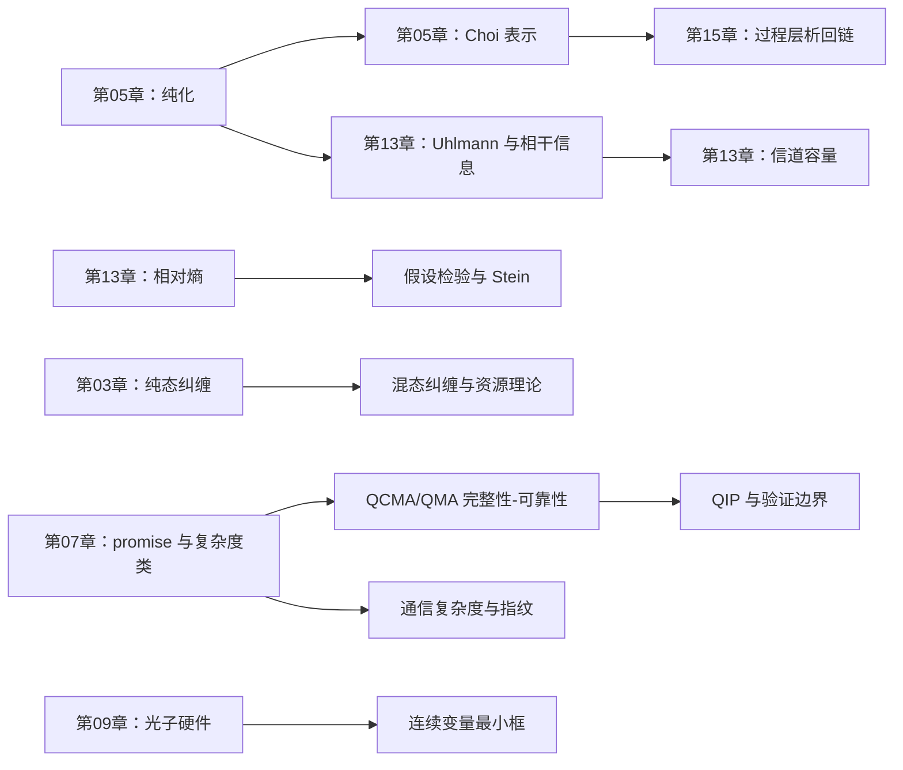

# 第 15 轮：“新知识边界”数学与量子信息缺口审计

日期：2026-09-22

## 1. 审计范围与总判断

本轮只审不改 `handbook/`。重点阅读了第 03、05、07、09、10、12、13、15、16 章及术语表，并对照第 6、8、10 轮报告，排除了已经解决的保真度约定、Holevo 维数上界、相对熵措辞、复杂度包含关系、QPE、block encoding 等旧问题。

当前 17 章已经形成一条可靠的“量子态—电路—噪声—算法—纠错—熵与距离—验证”主线；本轮没有发现现有公式错误。新的问题不是已有内容写错，而是研究生入口在三处仍然断开：

1. 第 05 章从 Kraus/Stinespring 直接跳到噪声模型，第 15 章却直接使用“重构 Choi 矩阵”，中间缺少纯化与 Choi–Jamiołkowski 对应；
2. 第 13 章讲到 Holevo 量，却没有把“一个编码集合的可访问量”推进到“一个信道在很多次使用下的可靠传输率”；
3. 第 07 章列出 BQP、QMA、QIP 的结论，却还没有把 QCMA、完整性/可靠性和交互协议模型讲成读者可操作的定义。

优先级统计：

| 等级 | 数量 | 含义 |
|---|---:|---|
| P1 | 3 | 应进入正文；否则现有章节之间存在直接术语或概念断层 |
| P2 | 5 | 建议进入正文或短专题；不影响现有正确性，但影响入门研究生继续阅读论文 |
| 延伸项 | 6 | 应列延伸阅读，不宜在本书主线展开证明 |

这里的 P1/P2 是“知识结构缺口”的优先级，不表示当前正文包含错误。

## 2. P1：应补入正文的三条主线

### P1-1｜纯化与 Uhlmann 定理：把混态、环境和根保真度接起来

**现状**

- 第 05 章用系统—环境酉演化推出 Kraus 表示；
- 第 13 章直接定义根保真度并陈述单调性；
- 全书没有正式定义纯化，也没有解释不同纯化为何只差辅助系统上的等距变换。

这使“环境保存了被丢弃的信息”“混态可以看作更大纯态的边缘态”“根保真度是纯化重叠的最优值”仍是三段孤立知识。

**精确落点**

在 `handbook/05-noise-channels.md` 第 2 节“纯态和混态”之后增加 1–1.5 页“纯化：把混态放回更大纯态”；第 13 章保真度节只回链，不重复证明。

**最低正文内容**

若

$$
\rho_A=\sum_i\lambda_i|i\rangle\langle i|,
$$

则一个标准纯化为

$$
|\psi_\rho\rangle_{AR}
=\sum_i\sqrt{\lambda_i}|i\rangle_A|i\rangle_R,
\qquad
\operatorname{Tr}_R|\psi_\rho\rangle\langle\psi_\rho|=\rho_A.
$$

辅助空间只需容纳 `rank(ρ)` 个正特征值。不同纯化不是不同的物理混态；在足够大的辅助空间上，它们由 $R$ 上的等距变换联系。

按本书采用的根保真度约定，Uhlmann 定理应写成

$$
F(\rho,\sigma)
=\max_{|\psi_\rho\rangle,|\psi_\sigma\rangle}
|\langle\psi_\rho|\psi_\sigma\rangle|,
$$

而不是把右侧再平方。这个公式可作为“信道后保真度不减”的证明路线，不必在主线完成全部矩阵分析。

**可手算例**

1. $I/2$ 的 Bell 纯化：$|\Phi^+\rangle=(|00\rangle+|11\rangle)/\sqrt2$，偏迹得 $I/2$。
2. $\rho=0.8|0\rangle\langle0|+0.2|1\rangle\langle1|$ 的标准纯化为 $\sqrt{0.8}|00\rangle+\sqrt{0.2}|11\rangle$；逐项偏迹，显示非对角辅助项为何消失。

**图表建议**

画一张三层图：大系统纯态 $|\psi\rangle_{AR}$ → 丢弃 $R$ → 混态 $\rho_A$；另一条线从 $R$ 上的等距变换返回“同一个 $\rho_A$ 的另一纯化”。

**前置知识**：谱分解、Schmidt 分解、偏迹。

**风险护栏**

- 纯化不是说实验室“实际上一定存在一个可访问环境”；它是表示与构造工具。
- 不要把密度矩阵的一种凸分解误认为唯一纯化。
- Uhlmann 公式必须遵守本书“根保真度”约定。

### P1-2｜Choi–Jamiołkowski 对应：给第 15 章已使用的术语补定义

**现状**

`handbook/15-practice-research.md` 已要求一般单比特过程层析“重构 Choi 矩阵或 Pauli transfer matrix”，第 05 章参考文献也列出 Choi 1975，但正文没有定义 Choi 矩阵。读者无法判断“正矩阵”“完全正”“保迹”分别在 Choi 表示中对应什么条件。

**精确落点**

在 `handbook/05-noise-channels.md` 第 4.1 节之后加入“4.2 Choi 矩阵：把信道写成一个二分算子”，原复位信道小节顺延；第 15 章只加回链。

**必须先固定归一化约定**

推荐用未归一化最大纠缠向量

$$
|\Omega\rangle=\sum_{i=0}^{d_A-1}|i\rangle_{A'}|i\rangle_A,
$$

并定义

$$
J_{\mathcal E}
=(I_{A'}\otimes\mathcal E_{A\to B})
(|\Omega\rangle\langle\Omega|)
=\sum_{i,j}|i\rangle\langle j|\otimes
\mathcal E(|i\rangle\langle j|).
$$

随后给出三条可直接使用的判据：

$$
\mathcal E\text{ 完全正}\iff J_{\mathcal E}\succeq0,
$$

$$
\mathcal E\text{ 保迹}\iff
\operatorname{Tr}_B J_{\mathcal E}=I_{A'},
$$

$$
\mathcal E(X)=
\operatorname{Tr}_{A'}[(X^T\otimes I_B)J_{\mathcal E}].
$$

转置依赖定义 $|\Omega\rangle$ 时选定的基。若改用归一化 $|\Phi\rangle=|\Omega\rangle/\sqrt d$，则 Choi 态为 $J/d$，保迹条件变成边缘态 $I/d$；两套约定不能混写。

**可手算例**

对复位信道 $\mathcal R(X)=\operatorname{Tr}(X)|0\rangle\langle0|$：

$$
J_{\mathcal R}=I_{A'}\otimes|0\rangle\langle0|.
$$

它显然半正定，且 $\operatorname{Tr}_B J_{\mathcal R}=I_{A'}$。这一例可直接复用第 05 章已有 Kraus 算子，展示 Kraus 与 Choi 是同一信道的两种表示。

**图表建议**

用线框图并排画“信道盒子”和“把最大纠缠态一半送入信道后的 Choi 算子”；在旁边列 Kraus、Choi、Pauli transfer matrix 三种表示分别适合模拟、凸优化/物理性约束和实验重构。

**前置知识**：外积、张量积、偏迹、完全正。

**风险护栏**

- $J\succeq0$ 只给完全正；保迹必须另查偏迹条件。
- “Choi 态”通常指归一化版本；“Choi 矩阵”可能未归一化，必须报约定。
- 过程层析得到的 Choi 估计仍受 SPAM 偏差影响，不能把矩阵物理性约束当作已消除系统误差。

### P1-3｜从 Holevo 量到信道容量：补上“多次使用、编码与可靠率”

**现状**

第 13 章已经正确讲清一个量子态集合的 Holevo 量、可访问信息和 $\chi\le\log d$，但“Holevo 量”容易被读者直接当作所有量子信道的容量。第 12 章又多次使用“密钥率、生成率、端到端率”，却没有一张容量资源表。

**精确落点**

在 `handbook/13-quantum-information.md` Holevo 节之后增加 3–4 页“量子信道不只有一种容量”；第 12 章只链接到这张表。

**第一步：定义容量而不是先给公式**

容量是 $n$ 次信道使用、允许跨多次使用联合编码/解码时，在错误趋于零的条件下每次使用可可靠传输的渐近速率。至少区分：

| 记号 | 传输对象 | 额外免费资源 | 单位 |
|---|---|---|---|
| $C(\mathcal N)$ | 经典信息 | 无预共享纠缠 | bit/use |
| $Q(\mathcal N)$ | 未知量子信息 | 无辅助 | qubit/use |
| $P(\mathcal N)$ | 对窃听环境保密的经典信息 | 需声明公共通信模型 | secret bit/use |
| $C_E(\mathcal N)$ | 经典信息 | 无限预共享纠缠 | bit/use |

这些量不能只用“信道保真度”代替，也不能直接换算成每秒吞吐；后者还要乘尝试率并计入编码块长、延迟和失败重试。

**第二步：只给足以看懂论文的公式地图**

定义信道的一次 Holevo 量

$$
\chi(\mathcal N)=\max_{\{p_x,\rho_x\}}
\left[
S\!\left(\sum_xp_x\mathcal N(\rho_x)\right)
-\sum_xp_xS(\mathcal N(\rho_x))
\right].
$$

一般无辅助经典容量需要正则化：

$$
C(\mathcal N)
=\lim_{n\to\infty}\frac1n
\chi(\mathcal N^{\otimes n}).
$$

量子容量用相干信息

$$
I_c(\rho,\mathcal N)
=S(B)-S(RB)=-S(R|B),
$$

其中 $|\psi_\rho\rangle_{RA}$ 是 $\rho_A$ 的纯化，$RB=(I_R\otimes\mathcal N)(\psi_\rho)$。一般情形同样要写成多次使用后的正则化极限，而不是暗示一次优化总是充分。

$$
Q(\mathcal N)
=\lim_{n\to\infty}\frac1n
\max_{\rho^{(n)}}
I_c(\rho^{(n)},\mathcal N^{\otimes n}).
$$

预共享纠缠辅助经典容量有单字母公式

$$
C_E(\mathcal N)=\max_{\rho_A}I(R:B).
$$

这正好连接第 04 章超密编码和第 13 章互信息。

**可手算例：量子擦除信道**

对 qubit 擦除信道

$$
\mathcal E_\varepsilon(\rho)
=(1-\varepsilon)\rho
+\varepsilon|e\rangle\langle e|,
$$

$|e\rangle$ 与 qubit 子空间正交。其容量为

$$
C=1-\varepsilon,
\qquad
Q=\max\{0,1-2\varepsilon\},
\qquad
C_E=2(1-\varepsilon).
$$

取 $\varepsilon=1/4$：$C=0.75$ bit/use，$Q=0.5$ qubit/use，$C_E=1.5$ bit/use。一个信道得到三个不同答案，能最直接阻止“容量只有一个数”的误解。$Q$ 在 $\varepsilon\ge1/2$ 时为零也可用环境获得的信息与不可克隆作直觉解释，不必证明反降解理论。

**数据处理护栏**

若在固定辅助资源模型下加入编码前处理 $\mathcal A$ 或解码后处理 $\mathcal D$，则容量不能超过中间瓶颈信道：

$$
\mathrm{Cap}(\mathcal D\circ\mathcal N\circ\mathcal A)
\le \mathrm{Cap}(\mathcal N).
$$

必须强调这是“同一种容量、同一辅助资源账本”的比较。

**图表建议**

画“消息/量子态 → 跨 $n$ 次信道的编码 → $\mathcal N^{\otimes n}$ → 联合解码 → 错误 $\to0$”流程图；旁边放擦除概率横轴上的三条容量曲线。

**前置知识**：纯化、条件熵、互信息、Holevo 量、量子信道。

**风险护栏**

- 一次 ensemble 的 $\chi$、可访问信息和完整信道容量不是同一个量。
- 正则化不是排版细节；一般量子容量和经典容量都可能有非加性现象。
- 默认应明确无记忆信道与渐近块长；有限块长和每秒速率另属工程问题。
- 不在主线证明 HSW 或 Lloyd–Shor–Devetak 编码定理。

## 3. P2：研究生入口建议补齐的五项

### P2-1｜把相对熵的“操作含义”落实为最小假设检验模型

第 13 章已经谨慎说明相对熵与“多副本、非对称假设检验”有关，但读者仍不知道“非对称”具体指什么。建议在相对熵节后增加一页。

令 $0\le T\le I$ 表示“接受 $\rho$”的二元检验：

$$
\alpha(T)=\operatorname{Tr}[(I-T)\rho],
\qquad
\beta(T)=\operatorname{Tr}[T\sigma].
$$

固定第一类错误 $\alpha\le\epsilon$，定义

$$
D_H^\epsilon(\rho\|\sigma)
=-\log_2\min_{T:\alpha(T)\le\epsilon}\beta(T).
$$

量子 Stein 引理给出 i.i.d. 极限

$$
\lim_{n\to\infty}\frac1n
D_H^\epsilon(\rho^{\otimes n}\|\sigma^{\otimes n})
=D(\rho\|\sigma),
\qquad 0<\epsilon<1.
$$

**手算例**：对可对易态 $\rho=\operatorname{diag}(0.8,0.2)$、$\sigma=I/2$，

$$
D(\rho\|\sigma)
=0.8\log_2 1.6+0.2\log_2 0.4
\approx0.2781\text{ bit}.
$$

这表示固定第一类错误预算时，最优第二类错误的指数率；它不是一个样本、等先验的 Helstrom 成功率。

**风险**：必须写出 i.i.d.、固定 $\epsilon$、不对称错误和对数底；不展开量子 Chernoff、Hoeffding 或二阶渐近。

### P2-2｜混态纠缠与资源理论：补一套“先声明免费操作”的语言

第 13 章已经正确说“混态约化熵不是通用纠缠百分比”，但随后没有告诉读者下一步怎么做。建议在纯态纠缠熵之后增加 2 页研究生入口。

最小资源理论框架：

1. 指定免费态，例如二分纠缠理论中的可分态；
2. 指定免费操作，例如 LOCC；
3. 资源量 $E$ 至少应在免费态上为零，并在所选免费操作下不增加；
4. 不同任务可能对应不同量，不能期待一个标量完整排序所有混态。

给出三个名称即可：纠缠形成、可蒸馏纠缠、负性；前两者只解释任务，不展开正则化。负性可用于手算：

$$
\mathcal N(\rho)
=\frac{\|\rho^{T_B}\|_1-1}{2}.
$$

对“加白噪声的 Bell 态”

$$
\rho_p=p|\Phi^+\rangle\langle\Phi^+|+(1-p)I/4,
$$

部分转置本征值为三个 $(1+p)/4$ 和一个 $(1-3p)/4$，因此

$$
\mathcal N(\rho_p)=\max\{0,(3p-1)/4\}.
$$

这同时复习第 05 章转置映射，并给出 $p>1/3$ 的两 qubit 纠缠阈值。

**图表建议**：画“免费态集合”为凸区域，LOCC 箭头不能从集合内指向集合外；另画纯态时单一 Schmidt 谱与混态时多种操作任务分叉。

**风险**：负性检测不到所有高维 PPT 纠缠；LOCC、可分操作和“不生成纠缠的操作”不是同一集合；不要把某个量称为唯一纠缠量。

### P2-3｜在复杂度类表中加入 QCMA，并正式写完整性/可靠性

第 07 章当前定义 BQP、NP、QMA 并给出包含关系，但没有 QCMA，也没有把“是实例存在见证、否实例任何见证都失败”写成量词。建议扩写第 7 节而不另开大章。

应并列写出：

$$
\begin{aligned}
x\in L_{\rm yes}&:\ \exists w,\quad
\Pr[V_x(w)=1]\ge c,\\
x\in L_{\rm no}&:\ \forall w,\quad
\Pr[V_x(w)=1]\le s,
\end{aligned}
$$

其中 $c-s\ge1/\operatorname{poly}(|x|)$。QCMA 的 $w$ 是多项式长度经典串，但验证者仍是量子多项式时间；QMA 的 $w$ 可以是多项式量子比特态。应补关系

$$
\mathrm{BQP}\subseteq\mathrm{QCMA}\subseteq\mathrm{QMA},
\qquad
\mathrm{NP}\subseteq\mathrm{QCMA},
$$

并明确 QCMA 是否等于 QMA 在无 oracle 的一般情形仍未知。

**小算例**：把固定验证电路写成 POVM 接受元 $M_x$，则最优量子见证接受率是 $\lambda_{\max}(M_x)$。对 $M=|+\rangle\langle+|$，见证 $|+\rangle$ 的接受率为 1，而 $|0\rangle$ 为 $1/2$。这个例子只解释“验证是对见证态优化”，不宣称展示 QCMA/QMA 分离。

**风险**：QMA 不是“量子计算机解决 NP”；量子见证不是其全部振幅的经典清单；复杂度类的间隔放大也不等于复制未知见证。

### P2-4｜补一个正式的量子通信复杂度模型和量子指纹例

第 04 章有超密编码，第 12 章有网络通信，第 07 章有时间/查询复杂度，但通信复杂度仍完全缺席。建议在第 07 章复杂度节后增加 2 页，第 04 章只加前向链接。

先固定模型：Alice 持有 $x$，Bob 持有 $y$，目标计算 $f(x,y)$；本地计算免费，资源是交换的 bit/qubit 数。必须逐项声明单向/交互/同时消息、私有/公共随机性、预共享纠缠和允许错误率。

建议用同时消息模型的 equality 指纹作为研究入口。取把 $n$ 位串编码为 $m=O(n)$ 位、相对距离至少 $\delta$ 的经典纠错码 $E$，定义

$$
|\phi_x\rangle
=\frac1{\sqrt m}\sum_{i=1}^m(-1)^{E(x)_i}|i\rangle.
$$

若 $x=y$，内积为 1；若 $x\ne y$，则

$$
|\langle\phi_x|\phi_y\rangle|\le1-2\delta.
$$

裁判做 swap test，其“相同”结果概率为

$$
p_{\rm same}=\frac{1+|\langle\phi_x|\phi_y\rangle|^2}{2}.
$$

每份指纹只有 $\log_2m=O(\log n)$ 个 qubit。比较经典下界时必须写明：指数差距针对没有共享随机性的同时消息模型；改变为公共随机模型会改变基线。

**图表建议**：Alice、Bob 各自只向 referee 发消息的三节点图；边上标 bit/qubit、共享随机性/纠缠，避免把它误画成普通单链路容量问题。

**风险**：通信复杂度忽略本地计算成本；它不是信道容量，也不是网络每秒吞吐；纠缠不能替代所有通信，只可能降低特定任务、特定模型的通信量。

### P2-5｜把 QIP/交互证明与实验验证明确分层；连续变量只补最小入口

这一项包含两个适合短专题、但不宜膨胀为新主章的边界。

#### A. QIP 与“验证实验结果”不是同一件事

第 07 章只用一句话解释 QIP，第 16 章又用“验证”讨论层析、经典阴影和能隙证书。建议在第 16 章验证节开头加一张两列卡片：

| 复杂度论交互证明 | 实验/计算结果验证 |
|---|---|
| 多项式时间量子验证者与计算上不受限证明者交互 | 给定设备、任务和噪声模型，收集足以支持输出的证据 |
| 关心 completeness/soundness 与可判定语言 | 关心误差条、SPAM、漂移、模型失配和资源成本 |
| $\mathrm{QIP}=\mathrm{PSPACE}$ 是表达能力定理 | 不意味着实验室能用 BQP 设备高效求解 PSPACE |

画“验证者发挑战—证明者回消息—验证者测量接受位”的三轮示意即可。Mahadev 式经典验证、盲计算、MIP* 不进入主线，只列延伸。

#### B. 连续变量应进入一页基础框，但完整理论放附录/延伸

第 09 章已经写“光场正交分量、压缩态、非高斯资源”，第 10 章又说连续变量编码留作拓展；完全不定义会让这些句子停留在术语层。建议在第 09 章光子路线之后加一页，并可链接新的可选附录。

固定约定

$$
[\hat q,\hat p]=i,
\qquad
\hat a=\frac{\hat q+i\hat p}{\sqrt2},
$$

于是真空态

$$
\operatorname{Var}(q)=\operatorname{Var}(p)=\frac12.
$$

单模压缩真空的协方差矩阵可写成

$$
V(r)=\frac12
\begin{pmatrix}
e^{-2r}&0\\
0&e^{2r}
\end{pmatrix},
$$

两方差乘积保持 $1/4$，直观展示“压低一个正交分量必须放大另一个”。只需定义：Gaussian 态由一、二阶矩决定；同相探测测一个正交分量；Gaussian 操作保持 Gaussian 性；通用连续变量量子计算需要合适的非 Gaussian 资源。

**图表建议**：相空间中的真空圆、位移圆和压缩椭圆；在图注中写清横纵轴及真空方差约定。

**风险**

- 文献常用 $[q,p]=2i$，此时真空方差是 1；必须从第一行锁定约定。
- 无限维系统若没有平均能量约束，容量和精度比较可能失去物理意义。
- 理想 GKP 梳状态需要无限能量；正文只能把有限压缩近似态当现实对象。
- “Gaussian 可高效经典模拟”需要同时限定初态、操作、测量与前馈模型，不能简写成“所有 Gaussian 实验都经典”。

## 4. 只列延伸、不进入核心推导的六项

### E1. 一次性信息论与光滑熵

假设检验相对熵、min/max entropy、有限块长二阶项适合在参考阅读中列出。主线先讲 i.i.d. Stein 极限和渐近容量，否则符号会压过直觉。

### E2. Petz 恢复、数据处理等号与近似 Markov 链

这些内容能深化“何时信息没有损失”，但需要更强的算子理论。正文可在数据处理后留一句入口，不展开恢复映射证明。

### E3. 容量非加性、私有容量与超激活

Hastings 非加性、零量子容量信道的超激活、私有容量和双向辅助容量应列为“为何一般容量难算”的研究入口，不应让初学者先学反例再学容量定义。

### E4. 混态纠缠量的完整体系

纠缠成本、可蒸馏纠缠、相对熵纠缠、concurrence、squashed entanglement、束缚纠缠与多体纠缠分类不宜全部进入主线。主线只需资源理论骨架、负性手算和“不同任务不同量”。

### E5. 高级复杂度与多证明者体系

QMA(2)、StoqMA、QMA$_1$、MIP*、MIP*=RE、oracle 分离及量子 PCP 都应只列参考。它们需要复杂度论、非局域博弈或算子代数背景，且会模糊本书当前 BQP/QCMA/QMA/QIP 主线。

### E6. 完整连续变量与 Gaussian 信息论

多模辛谱、Williamson 分解、Gaussian 通道标准形、bosonic channel 容量、CV-QKD 安全证明、cluster-state CV 计算和 GKP 容错阈值适合独立专章或后续卷。本书只需最小相空间入口和通往权威综述的链接。

## 5. 推荐实施顺序与依赖关系

建议按以下顺序实施：

1. 先补纯化与 Choi；它们是容量、Uhlmann、过程层析的共同前置。
2. 再补容量地图与擦除信道例；此时第 04、12、13 章可以共用同一资源账本。
3. 补假设检验和资源理论；二者分别给相对熵和混态纠缠一个操作意义。
4. 扩写 QCMA/QMA/QIP，并加入通信复杂度；不要把两种复杂度混成一个章节表。
5. 最后加入连续变量一页框；完整 CV 内容保持选读。
6. 每个新增主体各增加 1–2 道自检，答案同步到附录；建议新增 10–12 题，而不是只增加名词。

## 6. 建议新增的练习与验收标准

| 主题 | 练习 | 可核验结果 |
|---|---|---|
| 纯化 | 偏迹 $\sqrt{0.8}|00\rangle+\sqrt{0.2}|11\rangle$ | 得 $\operatorname{diag}(0.8,0.2)$ |
| Choi | 求复位信道的 $J_{\mathcal R}$ 并查 CP/TP | $I\otimes|0\rangle\langle0|$，半正定且输出偏迹为 $I$ |
| 容量 | $\varepsilon=1/4$ 擦除信道三种容量 | $C=0.75,Q=0.5,C_E=1.5$ |
| 假设检验 | 对角二元态的相对熵 | $0.2781$ bit |
| 混态纠缠 | 求 $\rho_p^{T_B}$ 谱与负性 | 阈值 $p>1/3$，负性 $(3p-1)/4$ |
| QCMA/QMA | 把量词和 $c,s$ 写全 | yes 存在、no 对所有；$c-s\ge1/\mathrm{poly}$ |
| 通信复杂度 | 推导 swap test 接受率 | $(1+|\langle\phi_x|\phi_y\rangle|^2)/2$ |
| 连续变量 | 复算压缩态方差乘积 | $\operatorname{Var}(q)\operatorname{Var}(p)=1/4$ |

完成后的读者应能：

- 从密度矩阵构造纯化，并说明纯化的非唯一性；
- 在声明归一化约定后构造 Choi 矩阵，分别检查 CP 与 TP；
- 说清 $\chi$、$C$、$Q$、$P$、$C_E$ 各回答什么问题；
- 区分 Stein 非对称多副本检验与 Helstrom 单副本等先验判别；
- 解释为何混态纠缠没有唯一“百分比”；
- 用量词区分 QCMA 与 QMA，并不把 QIP=PSPACE 当成普通量子算法；
- 在报量子通信优势前写清通信模型；
- 读懂压缩态的最小协方差矩阵，并指出 Gaussian/非 Gaussian 与能量约束边界。

## 7. 权威来源与核对记录

以下网页均访问于 2026-09-22。优先列原始论文、作者公开教材、同行评审综述和正式公开课程。

### 教材与总体框架

1. John Watrous, [*The Theory of Quantum Information*](https://cs.uwaterloo.ca/~watrous/TQI/)，Cambridge University Press，2018-04；作者公开完整手稿，章节 2、3、5、6、8 分别覆盖纯化/信道、距离、熵、纠缠和信道容量。
2. John Preskill, [Quantum Computation / Quantum Information lecture notes](https://preskill.caltech.edu/ph229/)，Caltech 官方课程资料；用于核对熵、信道、纠错与复杂度教学顺序。

### 纯化、信道与 Choi

3. W. F. Stinespring, [“Positive Functions on $C^*$-Algebras”](https://doi.org/10.1090/S0002-9939-1955-0069403-4)，*Proceedings of the AMS* 6, 211–216 (1955)。
4. A. Jamiołkowski, [“Linear transformations which preserve trace and positive semidefiniteness of operators”](https://doi.org/10.1016/0034-4877(72)90011-0)，*Reports on Mathematical Physics* 3, 275–278 (1972-12)。
5. M.-D. Choi, [“Completely positive linear maps on complex matrices”](https://doi.org/10.1016/0024-3795(75)90075-0)，*Linear Algebra and its Applications* 10, 285–290 (1975)。
6. A. Uhlmann, [“The ‘transition probability’ in the state space of a $*$-algebra”](https://doi.org/10.1016/0034-4877(76)90060-4)，*Reports on Mathematical Physics* 9, 273–279 (1976-04)。

### 信道容量与假设检验

7. B. Schumacher and M. D. Westmoreland, [“Sending classical information via noisy quantum channels”](https://doi.org/10.1103/PhysRevA.56.131)，*Physical Review A* 56, 131–138，发布于 1997-07-01。
8. A. S. Holevo, [“The capacity of the quantum channel with general signal states”](https://doi.org/10.1109/18.651037)，*IEEE Transactions on Information Theory* 44, 269–273 (1998)。
9. S. Lloyd, [“Capacity of the noisy quantum channel”](https://doi.org/10.1103/PhysRevA.55.1613)，*Physical Review A* 55, 1613，发布于 1997-03-01。
10. I. Devetak, [“The private classical capacity and quantum capacity of a quantum channel”](https://doi.org/10.1109/TIT.2004.839515)，*IEEE Transactions on Information Theory* 51, 44–55 (2005-01)。
11. C. H. Bennett, P. W. Shor, J. A. Smolin, A. V. Thapliyal, [“Entanglement-assisted capacity of a quantum channel and the reverse Shannon theorem”](https://arxiv.org/abs/quant-ph/0106052)，预印本 2001-06-08；正式发表于 *IEEE Transactions on Information Theory* 48, 2637–2655 (2002)，DOI 10.1109/TIT.2002.802612。
12. F. Hiai and D. Petz, [“The proper formula for relative entropy and its asymptotics in quantum probability”](https://doi.org/10.1007/BF02100287)，*Communications in Mathematical Physics* 143, 99–114 (1991)。
13. T. Ogawa and H. Nagaoka, [“Strong converse and Stein's lemma in quantum hypothesis testing”](https://doi.org/10.1109/18.887855)，*IEEE Transactions on Information Theory* 46, 2428–2433 (2000)。

### 纠缠与资源理论

14. R. Horodecki, P. Horodecki, M. Horodecki, K. Horodecki, [“Quantum entanglement”](https://doi.org/10.1103/RevModPhys.81.865)，*Reviews of Modern Physics* 81, 865–942，发布于 2009-06-17。
15. E. Chitambar and G. Gour, [“Quantum resource theories”](https://doi.org/10.1103/RevModPhys.91.025001)，*Reviews of Modern Physics* 91, 025001，发布于 2019-04-04。

### 复杂度、交互证明与通信复杂度

16. E. Bernstein and U. Vazirani, [“Quantum Complexity Theory”](https://doi.org/10.1137/S0097539796300921)，*SIAM Journal on Computing* 26, 1411–1473 (1997)。
17. J. Kempe, A. Kitaev, O. Regev, [“The Complexity of the Local Hamiltonian Problem”](https://arxiv.org/abs/quant-ph/0406180)，预印本 2004-06-24；2-local Hamiltonian 的 QMA 完备性来源。
18. S. Aaronson and G. Kuperberg, [“Quantum Versus Classical Proofs and Advice”](https://theoryofcomputing.org/articles/v003a007/)，*Theory of Computing* 3, 129–157 (2007)；用于 QCMA 与 QMA 的边界。
19. R. Jain, Z. Ji, S. Upadhyay, J. Watrous, [“QIP = PSPACE”](https://arxiv.org/abs/0907.4737)，预印本 2009-07-27；正式结果见 *Journal of the ACM* 58(6), Article 30 (2011)。
20. MIT OpenCourseWare, [6.845 Quantum Complexity Theory readings](https://ocw.mit.edu/courses/6-845-quantum-complexity-theory-fall-2010/pages/readings/)，Fall 2010；用于复杂度类与通信模型的研究生课程边界。
21. H. Buhrman, R. Cleve, J. Watrous, R. de Wolf, [“Quantum Fingerprinting”](https://doi.org/10.1103/PhysRevLett.87.167902)，*Physical Review Letters* 87, 167902，发布于 2001-09-26。
22. H. Buhrman, R. Cleve, S. Massar, R. de Wolf, [“Nonlocality and communication complexity”](https://doi.org/10.1103/RevModPhys.82.665)，*Reviews of Modern Physics* 82, 665–698，发布于 2010-03-11。

### 连续变量

23. S. Lloyd and S. L. Braunstein, [“Quantum Computation over Continuous Variables”](https://arxiv.org/abs/quant-ph/9810082)，预印本 1998-10-27；正式发表于 *Physical Review Letters* 82, 1784–1787 (1999)。
24. C. Weedbrook et al., [“Gaussian Quantum Information”](https://arxiv.org/abs/1110.3234)，预印本 2011-10-14；正式发表于 *Reviews of Modern Physics* 84, 621–669 (2012)。
25. S. D. Bartlett, B. C. Sanders, S. L. Braunstein, K. Nemoto, [“Efficient Classical Simulation of Continuous Variable Quantum Information Processes”](https://doi.org/10.1103/PhysRevLett.88.097904)，*Physical Review Letters* 88, 097904，发布于 2002-02-14。
26. D. Gottesman, A. Kitaev, J. Preskill, [“Encoding a qubit in an oscillator”](https://doi.org/10.1103/PhysRevA.64.012310)，*Physical Review A* 64, 012310，发布于 2001-06-11。

## 8. 最终建议

本书不需要再无边界地扩章。应优先进入正文的是三项：**纯化、Choi–Jamiołkowski 对应、信道容量**；随后以短专题补上 **Stein 假设检验、混态纠缠资源、QCMA/QMA/QIP 的协议定义、通信复杂度和连续变量最小形式**。其余一次性信息论、容量反常现象、高级复杂度、多体纠缠与完整 Gaussian 理论应明确留在延伸阅读。

这样扩展后，读者会获得进入研究论文所需的共同语言，同时不会为了追求“所有知识”而失去初学主线。
